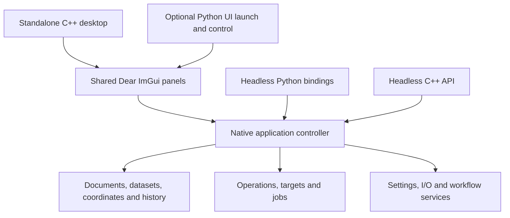

# ImageJ and Fiji gap closure plan

**Explicit RGB stage creation, 2026-10-23 (work in progress):**
The main C++/Python ImGui contrast panel now offers Keep current adjustment.
It freezes the current stage and selection, then begins an identity draft with
the same components. Reset preserves saved stages; Apply records and publishes
all stages in one paired edit. Native admission precedes mutation, with busy,
stale, scalar and uniform-target refusal. New tests check all seven component
combinations, stack/selection choices, actual button delivery, recording and
Undo/Redo against independent byte expectations. Windows/Linux each pass 20,479
installed Python checks (59 new), six native groups, the extended contrast-panel
group and three standalone UI probes, with zero failures/errors/skips.
Editing/reordering/deleting earlier stages, explicit visit authoring, broader
real transition input and full ImageJ/Fiji parity remain open. All99 triples and
the historical Auto evidence gate remain unchanged. See
[RGB stage authoring](parity/RGB_STAGE_AUTHORING.md).

**Fresh scalar Auto qualification, 2026-10-23 (work in progress):**
Current Windows/Linux builds each pass 64 native cases (1,286 checks), 13
installed C++ SDK cases (485 checks), and 396 installed Python checks, including
all 16 paired Auto UI cases. Every original 362 API test ID remains covered.
Fresh Windows observations pass all 144 four-context composition assertions;
35 non-file-identity expectations per context are unchanged. Separate current
contracts bind fresh preference paths/hashes; historical records are untouched.
The composition retains the existing 64 MiB bound and pins full desktop binary
bodies separately in product ledgers. No production change or full parity
acceptance is claimed. The historical gate still needs exact old source and
native-executable bytes. Actual RGB selection/navigation/Auto/Reset input and
stage/visit authoring remain next editor gaps. All99 triples are unchanged.
See [Auto requalification](parity/AUTO_REQUALIFICATION.md).

**Combined RGB promotion/navigation/Auto reference, 2026-10-23 (work in progress):**
A new independent ImageJ 1.54r oracle combines actual component callbacks,
selection changes, plane departure/return, replacing/resetting a returning draft,
manual or Auto final bounds, and actual final stack Apply. All 42 component
promotion pairs, nine selection forms, three navigation axes and both directions
produce 4,536 traces. Two fresh compilations/runs reproduce the fixture byte for
byte. Native API and shared-panel tests check every numerical checkpoint, final
whole-stack hashes, complete captures/workflows/worker publication and paired
history. Another 84 cases drive the real ImGui component, stack and Apply widgets.
Windows/Linux each pass 9,156 installed checks (4,536 native API, 4,536 shared
panel, 84 actual widget cases) against the unchanged qualified main binaries. Broader
selection/navigation/Auto/Reset gesture delivery and independent stage authoring
remain open. The old Auto source-evidence gate still requires separate fresh
qualification; its original record and expectations are unchanged.

**Shared RGB session panel, 2026-10-23 (work in progress):**
The main ImGui contrast panel now retains complete RGB histories across live
selection and T/C/Z changes. Native admission precedes source/range adoption;
refusal keeps saved intent and blocks stale Apply, with budget/source retry and
explicit restart. Existing simple single-visit and uniform-target records remain
available; historical boundaries use complete session captures. Historical masks
stay frozen during component promotion, Reset and stack-policy switching. Preview
renders baked logical output on every visited plane; final entire-stack mapping
occurs only during Apply. Session replay, recording, guarded paired publication
and matching non-stack READY reuse are connected. A fresh identity draft can adopt
Undo after a completed Apply; external edits with pending intent require restart.
Virtual XYZ now uses worker sampling even with ordinary async rendering disabled.
Windows/Linux qualify 29,248 unique installed Python checks (390 new), including
all 6,086 affected frontend cases rerun after the final busy-state guard. Six native
groups and three standalone UI probes also pass.
The unchanged six-case editor probe matches all 48
checks on both hosts; final qualification also exercises the full navigation
matrix, source/selection preservation, recovery and linked eager/virtual views.
Original 99 requirement/status triples and the old Auto evidence gate are unchanged.

**Native RGB session transition state, 2026-10-22 (work in progress):**
`RgbContrastSessionEditor` now owns admitted native editing intent: selection
changes replace the current draft mask; component/snapshot promotions retain
frozen stages; T/C/Z changes freeze outgoing visits and start identity drafts
on accumulated logical output. Reset preserves promotions and earlier visits.
Compatible camera/title/metadata changes refresh captures. Incompatible owner,
pixels, storage or calibration changes refuse adoption, preserving saved intent.
All candidates pass command/job admission before replacing state, without sample
IO. Navigation previews retain all visits and omit the final stack Apply policy.
C++ and installed Python APIs are available; Windows/Linux each pass four native suites, one installed SDK consumer and
23,162 installed Python checks (5,681 new). The main
ImGui panel still needs to consume this controller and the editor gap probe
remains open. Original 99 requirement/status triples are unchanged.

**RGB portable session workflow, 2026-10-22 (work in progress):**
Complete RGB visit histories now run through portable native workflows and
session Batch. One explicit final-visit anchor translates every saved T/C/Z
position together, preserving repeats, stage order and frozen selections. Whole
stack policy uses the destination stack; live selection/navigation survive.
Metadata-only preflight shares exact session membership and rejects late invalid
history before earlier sample reads. Shared ImGui review inspects visits and
mappings and edits the final anchor, retaining the full original capture.
Windows and Linux each pass 22 native suites, two installed SDK consumers,
three standalone UI probes and 51,397 unique installed Python checks (6,078 new).
The initial full run reached a UI report-path setup error; the corrected UI/Batch
tail passes, and the unique aggregate retains both invocations as evidence.
Main brightness/contrast snapshot/navigation transition
retention and dedicated stage-choice authoring remain open. Original 99 scope/
status triples and the old Auto evidence gate are unchanged.

**RGB captured-session jobs, 2026-10-22 (work in progress):**
Immutable C++/Python session captures now retain complete ordered visits, frozen
selections, promoted stages and the final stack policy in a separate closed V1.
Strict replay checks the original owner/revisions; explicit source rebinding
preserves all saved historical positions/selections and destination navigation.
The shared Apply job prepares on a worker, retains escaped preview reservations
and publishes one guarded paired transaction. Descriptor-only validation rejects
malformed late geometry before original history can be rebound.
Windows/Linux each pass 22 native suites, three existing standalone C++ UI
probes, two installed SDK consumers, ten background repetitions, four hidden
GL contexts and 45,319 installed Python checks (5,715 new), no failures/errors/
skips. Final full suites use the corrected Python test fixtures; all production
and native test inputs are unchanged after the final native qualification.
Owned scratch is CRC/member-SHA archived before cleanup; final installs and
probes remain. See the [scoped receipt](parity/reviews/p11u-rgb-session-command001.json).
Portable workflow/Batch/review adapters and shared ImGui transition
retention remain open. Original 99 scope/status triples are unchanged.

**RGB per-plane session core, 2026-10-22 (work in progress):**
New C++/Python session plans retain ordered plane visits and frozen per-stage
selections. Replacing the current draft models endpoint/selection changes;
identity Reset retains earlier visits. Evaluation reads each affected source
plane at most once and stages one guarded paired transaction. Final stack Apply
uses only the final draft for narrowed noncurrent processors. Metadata/stage/
geometry admission and validation precede source reads.
Windows/Linux each pass 22 native suites, three existing standalone C++ UI
probes, two installed SDK consumers, ten background repetitions, four hidden
GL contexts and 39,604 installed Python checks (5,689 new), zero failures/errors/
skips. A final facade-only import-order correction is separately installed and
verified for wildcard exports, exact composed pixels and Undo on both hosts;
native products and numerical inputs are unchanged. Exact owned scratch is
CRC/member-SHA archived before cleanup. See the
[scoped receipt](parity/reviews/p11t-rgb-session-core001.json).
The main ImGui panel still needs complete session captures/jobs/replay before
navigation retention is enabled. All99 status triples and the old Auto evidence
gate stay unchanged. See [the session contract](parity/RGB_NAVIGATION.md).

**RGB navigation gap evidence, 2026-10-22 (open):**
A new actual ImageJ reference captures 378 T/C/Z navigation, selection and Reset
cases. Two independent runs reproduce the fixture exactly. The installed native
editor matches 36/48 checks across six round trips; twelve returning Reset/remap
checks differ because pending per-plane visits are discarded. This is gap
evidence, not completed feature qualification. Implement native session state,
complete captured jobs/replay, then shared ImGui transitions and full regression
qualification in that order. See [the execution plan](parity/RGB_NAVIGATION.md)
and [the evidence receipt](parity/reviews/p11s-rgb-navigation001.json).
All 99 requirement/status triples and the old Auto evidence gate stay unchanged.

**RGB main-panel stack checkpoint, 2026-10-22 (work in progress):**
The shared ImGui brightness/contrast panel now previews and applies exact ImageJ
entire-stack RGB mappings. The checkbox keeps compatible current-plane component
promotions; endpoint drafts replace the current map, Auto measures its promoted
baseline and retains the whole-active-plane policy. Apply reuses its READY
native stack job and records the complete capture for workflow replay. Ordinary
and XYZ views use one compact whole-stack preview target on eager/virtual data.
Typed stack stages avoid retaining a full legacy capture for each promotion.
Windows/Linux each pass 22 native suites, three existing standalone C++ UI
regression probes, an installed C++ SDK consumer, ten background repetitions,
four hidden GL contexts and 33,915 installed Python checks (2,680 new), zero
failure/error/skip. Exact owned scratch is CRC/member-SHA archived before
cleanup; qualified installs/probes remain. See the
[scoped receipt](parity/reviews/p11r-rgb-stack-panel001.json).

Mode changes refuse noncurrent/positioned or incompatible non-area promoted
masks before retiring the existing preview. Source/selection/navigation snapshot
transitions, exact slider/log-plot/Set/reset/calibration, dedicated workflow
stage-choice editing and broader G057/ImageJ/Fiji/platform/resource acceptance
remain open. Promoted Auto currently composes a private stack baseline before
sampling its active plane; active-only composition is further optimization.
The existing Auto producer-source evidence gate is unchanged.

**RGB portable-stack workflow checkpoint, 2026-10-22 (work in progress):**
Exact captured RGB stack mappings now replay through native portable workflows,
session batches and the shared workflow review. The explicit singleton target
chooses the active T/C/Z processor; processing still covers the whole stack.
Replay adopts the destination selection and preserves its current navigation.
Sample-free preflight shares actual active/other-plane membership rules and
validates later stages before earlier samples. Workflow review reads complete
stack captures, edits the anchor and keeps the full portable program.
Windows/Linux each pass 22 native suites, three existing standalone C++ UI
regression probes, an installed C++ SDK consumer, ten background repetitions,
four hidden GL contexts and 31,235 installed Python checks (5,323 new), zero
failure/error/skip. Exact owned scratch is CRC/member-SHA archived before
cleanup; qualified installs/probes remain. See the
[scoped receipt](parity/reviews/p11q-rgb-stack-workflow001.json).

Next connect the main brightness/contrast panel's ImageJ stack controls and
complete snapshot/selection/navigation transitions. Saved stack mapping choices
are retained in workflow review; a dedicated stage-choice editor, broader actual
widget coverage, slider/log-plot/Set/reset/calibration and full G057/ImageJ/Fiji/
platform/resource acceptance remain open. The existing Auto producer-source
evidence gate is unchanged.

**RGB captured-stack jobs checkpoint, 2026-10-22 (work in progress):**
The exact RGB stack service now has immutable C++/Python captured commands,
a separate closed V1 record, strict replay and explicit destination rebinding.
The common native Apply job prepares full-stack results on a worker, retains
resource reservations through escaped previews and publishes one guarded paired
transaction. Original scalar and uniform RGB wire profiles stay unchanged.
Windows/Linux each pass 22 native suites, three existing standalone C++ UI
regression probes, an installed C++ SDK consumer, ten background repetitions,
four hidden GL contexts and 25,912 installed Python checks (5,335 new), zero
failure/error/skip. Exact owned scratch is CRC/member-SHA archived before
cleanup; qualified installs/probes remain. See the
[scoped receipt](parity/reviews/p11p-rgb-stack-command001.json).

Next adopt the captured stack path in portable workflow replay and the shared
ImGui stack controls. Selection/navigation snapshot transitions, broader actual
widget coverage, slider/log-plot/Set/reset/calibration and full G057/ImageJ/Fiji/
platform/resource acceptance remain open. The existing Auto producer-source
evidence gate is unchanged.

**RGB component editor checkpoint, 2026-10-22 (work in progress):**
The shared ImGui panel now promotes the current mapping when changing RGB
components, resets the new range, and replaces endpoint drafts without
reapplying earlier adjustments. Auto measures the promoted baseline; Apply
reuses its READY sequence and records the complete portable program. Ordinary
and XYZ previews use the combined target membership on eager/virtual sources.
Camera and compatible metadata changes preserve the draft and its target;
resource refresh retains Auto's whole-plane policy. Windows/Linux each pass 22 native suites, three standalone C++ UI probes,
one installed public C++ SDK consumer, ten background repetitions, four hidden
GL contexts and 15,262 installed Python checks (1,537 new), zero failure/error/skip.
The strengthened native actual Apply-button suite is also rebuilt and rerun on
both hosts. Exact owned scratch is CRC/member-SHA archived before cleanup;
qualified installs/probes remain. See the
[scoped receipt](parity/reviews/p11n-rgb-component-ui001.json).

**RGB entire-stack core checkpoint, 2026-10-22 (work in progress):**
The C++ core and Python interface now prepare ImageJ-compatible RGB stack
Apply transactions. Promoted component stages affect the active preview once;
the remaining C/Z/T planes use the current component and Java-int-narrowed
processor bounds. The original selection survives. Straight lines, points,
open polylines and angles retain ImageJ's distinct active/other-plane rules.
The actual private ImageJ 1.54r stack method supplies 5,292 reference rows.
Windows/Linux each pass 22 native suites, three existing standalone C++ UI
regression probes, an installed C++ SDK consumer, ten background repetitions,
four hidden GL contexts and 20,577 installed Python checks (5,315 new), zero
failure/error/skip. Exact owned scratch is CRC/member-SHA archived before
cleanup; qualified installs/probes remain. See the
[scoped receipt](parity/reviews/p11o-rgb-stack001.json).

Next connect this service to captured stack commands, leased background jobs,
portable replay and the shared ImGui stack controls. Selection/navigation
snapshot transitions, slider/log-plot/Set/reset/calibration and broader
G057/ImageJ/Fiji/platform/resource acceptance remain open. Existing uniform
multi-axis mapping remains an explicit extension. The existing Auto
producer-source evidence gate is unchanged.

Selection/ROI and navigation transitions, exact active/stack narrowing,
slider/log-plot/Set/reset/calibration and complete G057/ImageJ/Fiji/platform/
resource acceptance remain open. The existing Auto producer-source gate is
unchanged.

**RGB promoted-sequence foundation, 2026-10-22 (work in progress):**
The shared native Apply job can now compose captured RGB mappings in order,
with a sparse frozen target for each stage, one paired guarded publication and
an existing portable program record. All stages require the same exact source
capture. Callers retain promoted maps and replace the current draft instead
of appending each endpoint adjustment. Actual ImageJ snapshot/reset/Auto processing supplies
378 reference sequences. Windows/Linux each pass 22 native suites, three existing standalone C++ UI
probes, one installed public C++ SDK consumer, ten background repetitions, four
hidden GL contexts and 13,725 installed Python checks (1,540 new), zero
failure/error/skip. Exact owned scratch is CRC/member-SHA archived before
cleanup; qualified installs/probes remain. See the
[scoped receipt](parity/reviews/p11m-rgb-sequence001.json).

Next connect this service to component switching in the shared ImGui panel:
retain promoted prefixes, reset the new component range, use the promoted
baseline for Auto, display the union of affected target planes and record the
complete sequence on Apply. The current panel still uses its original baseline;
full component-switch/geometry/stack/slider/controller acceptance remains open.

**RGB histogram/Auto checkpoint, 2026-10-22 (work in progress):**
Native UInt8 RGB raw histograms, a pure repeated-cycle Auto decision and leased
histogram jobs now feed the shared modeless ImGui panel and Python interface.
Primary plots count whole planes; weighted plots use area membership. Auto
measures baseline weighted intensity and previews whole-plane mapping with the
selected component bits. Preference weights, cancellation and stale intent
remain explicit. Actual ImageJ methods supply 6,160 reference rows.
Windows/Linux each pass 22 native suites, three standalone C++ UI probes,
one installed public C++ SDK consumer, ten background repetitions, four hidden
GL contexts and 12,185 installed Python checks (6,747 new), zero failure/error/skip.
Exact owned scratch is CRC/member-SHA archived before cleanup; qualified products
remain. See the [scoped receipt](parity/reviews/p11l-rgb-histogram001.json).
Exact component-switch snapshot promotion, active/
stack narrowing, slider/log-plot/Set/reset/calibration and complete ImageJ/Fiji
acceptance remain open. The existing Auto producer-source gate is unchanged.

**RGB workflow/Batch checkpoint, 2026-10-22 (work in progress):**
RGB Apply now participates in portable native programs, recorded Run review,
editable mapping/component parameters and session Batch. Saved originals remain
immutable while authored choices can replace their options. Whole-program
metadata-only preflight follows evolving RGB storage and reset display bounds;
execution consumes preceding-stage pixels and publishes paired final history.
Windows/Linux each pass 22 native suites, three existing full C++ UI probes,
one installed public C++ SDK consumer, ten background repetitions, four hidden
GL contexts and 5438 installed Python checks (664 new), zero failure/error/skip.
Exact owned scratch is archived and verified before cleanup. See the
[scoped receipt](parity/reviews/p11k-rgb-workflow001.json).
RGB histogram/Auto, exact ImageJ stack/slider/controller
semantics and complete G057/platform/resource acceptance remain open.
See [Apply details](CONTRAST_APPLY.md).

**RGB modeless editor checkpoint, 2026-10-22 (work in progress):**
The shared C++/optional Python editor now prepares immutable RGB previews with
seven component masks, reuses READY preview jobs for guarded Apply, and supports
recorded strict replay and Rebind review. Ordinary and linked XYZ preview use a
neutral display range; source pixels/display/history stay unchanged until Apply.
RGB targets include bounded editable explicit plane lists in selected order.
Cancellation covers running jobs and pending intent; new adjustments can retry.
Windows/Linux each pass 22 native suites, three existing full C++ UI probes,
one installed C++ SDK consumer, ten background repetitions, four hidden GL
contexts and 4774 installed Python checks (331 new), zero failure/error/skip.
Owned scratch is archived and verified before cleanup. See the
[scoped receipt](parity/reviews/p11j-rgb-editor001.json).
RGB native workflow/Batch and histogram/Auto adapters,
exact active/stack controller and slider semantics remain open. The multi-axis
UI exposes the explicit native uniform mapping and paired Undo extension.
See [Apply details](CONTRAST_APPLY.md).

**RGB captured-command/job checkpoint, 2026-10-22 (work in progress):**
RGB Apply now has a separate C++/Python record profile, metadata-only strict
replay and explicit rebind, with immutable source/target/display/geometry intent.
Scalar V1 stays unchanged. The shared worker path prepares detached RGB results,
retains preview memory leases, arbitrates cancellation and guards caller-thread
publication against source closure or any revision change. The installed C++
example exercises RGB command replay and job publication.
Windows/Linux each pass 22 native suites, three existing full C++ UI probes,
one installed public C++ SDK consumer, ten background repetitions, four hidden
GL contexts and 4443 installed Python checks (316 new), zero failures/errors/skips.
Exact owned scratch is archived and verified before cleanup. See the
[scoped receipt](parity/reviews/p11i-rgb-command001.json).
Shared RGB preview/component/Apply/Rebind controls,
actual active/stack controller semantics and workflow/Batch adapters remain open.
See [Apply details](CONTRAST_APPLY.md).

**RGB contrast foundation checkpoint, 2026-10-22 (work in progress):**
C++/Python now expose an independent RGB lookup transform, metadata estimate and
atomic ROI/axis-target transaction. Actual ImageJ ColorProcessor preview and
ContrastAdjuster RGB commit/snapshot behavior produce 273 reference rows. RGB
uses different fractional/overflow arithmetic from scalar Apply; all component
masks and source-baseline behavior are explicit. Scalar V1 records stay unchanged.
Windows/Linux each pass 22 native suites, three C++ UI probes, an installed SDK
consumer, ten background repetitions, four hidden GL contexts and 4127 installed
Python checks (334 new), with zero failures/errors/skips. Exact owned scratch is
archived/verified before cleanup. See the
[scoped receipt](parity/reviews/p11h-rgb-contrast001.json).
Captured RGB records/jobs and shared preview/Apply/
Rebind/workflow integration remain the next steps; RGB controls stay disabled.
See [Apply details](CONTRAST_APPLY.md).

**Contrast Apply workflow/batch checkpoint, 2026-10-22 (work in progress):**
Saved and authored scalar Apply now execute in native programs, Run review and
session Batch. Original records stay immutable while three explicit mapping
fields can be edited. Whole-program metadata/ROI admission uses sample-blocking
descriptors; actual execution passes observed reset ranges to subsequent steps.
Intermediate histograms, paired final history, disabled intent, portable Batch
setup/common/per-input programs and existing file publication rules are retained.
Windows/Linux each pass 22 native suites, three full C++ UI probes, ten background
repetitions, four hidden GL contexts and 3793 installed Python checks (71 new),
with zero failures/errors/skips. Owned scratch is archived/verified before
cleanup. See [Apply workflow details](CONTRAST_APPLY.md) and the
[scoped receipt](parity/reviews/p11g-contrast-workflow001.json).

**Contrast Apply rebind review checkpoint, 2026-10-22 (work in progress):**
The workflow recorder now opens a guarded ImGui destination review with saved
mapping/bit settings and shared T/C/Z/ROI controls. Opening/configuring/canceling
is metadata-only. Apply uses the existing native worker, staged recording and
paired history; stale revisions or owner switches require reopening the review.
Global cancellation and destination closure dismiss it. Windows/Linux each pass
20 native suites, ten background repetitions, four hidden GL contexts and
3354 installed Python checks, with zero failures/errors/skips. Exact owned
scratch is archived/verified before cleanup. See the
[scoped receipt](parity/reviews/p11f-contrast-rebind001.json).
Native workflow/batch execution remains the next dependency: preserve Apply's
reset presentation in subsequent stages without source reads during preflight.
See [Apply details](CONTRAST_APPLY.md).

**Desktop scalar Apply checkpoint, 2026-10-22 (work in progress):**
The shared C++ Window host and ImGui contrast panel now connect captured native
Apply jobs to T/C/Z/ROI controls, busy/wait/cancel/close, submit-time settings and
recording, paired pixel/display Undo/Redo, strict replay and explicit API rebind.
The workflow panel recognizes the schema for strict Replay. ImGui rebind review,
native workflow/batch execution, RGB/RGBA and broader upstream UI qualification
remain open. Windows/Linux each pass 20 native suites, ten background repetitions, four
hidden GL contexts and 3321 installed Python checks, with zero failures/errors/
skips. Temporary environments and fixtures are archived and verified before
cleanup. See [Apply details](CONTRAST_APPLY.md) and the
[scoped receipt](parity/reviews/p11e-contrast-host001.json).

**Captured Apply commands/jobs checkpoint, 2026-10-22 (work in progress):**
C++/Python now provide immutable Apply records, strict replay, explicit rebinding,
metadata admission and native worker jobs with caller-thread atomic publication.
Escaped previews/datasets/plane aliases retain their reservations after cancel or
completion. Queued cancellation releases sources. Reentrant caller changes cannot
alter frozen multi-plane inputs, and positioned-ROI union checks cancellation.
New ImageJ 1.54r cases correct reset semantics: clear threshold, preserve palettes,
and reset UInt16 to observed bounds or the configured full display range, even
when the mapped pixel maximum is one level lower.
Windows/Linux each pass twenty native suites, an installed command/job SDK
consumer, 3310 installed Python checks (54 new), ten background repetitions and
four background GL contexts. Linux source/test manifests verify native filesystem
inputs; exact scratch is archived/verified before cleanup. See
[the remaining host/UI sequence](CONTRAST_APPLY.md) and the
[scoped receipt](parity/reviews/p11d-contrast-command001.json).
The Window host, Apply button, editor workflow/batch routing, RGB behavior and
full upstream/resource/platform acceptance remain open. G057 stays in progress;
all 99 original requirement/status triples and the existing Auto gate remain.

**Scalar contrast Apply core checkpoint, 2026-10-22 (work in progress):**
C++ and Python now expose scalar UInt8/UInt16 Apply arithmetic and isolated
in-place target preparation. Masks preserve exterior pixels; range resets share
pixel Undo/Redo history. Admission precedes provider IO, cancellation is checked
inside the kernels, and stale display/data/selection rejects commit. Eighty new
Python cases include 64 actual ImageJ 1.54r full-domain output vectors, including
configured bit ranges and Java integer edge behavior.
Windows/Linux each pass nineteen native suites, an installed Apply SDK consumer,
3,256 selected Python checks, ten background repetitions and four background GL
contexts. Verified cleanup removes owned scratch; final products/evidence remain.
See [the Apply integration sequence](CONTRAST_APPLY.md) and the
[scoped receipt](parity/reviews/p11c-contrast-apply001.json).
Apply still needs its captured command/replay, worker job and ImGui route, plus
RGB behavior and full upstream/platform/resource acceptance. G057 stays in
progress. The 99 original requirement/status triples are unchanged; the existing
Auto evidence gate remains open.

**Modeless contrast checkpoint, 2026-10-22 (work in progress):**
Image → Brightness/Contrast now supplies native histogram-linked min/max,
brightness/contrast/window/level, cached Reset, channel targeting and asynchronous
Auto in both ImGui launchers. Histograms use captured native workers; display
changes reuse them, navigation discards stale captures, and close/cancel releases
work. Auto on ordinary images stages channel metadata privately and publishes
only on success; the original strict Auto API retains its contract. Both public
interfaces include the additive seeded Auto entry point.
Windows/Linux each pass fourteen native suites, ten background repetitions,
four background GL contexts, one installed SDK consumer and 1,819 selected Python
checks (twelve new), including actual slider/fractional-field input. Temporary
fixtures and redundant installs are archived/verified before cleanup. See
[behavior and remaining work](CONTRAST_PANEL.md) and the
[scoped receipt](parity/reviews/p11b-contrast-panel001.json).
Destructive Apply, broader histogram formats, exact upstream control semantics
and full platform/resource acceptance remain open. Original inventory: 47 in progress /
52 open / 0 complete; the pre-existing Auto evidence gate remains open.

**Metadata-only contrast and palettes checkpoint, 2026-10-22 (work in progress):**
Manual display-range changes and LUT selection/import/export now run before
source acquisition. Virtual scientific images admit these display-only palette
controls; Image-menu defaults use pixel-type metadata. IEEE endpoint validation
uses a bounded local processor carrier, and IEEE reset defers range reads to the
renderer. Invalid bounds/palette rows preserve display state without reads;
pixels, metadata history and dirty state remain unchanged. Native failing-provider
fixtures cover scalar/RGB/RGBA U8/U16/F32/F64 plus IEEE read observation and real
menu/form opening. Windows/Linux each pass eleven native suites, ten background
repetitions, four hidden/recreated GL contexts and 1,600 selected installed Python
checks (fifteen new), including real input-driven form submission and virtual TIFF
read counters. Core/IO modules and SDK archives stay byte-identical to p10z.
See [the scoped receipt](parity/reviews/p11a-display-actions001.json).
Finite automatic scans, other legacy action reads, histogram-linked contrast/
window/level controls, full palette editing/interchange and platform acceptance
remain required. All99 stays 47 in progress / 52 open / 0 complete; the Auto
Contrast fingerprint gate remains open.

**Optional background viewport checkpoint, 2026-10-22 (work in progress):**
Resources → Background virtual views now moves virtual ordinary/XYZ extraction,
live range scans and CPU display rendering onto bounded native jobs in both
ImGui launchers. Loading placeholders retain navigation; matching keys alone
publish, and ordinary hover uses a charged completed surface without source IO.
Document/mode/hidden-view/context cleanup cancels pending work. Re-enabling on a
cached texture acquires its sampling surface. Windows/Linux each pass ten native
suites, ten background repetitions, four hidden/recreated GL contexts and 1,585
selected installed Python checks, including real virtual TIFF volumes. Temporary
fixtures and redundant installs are archived/verified before cleanup.
The option defaults false; whole-editor responsiveness, broader preview/channel/
annotation input traces, resource/performance/platform acceptance and all other
original gaps remain. Follow [remaining work](BACKGROUND_VIEWPORT.md) and the
[scoped receipt](parity/reviews/p10z-background-views001.json). All99 remains
47 in progress / 52 open / 0 complete; the Auto Contrast gate remains open.

**Background viewport scheduler checkpoint, 2026-10-22 (work in progress):**
A private native scheduler now stages CPU viewport results on two workers with
16 total slots, including retiring work. Supersession discards stale ready and
running results; canceled readers retain their declared render reservations until
worker finalization. Pending admission retains no extra provider capture.
Creator-thread publication, sticky failures, queued owner release, cooperative
cancellation and shutdown are covered, including virtual XY/XZ/YZ pixel values.
This foundation is not wired into either UI; responsive background viewing is
still open. Follow [the integration sequence](BACKGROUND_VIEWPORT.md) for the
CPU renderer, matching-key publication, loading/navigation, hover sampling,
lifecycle and both-launcher qualification. Every original inventory requirement
and status remains: 47 in progress / 52 open / 0 complete. The Auto Contrast
fingerprint gate remains open.

**Managed render reservations checkpoint, 2026-10-22 (work in progress):**
Ordinary and linked XYZ views share the persisted Render surfaces (MiB) pool.
Direct source-output/RGB/upload work is admitted before pixel IO; retained
diagnostic/rank capacities and logical textures hold lifecycle leases. Limit
changes below live reservations refuse atomically. XYZ refusal now unwinds ImGui
style correctly. C++/Python expose detached counters. Windows/Linux each pass
5,010 selected Python checks (nine new), twelve native suites, three GL contexts,
eight session groups, three desktop regressions, 36 rank-host cases / 499 checks,
two resource groups and fresh installed SDK consumers. Readers verify 296 existing
reports / 39,261 raw input frames; all 1,297 registrations are unchanged.
Verified cleanup removes 2,503,966,119 scratch bytes and preserves final products.
See [managed quantities and boundaries](SCIENTIFIC_TIFF_SERVICE.md#managed-render-reservations)
and [the scoped receipt](parity/reviews/p10x-render-memory001.json).
Provider/transform internals, other preview/font/GUI surfaces, driver overhead
and full resource qualification remain open. Next: asynchronous viewport loading
with stale-result rejection and bounded queued/read-result ownership. All99 stays
47 in progress / 52 open / 0 complete, including the Auto Contrast gate.

**Ordinary canvas read checkpoint, 2026-10-22 (work in progress):**
Geometry, properties and annotation dimensions now use metadata; validated
texture/readback keys are checked before pixel acquisition. Evicted CPU planes
no longer force unchanged cached renders to decode again. Hover/picker sampling
retains the pre-input source and T/C/Z and reads only when needed. Windows/Linux
each pass 5,001 selected Python checks (4,422 base / 579 channel), eleven native suites, the new hidden-GL
and recreated-context checks, eight session groups, three desktop regressions,
36 rank-host cases / 499 checks, two resource groups and fresh installed SDK
consumers. Public dataset/settings headers and core archives remain byte-identical
to preceding qualified prefixes. Readers verify 296 existing reports / 39,273
raw input frames; all 1,297 registrations are unchanged. Verified cleanup removes
2,117,983,076 scratch bytes, including verified older helper leftovers, and preserves
final products/evidence. See [cache semantics](SCIENTIFIC_TIFF_SERVICE.md#shared-virtual-xy-cache)
and [the scoped receipt](parity/reviews/p10w-canvas-reads001.json).
Next: XYZ/display/readback/texture/upload accounting, followed by asynchronous
viewport reads with stale-result rejection. All original requirements remain;
All99 stays 47 in progress / 52 open / 0 complete, including the Auto Contrast gate.

**Shared virtual XY cache checkpoint, 2026-10-22 (work in progress):**
Open virtual documents now share a persisted decoded XY retention budget with
least-recently-used eviction. Preferences → Resources exposes Virtual XY cache
(MiB); C++/Python consume the same setting and expose detached counters. Capacity
admission, failed reads, shrinking budgets, provider lifetime, independent worker
caches and atomic document attachment are covered. Caller-held images survive
eviction. Windows/Linux each pass 4,422 selected Python checks (ten new), ten
native suites, eight session groups, three desktop regression suites, 36 rank-host
cases / 499 checks, two resource groups and fresh installed SDK consumers.
Readers verify 144 existing reports / 27,598 raw input frames; all 1,297 input
registrations remain unchanged. Verified cleanup removes 880,714,150 scratch bytes
and preserves final products/evidence. See [cache configuration and limits](SCIENTIFIC_TIFF_SERVICE.md#shared-virtual-xy-cache)
and [the scoped receipt](parity/reviews/p10v-view-cache001.json).
Next: metadata-only canvas geometry and texture reuse under cache pressure;
then XYZ/display/readback/texture and upload accounting, followed by asynchronous
viewport reads with stale-result rejection. Provider
scratch, external handles and whole-process memory remain separate. All99 stays
47 in progress / 52 open / 0 complete; the Auto Contrast gate remains open.

**Virtual TIFF import checkpoint, 2026-10-22 (work in progress):**
C++/Python and both ImGui launchers now open supported classic/BigTIFF inputs
virtually, decoding requested planes or intersected regions on demand. Reviewed
loading choices, strict V16 replay, atomic startup, source-change guards, linked
XYZ and worker histograms share the existing editor. Cross-extension execution
control preserves cancellation, progress, callback exceptions and reentrant reads.
Windows/Linux each pass 4,377 selected Python checks (845 new API / ten new input),
eight native suites, eight session groups, three desktop regression suites,
36 rank-host cases / 499 checks, two resource groups and fresh optional-IO SDK
consumers. Readers verify 144 reports / 27,578 raw input frames, including
20 new reports / 980 frames. Verified cleanup removes 2,182,993,622 scratch
bytes and keeps final products/evidence. Five cases append to 1,297 without
changing prior order. See [usage and limits](SCIENTIFIC_TIFF_SERVICE.md#virtual-tiff-loading-p10u)
and [the scoped receipt](parity/reviews/p10u-virtual-tiff001.json).
Other formats, pyramid/tiled/async viewport, aggregate caches and virtual output/
workspace serialization remain open. Next: bound aggregate viewport cache use,
then move provider reads off the render thread with stale-result rejection.
All99 stays 47 in progress / 52 open / 0 complete; the Auto Contrast gate remains open.

**Explicit virtual desktop checkpoint, 2026-10-22 (work in progress):**
C++ and Python launchers explicitly attach immutable virtual providers without
pixel reads. Metadata-only document inspection, cached current XY viewing,
dimension-based Z controls, bounded regional XYZ and native worker histogram
analysis now share the existing editor. Default eager attachment retains its
admission rules; snapshots inherit view limits and failed reads preserve useful
cached images and prior histogram publication. Unknown providers stay finite-only.
Windows/Linux each pass 733 selected Python checks (seven new API / eight new input),
seven native suites, 36 rank-host cases / 499 checks, two resource groups and fresh
installed SDK consumers. Readers verify 124 reports / 26,631 raw input frames,
including 16 new reports / 1,132 frames with XYZ source/RGB assertions.
Verified cleanup removes 791,830,270 scratch bytes and keeps final products/evidence.
Four cases append to 1,292 without changing prior order. See
[provider usage/limits](HISTOGRAM.md#virtual-providers-in-the-desktop) and
[the scoped receipt](parity/reviews/p10t-virtual-desktop001.json).
File-backed import choices, tiled/pyramid/async viewport and aggregate cache
policy, virtual output propagation and full qualification remain open. All99
stays 47 in progress / 52 open / 0 complete; the Auto Contrast gate remains open.

**Batch histogram statistics checkpoint, 2026-10-22 (work in progress):**
C++/Python and both shared ImGui launchers now retain and review unbinned
per-input/document histogram statistics, with opt-in summary CSV export.
Results reuse ordered-stage finite ROI samples, including range outliers;
existing session tables and default output files are preserved. Closed V2 setup
intent stores the export choice without consent and retains V1 compatibility.
Windows/Linux each pass 589 selected Python checks (24 new API / ten new input),
five native suites and fresh installed SDK consumers. Independent readers verify
84 reports / 23,800 raw input frames, including 20 new reports / 2,056 frames.
Verified cleanup removes 568,672,114 scratch bytes, preserving products/evidence.
Five input cases append to 1,288 without changing prior order. See
[usage](HISTOGRAM.md#batch-histogram-statistics-review-and-export) and
[the scoped receipt](parity/reviews/p10s-batch-histogram-statistics001.json).
Virtual sources, remaining numeric/calibration domains, upstream conventions and
full qualification remain open. All99 stays 47 in progress / 52 open / 0 complete;
the existing Auto Contrast fingerprint gate remains open.

**Histogram workflow options checkpoint, 2026-10-21 (work in progress):**
C++/Python workflows now author histogram bin/range/log choices independently of
optional original captures. The closed V5 format preserves V4 and retained history;
new intent can be authored without fabricating a capture. Both ImGui launchers
edit/restore choices inline and keep/reopen V5 programs without changing targets
or standalone defaults. Commands and workflows share option validation.
Windows/Linux each pass 555 selected Python checks (41 new API / ten new input),
five native suites and fresh installed SDK consumers. Independent readers verify
64 reports / 21,715 frames, including 20 new reports / 2,096 frames. Verified
cleanup removes 511,231,849 scratch bytes, retaining final products/evidence.
Registration appends five cases to 1,283 and preserves prior order. See
[usage](HISTOGRAM.md) and
[the scoped receipt](parity/reviews/p10r-histogram-workflow-options001.json).
At that checkpoint, batch statistics review/export, virtual sources, remaining domains and
full qualification remain open. All99 stays 47 in progress / 52 open / 0 complete;
the unchanged Auto Contrast fingerprint gate remains open.

**Histogram workflow UI checkpoint, 2026-10-21 (work in progress):**
Both ImGui launchers now review captured histogram entries/V4 programs in Run
and native Batch. Plane/ROI targets, enabled steps and CSV tokens are editable;
workers prepare plots, statistics and exact clipped bin tables. Guarded Apply
appends summary Results and optionally publishes Run CSVs through the save
browser. Batch emits per-document CSVs. Preview, queued cancellation, source
changes and publication conflicts preserve the expected live state/file policy.
Windows/Linux each pass 504 selected Python checks (18 new) and four native
suites. Independent readers verify 44 reports / 19,590 input frames, including
36 new reports / 2,227 frames. Verified cleanup removes 1,907,508,259 scratch
bytes while retaining final products and archived evidence. Registration appends
nine cases to 1,278 and preserves prior order. See [usage](HISTOGRAM.md) and
[the scoped receipt](parity/reviews/p10q-histogram-workflow-ui001.json).
Workflow histogram numeric choice authoring, batch unbinned statistics review/
export, virtual sources, remaining domains/conventions and full qualification
remain open. All99 stays 47 in
progress / 52 open / 0 complete; the unchanged Auto Contrast gate remains open.

**Histogram workflow checkpoint, 2026-10-21 (work in progress):**
C++/Python native workflows now retain ordered, read-only histogram results and
portable V4 intent. Session batches emit histogram CSVs per selected document;
explicit target rebinding, cancellation, cumulative admission and new-file conflict
rules preserve source/history/tables. Python result getters own detached copies.
Windows/Linux each pass 505 selected Python checks (30 new), four native suites
and fresh installed SDK consumers. Both desktop targets build and explicitly
refuse histogram workflow review pending target/output/publication integration.
Verified cleanup removes 100,653,991 scratch bytes and retains final products.
See [usage](HISTOGRAM.md) and
[the scoped receipt](parity/reviews/p10p-histogram-workflow001.json).
Desktop workflow integration, remaining histogram domains and full qualification
remain open. All99 stays 47 in progress / 52 open / 0 complete; the unchanged
Auto Contrast producer fingerprint gate remains open.

**Histogram async UI checkpoint, 2026-10-21 (work in progress):**
Both ImGui launchers now queue native histogram Calculate/Replay work on the
shared scheduler, show stage progress/Cancel and preserve prior output during
work. Creator-thread publication guards source/draft identity, captured recording,
preferences and workflow; source changes/closure, activation, drafts and cancellation
discard stale work. Live navigation stays independent of captured planes. Target
dialog presentation is preserved and explicit-position replay captions render.
Windows/Linux each pass 1,527 selected checks (31 new) and ten native suites.
Independent readers verify 232 reports / 31,133 input frames, including 24 new
async reports / 1,700 frames. Verified cleanup removes 1,926,803,769 scratch bytes,
retaining final products/evidence. Registration appends six cases to 1,269 and
preserves prior order. See [usage](HISTOGRAM.md) and
[the scoped receipt](parity/reviews/p10o-histogram-async001.json).
Native workflow/batch, remaining histogram domains and full qualification remain
open. All99 stays 47 in progress / 52 open / 0 complete; the existing Auto Contrast
producer fingerprint gate remains open.

**Histogram worker checkpoint, 2026-10-21 (work in progress):**
C++ and Python now submit immutable histogram commands to the shared scheduler.
Metadata-only admission, progress, cooperative cancellation and caller-thread
completion preserve readonly analysis. Native result aliases retain their
reservation while Python receives detached copies; READY results release source
captures. Publication errors do not persist Python traceback objects in scheduler
state. Windows/Linux each pass 581 selected checks (25 new), eight native suites
and fresh installed core-only SDK consumers; both desktop products rebuild.
Verified cleanup removes 4,994,511 scratch bytes, retaining products/evidence.
See [usage and limits](HISTOGRAM.md) and
[the scoped receipt](parity/reviews/p10n-histogram-job001.json).
Histogram UI panels remain synchronous: worker progress/cancel/result integration
is next. Native workflow/batch, remaining domains and full qualification remain
open. All99 stays 47 in progress / 52 open / 0 complete; the existing Auto Contrast
producer fingerprint gate remains open.

**Histogram recorder checkpoint, 2026-10-21 (work in progress):**
Both ImGui launchers record successful simple/pooled calculations as native
histogram commands, preserve them through workflow save/load, strictly replay
frozen targets and review explicit destination rebinding with fixed numeric/log
options. Preference-save and source/draft failures preserve prior output; final
panel/workflow publication uses non-throwing ownership moves on Windows/Linux.
Each OS passes 1,429 selected checks (23 new), five native suites and independent
readers of 104 reports / 14,716 input frames. Across both OSs, recorder coverage
adds eight reports / 1,064 frames. Verified cleanup removes 3,591,087,838 scratch
bytes, preserving final products and evidence. Registration appends two cases to
1,263 while retaining all previous order. See [usage](HISTOGRAM.md) and
[the scoped receipt](parity/reviews/p10m-histogram-recorder001.json).
Async execution, native workflow-program/batch integration, desktop virtual
sources, remaining histogram domains and full qualification remain open. All99
stays 47 in progress / 52 open / 0 complete; the existing Auto Contrast producer
fingerprint gate remains open.

**Histogram command checkpoint, 2026-10-21 (work in progress):**
C++ and Python now capture immutable histogram intent with strict source-bound
replay and explicit destination rebinding. Records freeze target, binning, storage
policy and log presentation without sample arrays or file paths. Metadata/record
admission, cancellation and detached results preserve readonly analysis behavior.
Windows/Linux each pass 272 selected Python checks (106 new), four native suites
and fresh installed core-only SDK consumers; both ImGui products build. Verified
cleanup removes 187,484,983 scratch bytes, retaining final products and evidence.
See [usage](HISTOGRAM.md) and
[the scoped receipt](parity/reviews/p10l-histogram-command001.json).
Panel recorder/workflow integration, async execution, remaining histogram domains
and full qualification remain open. All99 remains 47 in progress / 52 open /
0 complete; the existing Auto Contrast producer fingerprint gate still fails.

**Histogram defaults checkpoint, 2026-10-21 (work in progress):**
Both ImGui launchers consume eight native Histogram defaults. Successful
calculation remembers used options; raw mode preserves the last custom range,
and basic/scientific ROI choices are independent. New sources start their own
Current grids. Coupled bounds migrate/reset atomically; protected files retain
their bytes, and save failures preserve the previous result and memory defaults.
Windows/Linux each pass 1,300 selected checks (124 new), six native executable
suites and fresh installed SDK consumers. Independent readers verify 200 UI
reports / 28,368 input frames, including eight restart reports / 516 frames.
Verified cleanup removes 1,004,327,009 scratch bytes while preserving final
products/evidence. The 1,261-case capture registration is unchanged; restart
checks launch paired processes/editors directly. See [usage](HISTOGRAM.md) and
[the scoped receipt](parity/reviews/p10k-histogram-defaults001.json).
Recording/async, remaining domains/conventions and full source/reference/
resource/platform qualification stay open, along with the existing Auto Contrast
fingerprint gate. All99 stays 47 in progress / 52 open / 0 complete.

**Pooled histogram UI checkpoint, 2026-10-21 (work in progress):**
Both ImGui launchers now reuse Current/All/First/Last/Step for scientific C/T/Z
grids and whole/active/positioned area ROI unions. Calculate pools the native
target service; unmatched planes contribute no members. Invalid drafts and mode
switches preserve the last result, its scope labels and lossless raw CSV export.
Windows/Linux each pass 916 selected checks (51 new), four native executable
suites and fresh installed SDK consumers. Independent readers verify 144 UI
reports / 24,780 input frames, including 36 new reports / 7,848 frames.
The 1,261-case registration preserves prior order. Verified cleanup removes
830,430,034 scratch bytes, preserving final products and evidence. See
[usage/limits](HISTOGRAM.md) and [the scoped receipt](parity/reviews/p10j-histogram-target-ui001.json).
Remaining domains/statistical conventions/defaults/recording/async and full
source/reference/resource/platform acceptance stay open, along with the existing
Auto Contrast fingerprint gate. All99 stays 47 in progress / 52 open / 0 complete.

**Native pooled histogram checkpoint, 2026-10-21 (work in progress):**
The C++/Python service now pools frozen C/T/Z ranges or explicit positions with
whole/active/positioned area ROI unions, preserving raw processor/custom bins,
statistics and lossless CSV. It admits total target pixels before reads, validates
ROI exterior/unmatched planes and retains no source/provider in its result.
Windows/Linux each pass 829 selected checks (53 new), four native executable
suites and fresh installed SDK consumers. Existing histogram ImGui regression
readers verify 36 reports / 4,980 input frames; pooled UI controls remain next.
Verified cleanup removes 278,579,662 scratch bytes while retaining final products
and evidence. See [usage/limits](HISTOGRAM.md) and
[the scoped receipt](parity/reviews/p10i-target-histogram001.json).
No new upstream oracle, pooled UI or complete resource/platform acceptance is
claimed. Remaining domains/defaults/recording/async and the existing Auto Contrast
fingerprint gate stay open; all99 stays 47 in progress / 52 open / 0 complete.

**Standalone histogram UI checkpoint, 2026-10-21 (work in progress):**
Both ImGui hosts now provide captured single T/C/Z and active-area ROI controls,
processor-raw/custom bins and inclusive range, log1p display, raw statistics,
mode-bin intervals and lossless CSV through the shared save browser. Invalid
drafts retain the last result; source edits invalidate calculation and closure
releases its source capture. Legacy histogram routes remain available.
Windows/Linux each pass 776 selected checks (35 new), three native executable
suites and fresh installed SDK consumers. Independent readers verify 36 UI
reports / 4,980 physical-input frames. Verified cleanup removes 717,640,701
scratch bytes; final products and evidence remain. See [usage/limits](HISTOGRAM.md)
and [the scoped receipt](parity/reviews/p10h-histogram-ui001.json).
Pooled standalone grids, positioned ROIs, remaining domains/defaults/recording/
async and full qualification stay open. The existing Auto Contrast fingerprint
gate remains; all99 stays 47 in progress / 52 open / 0 complete.

**Native histogram statistics checkpoint, 2026-10-21 (work in progress):**
The standalone Dataset histogram service now returns unbinned finite-ROI mean,
population standard deviation and sum, independently of bin range. Raw CSV
formatting preserves full edge precision and UInt64 counts without reading
the source or writing files. Windows/Linux each pass 741 selected Python checks
(19 new), three native test executables and an installed core-only SDK consumer.
Both ImGui products compile; connecting their standalone Histogram controls
to the native service remains the next step. No UI runtime acceptance or
whole-family completion is claimed. See [usage](HISTOGRAM.md) and the
[scoped receipt](parity/reviews/p10g-histogram-statistics001.json).
The existing Auto Contrast fingerprint gate remains open; all99 stays
47 in progress / 52 open / 0 complete.

**Scientific threshold checkpoint, 2026-10-21 (work in progress):**
Both ImGui hosts now reuse validated Current/All/First/Last/Step controls for
C/Z/T, whole/active/positioned write ROIs and independent histogram ROI choice.
Invalid drafts disable publication; Show preview plane preserves the frozen
grid. Auto retains and plots raw target histograms, including Mean/constants,
while Apply edits that grid/ROI and preserves other pixels. Nested state version
three retains the range grid through sessions and Z-subset intersection/remapping.
Existing single-plane/all-Z forms and the C++ callable signature remain supported.
Windows/Linux each pass 5,445 selected checks without skips, including 68 new
scientific checks. Independent readers verify 408 reports / 38,736 frames,
including 72 scientific target reports. Fresh SDK consumers check retained bins,
legacy/new calls, zero-read admission, membership and positioned replay. The
1,243-case registration preserves prior order; commercial-use inventory passes
with no new runtime dependencies. Verified archives remove
4,214,535,670 scratch bytes while retaining final products and evidence.
See [the scoped receipt](parity/reviews/p10f-scientific-threshold001.json) and
[usage/limits](THRESHOLDING.md). G069 starts in progress for this targeted
histogram foundation. Standalone histogram range/bin/log/statistics/export,
asynchronous execution, remaining defaults/recording and full source/reference/
resource/platform acceptance remain open, as does the existing Auto Contrast
fingerprint gate. All99 is 47 in progress / 52 open / 0 complete; all existing
96 format variants remain partial.

**Pooled display checkpoint, 2026-10-21 (work in progress):**
Pooled Auto now estimates every Z at captured T/C. The shared Threshold panel
retains that scope, displays the common overlay across Z navigation, and applies
numeric bounds to the same frozen stack with the active 2D ROI repeated. To
Selection uses the captured plane. All-Z display and multi-plane command records
are versioned; existing single-plane records remain unchanged. Sessions, subset
remapping and typed replay/rebind preserve the captured scope.
Windows/Linux each pass 5,369 regression checks plus eight additional
non-anchor variance/top-hat scope/history checks, without skips (5,377 total).
The regression suite includes 259 new pooled checks. Independent readers inspect 336 threshold reports / 26,784 frames,
including 72 pooled display reports. Fresh installed SDK consumers prove zero
reads on cap refusal, three scans for histogram-based display, exact six-method
levels, and all-Z display/command state. The 1,225-case registration preserves
all previous cases; commercial-use inventory passes without new dependencies.
Verified archives remove 1,296,561,462 scratch bytes while retaining final builds/evidence.
See [the scoped receipt](parity/reviews/p10e-pooled-display001.json) and
[scope/resource/record contracts](THRESHOLDING.md). Next are scientific T/C/range
and histogram ROI controls, then remaining defaults/recording and asynchronous
execution. Full reference/resource/platform acceptance and the existing Auto
Contrast fingerprint gate remain open. All99 stays 46 in progress / 53 open /
0 complete; all 96 format variants remain partial.

**Threshold preference checkpoint, 2026-10-21 (work in progress):**
The shared native Settings schema now retains the last Auto display method,
bright/dark direction and endpoint exclusions. Both ImGui hosts restore them
when opening the panel and after restart. Successful calculations save implicitly;
Reset/Cancel retain last-used options. Unknown plugin data and protected newer
files survive. A save failure leaves the overlay and remembered settings unchanged.
Windows/Linux each pass 4,322 selected checks with no skips, including 167 new
preference checks. Independent readers inspect 264 threshold reports / 21,456
frames, including 48 restart reports. Installed C++ SDK consumers additionally
verify all 144 method/direction/endpoint combinations and atomic group reset.
Commercial-use inventory passes; verified archives remove
1,105,192,533 temporary bytes, retaining final builds and evidence. See
[the scoped receipt](parity/reviews/p10d-threshold-preferences001.json) and
[settings behavior](THRESHOLDING.md). Next are pooled automatic display and
complete scientific/ROI controls, plus remaining automatic-mask/plugin form
defaults. Full reference/resource/platform acceptance and the pre-existing Auto
Contrast fingerprint gate remain open. All99 stays 46 in progress / 53 open /
0 complete; all 96 format variants remain partial.

**Automatic threshold display checkpoint, 2026-10-21 (work in progress):**
The manual Threshold panel now offers all eighteen Auto methods, bright/dark
objects and endpoint exclusions. C++/Python expose exact inclusive display
ranges; Auto leaves pixels/history unchanged and atomically checks revisions.
Reset/Cancel, To Selection and Apply retain their existing behavior. Windows and
Linux each pass 4,062 selected checks without skips, four installed SDK examples,
and 15 capture transport checks. Independent readers verify 216 threshold
reports / 18,384 frames across both platforms, including 72 new display reports.
No new runtime dependencies; commercial-use inventory passes. Verified archives
remove 2,739,705,142 scratch bytes while retaining final builds and evidence.
See [the scoped receipt](parity/reviews/p10c-auto-display001.json) and
[usage and limits](THRESHOLDING.md). Next are persistent options, pooled automatic
display and complete scientific/ROI controls, then reference/resource/platform
qualification. The existing Auto Contrast source-fingerprint gate remains open.
All99 remains 46 in progress / 53 open / 0 complete; all 96 format variants remain
partial.

**Pooled stack threshold checkpoint, 2026-10-21 (work in progress):**
The C++/Python target API and managed executor now compute one threshold across
captured planes/ROI members without concatenating pixels. Ordinary ImGui Z-stack
forms select/lock all slices for pooling; preview uses the same global level as
Apply. Endpoint options and recorded workflows retain the flag. Windows/Linux
each pass 3,716 selected checks without skips, three installed SDK examples and
15 transport checks. Read counters prove zero reads on cap refusal and two scans
for four-plane histogram construction. 144 input reports cover 13,632 frames,
including 48 new pooled reports. No new runtime dependencies; commercial-use
inventory passes. Verified archives remove 2,173,857,541 scratch bytes.
See [the scoped receipt](parity/reviews/p10b-pooled-threshold001.json). Next are
threshold-display integration, persistent options and complete scientific target
UI/reference/platform/resource qualification. The pre-existing Auto Contrast
source-fingerprint gate remains open. All99 stays 46 in progress / 53 open /
0 complete; all existing 96 format variants remain partial.

**Threshold endpoint options checkpoint, 2026-10-21 (work in progress):**
All eighteen image methods and six histogram methods now support ignoring the
first/last histogram bins. Both flags default off and are exposed in C++/Python
and the shared ImGui form. They affect estimation, while the whole image is
masked. Empty eligible histograms refuse without publication; saved workflows
retain/replay flags. Windows/Linux each pass 3,542 selected checks without skips,
old/new installed SDK examples and 15 transport checks. The new oracle contains
1,302 exact threshold values and 15 empty preconditions; the previous 348 values
remain unchanged. Real input yields 96 reports / 8,832 frames across both hosts
and platforms, including 72 new checkbox reports. Commercial-use inventory passes
with no new runtime dependencies. Verified archives remove 1,031,191,775 scratch
bytes. See [the scoped receipt](parity/reviews/p10a-threshold-options001.json).
Next are pooled stack histograms and threshold-display integration, followed by
complete plugin/reference/platform/resource qualification. The pre-existing
Auto Contrast source-fingerprint gate remains open. All99 stays 46 in progress /
53 open / 0 complete; all existing 96 format variants remain partial.

**Automatic threshold methods checkpoint, 2026-10-21 (work in progress):**
The C++ core, Python API and both Dear ImGui hosts now expose Default,
IJ_IsoData, Huang, Huang2, RenyiEntropy and Shanbhag. The histogram API retains
bilevel/range/tie behavior; image adapters use the existing bin-center policy.
348 results from pinned ImageJ 1.54r histograms match on both installed platforms.
Windows/Linux each pass 1,981 distinct selected checks without skips, a fresh
installed SDK example and 15 transport checks. Real pointer/scroll input in
both hosts produces 24 reports / 2,016 frames covering method selection,
preview/cancel, Apply and undo/redo. Table admission, cancellation and callback
behavior are covered. No new runtime dependencies; commercial-use inventory
passes. Verified archives remove 721,729,459 scratch bytes while retaining final
products and evidence. See [the scoped receipt](parity/reviews/p09z-auto-threshold001.json)
and [method semantics](THRESHOLDING.md). G047 moves to in progress. Plugin options,
full numerical/reference/resource/platform qualification and the pre-existing
Auto Contrast source-fingerprint gate remain open. All99 is 46 in progress /
53 open / 0 complete; existing 96 format variants remain partial.

**AVI movie export checkpoint, 2026-10-21 (work in progress):**
The C++ core, installed SDK, Python API and both Dear ImGui hosts now export
uncompressed Gray8/RGB24 AVI. The UI supports Z/C/T, inclusive range/stride,
forward/reverse/ping-pong, FPS and supported calibrated time. Export preserves
source samples and uses bounded staging, explicit replacement, cancellation,
revision checks and strict editable drafts. Both installed Windows/Linux profiles
pass 371 selected checks without skips, native AVI/playback/preferences tests,
a fresh installed SDK AVI example and 15 transport checks. 232 input reports
cover 12,920 frames plus six options guard artifacts; FFmpeg independently decodes
54 generated files with exact dimensions, timing, frame count and pixel bytes.
No new dependencies; reviewed commercial-use inventory passes on both platforms.
Verified archives reclaim 4,852,665,309 scratch bytes across this increment.
See [the scoped receipt](parity/reviews/p09y-avi-movie001.json). Compressed video,
GIF, overlays/workflow, formal AVI format/reference coverage and full hosted
qualification remain open. The pre-existing Auto Contrast source-fingerprint
gate is unchanged. G079 moves to in progress; All99 is 45 in progress / 54 open /
0 complete. Existing 96 format variants remain partial.

**Python 3.10 evidence-reader checkpoint, 2026-10-21 (work in progress):**
17 unsupported file_digest calls across 15 scripts/readers now use bounded
streaming SHA256. Expected hashes, comparison assertions and all other code
remain unchanged by AST audit. Real Python 3.10/3.12 profiles on Windows/Linux
each pass 158 hash/identity checks plus 30 installed C++ UI reader checks.
78 distinct captures cover 5,506 frames; the 42 target/slicing captures are shared
between versions and 36 navigation/session captures are fresh. No Python UI or
complete hosted acceptance is claimed. Verified archives reclaim
829,020,360 scratch bytes. See [the scoped receipt](parity/reviews/p09x-python310-hashes001.json).
Initial harness failures and the full reference-inventory failure are retained.
Its historical-copy test lacks source freezes and still expects four fixtures
where the manifest now has twelve. It remains unchanged. Modified capture
scripts also require historical source binding; old pins were not repinned and
exact preimages remain retained. The stale Auto Contrast gate, missing evidence,
movie export and every broader feature obligation remain open. All99 stays
44 in progress / 55 open / 0 complete; all 96 format variants remain partial.

**Ordinary Z time-series playback checkpoint, 2026-10-21 (work in progress):**
ordinary stacks (one T and one scientific channel) now offer explicit calibrated
time pacing along Z in both Dear ImGui hosts. Forward, stride, reverse and
ping-pong use the existing native time conversion. Scientific Z depth and C
remain FPS-only; no spatial unit or spacing infers temporal intent. Unknown
units refuse calibrated mode and metadata edits stop playback.
Both installed Windows/Linux profiles pass 298 selected playback, desktop,
persistent-session and preferences checks without skips, plus native playback/
preferences, the existing installed SDK playback example and 15 transport checks
per host. 168 UI observations cover 10,336 frames, plus six source/axis/metadata
refusal artifacts. CI preserves 1,131 definitions and adds six legacy timing
captures, for 1,137 launches. An initial test used readonly calibration properties;
it was corrected to construct calibration through its public API. Original failed
reports are retained. Verified archives reclaim 1,325,347,742 scratch bytes.
See [the scoped receipt](parity/reviews/p09w-legacy-time001.json).
Movie export, full hosted/platform qualification, the Python 3.10 evidence-reader
failures and missing reference artifacts remain required. The preexisting stale
Auto Contrast gate still fails. All99 stays 44 in progress / 55 open / 0 complete;
all 96 format variants remain partial.

**Calibrated T playback checkpoint, 2026-10-21 (work in progress):** both
Dear ImGui hosts offer explicit FPS or calibrated-time pacing for scientific T.
The shared C++ conversion covers recognized seconds through days, includes stride,
and refuses unknown units or non-positive/non-finite/unrepresentable intervals.
FPS changes do not alter calibrated ticks; metadata edits stop playback.
Both installed Windows/Linux profiles pass 2,250 selected checks without skips,
native timing/playback/preferences, the updated installed SDK example and 15
transport checks per host. 780 UI observations cover 52,112 frames, plus
six source/axis/metadata refusal artifacts. CI preserves 1,123 capture definitions
and adds eight timing cases, for 1,131 launches. Verified archives reclaim
8,413,695,486 scratch bytes. See [the scoped receipt](parity/reviews/p09v-calibrated-playback001.json).
Legacy Z time-series calibrated timing, movie export, complete hosted/platform
qualification and all broader requirements remain open. The previous hosted run
now confirms complete Python failures, including Python 3.10 file_digest usage
and unavailable reference evidence. The preexisting stale Auto Contrast gate
still fails. All99 remains 44 in progress / 55 open / 0 complete; all 96 format
variants remain partial.

**Animation ranges checkpoint, 2026-10-21 (work in progress):** C++ and Python
now share inclusive First/Last/Step playback with forward, reverse and ping-pong
modes. Both Dear ImGui hosts offer Animation options; changes to source or axis
refuse stale confirmation. Off-grid entry and non-aligned range ends have literal
position oracles. Both installed Windows/Linux profiles pass the same 2,184
selected checks without skips, native playback/preferences, the added installed
SDK example and 15 transport checks per host. 748 UI observations cover 48,620
frames, plus six refusal artifacts. Installed audits verify 67 headers, 12 Python
modules and 92 operations. CI preserves 1,116 definitions and adds seven ranges,
for 1,123 launches. Verified archives reclaim 9,398,344,949 scratch bytes.
See [the scoped receipt](parity/reviews/p09u-animation-ranges001.json).
G037 remains in progress: calibrated-time pacing, movie export and full hosted/
platform qualification remain open. All99 stays 44 in progress / 55 open /
0 complete; all 96 format variants remain partial. The preexisting stale Auto
Contrast evidence gate still fails and has not been repinned.

**Export capture checkpoint, 2026-10-21 (work in progress):** the hosted
rounded-export oversized case exhausted 550 frames while its file worker was
still active. The observer now polls every 20 ms, retaining that frame cap and
the 10-second worker deadline. Independent ordinary/rounded readers check actual
wait durations and poll counts alongside all wire, replay, overwrite, stale,
cancel and no-pixel-read assertions. Both installed Windows/Linux profiles pass
the same 45 export/playback checks without skips, native preferences and 15
transport checks. 84 UI observations cover 17,146 frames; the largest checked
export uses 425 frames. Verified archives reclaim 1,808,088,129 scratch bytes.
See [the scoped receipt](parity/reviews/p09t-export-wait001.json).
The 1,116 default capture definitions are unchanged. Hosted confirmation, full
Python acceptance, the stale Auto Contrast evidence gate and all broader feature
obligations remain open. All99 stays 44 in progress / 55 open / 0 complete;
all 96 format variants remain partial.

**Scientific playback checkpoint, 2026-10-21 (work in progress):** both hosts
now offer explicit Z, scientific channel and time playback through the shared
C++ controller. Native dimensions replace the legacy frame-table assumption;
linked XY/XZ/YZ bindings follow each position. Live FPS settings, singleton and
malformed requests, source switch/close/edit and processing guards pass. Stopping
releases the source snapshot. RGB samples and literal IEEE Float32 bits remain
unchanged alongside calibration, selections, history and workflow records.
Both installed Windows/Linux profiles pass the same 2,107 checks with no skips,
native preferences/settings and 15 transport checks per platform. 720 actual UI
observations cover 46,292 frames; 52 playback observations cover 1,488 frames.
CI retains 1,103 definitions and adds 13 playback cases, giving 1,116 launches.
See [the guide](DESKTOP.md#z-channel-and-time-playback) and
[the scoped receipt](parity/reviews/p09s-animation001.json).
G037 is now in progress; all99 is 44 in progress / 55 open / 0 complete, and all
96 format variants remain partial. Ranges, reverse/ping-pong, calibrated-time
pacing, movie export and complete platform/UI parity remain required.
The prior preferences fix now passes hosted native/SDK checks on all three OSes.
Full hosted Python acceptance still fails; the latest Linux capture stops at the
rounded-export oversized worker frame bound. Qualify its polling cadence next,
retaining existing deadlines and independent assertions. The stale Auto Contrast
evidence gate and broader ImageJ/Fiji requirements remain open.

**Persistent renderer/editor checkpoint, 2026-10-21 (work in progress):** CI
now supplies the eight existing persistent-session C++ cases, retaining their
original absolute capture roots and raw archival copies. It preserves all 1,102
prior definitions and adds one aggregate launch. Independent readers verify both
hosts' lifetime, physical input, initialization/frame recovery and resource cleanup.
Workspace extension and binary-control checks follow current public contracts;
substack checks cover an independently derived oblique origin and strided spacing.
Quiet-NaN transactions retain exact bits and atomically refuse signaling NaNs.
A hosted macOS native test exposed directory reads reported as EOF; preferences
now explicitly refuse directories before parsing. Both rebuilt Windows/Linux
profiles pass the same 1,760 checks with no skips, native preferences and 15
transport checks per platform. 32 persistent-session observations cover 768 frames.
See [the scoped receipt](parity/reviews/p09r-editor-integration001.json).
macOS confirmation, complete hosted acceptance, missing reference/capture inputs
and the stale Auto Contrast evidence gate remain open. All99 stays 43 in progress /
56 open / 0 complete; all 96 format variants remain partial.

**Preferences and reslice integration checkpoint, 2026-10-21 (work in progress):**
strict native preferences loading now preserves Linux filesystem read failures as
I/O errors, while recovery retains defaults, warnings and blocked automatic
writes. Native checks include exact-block reads and split UTF-8. Captured axis
extraction now reports a closed source through the controller lifetime guard.
CI obtains independent compiler measurements for both reslice memory contracts;
the readers retain exact pixel, affine, memory and publication assertions.
Both installed Windows/Linux profiles pass the same 317 selected checks without
skips, plus native preferences and 12 capture-runner checks per platform.
512 actual UI observations cover 34,340 frames. See
[the scoped receipt](parity/reviews/p09q-preferences-reslice001.json).
Full hosted acceptance, missing reference/capture contracts and the stale Auto
Contrast evidence gate remain open. All99 stays 43 in progress / 56 open /
0 complete; all 96 format variants remain partial.

**Direct shadow preset checkpoint, 2026-10-21 (work in progress):** the eight
named Process/Shadows entries now apply directly to a single ordinary image,
open a seeded scope form for legacy stacks, and retain target review for
scientific datasets. Actual Process all slices input, preview, recording and
Undo/Redo pass; source admission now disables both preset and general entries
for unsupported types/policies. A direct asynchronous Float32 overflow is
visibly refused without source, history or recorder changes. Both installed
platforms pass the same 3,600 selected tests with no skips; 116 preset
observations cover 4,436 shared-ImGui frames. Products match 66 headers,
12 Python modules and 92 native operations; no dependency was added. Verified
archives reclaim 1,036,280,057 bytes, including superseded owned installs.
CI preserves its prior 972 cases and adds 29, giving 1,001. See
[the guide](SHADOWS.md) and [the scoped receipt](parity/reviews/p09l-shadow-presets001.json).
Animated Demo, IEEE and broader scientific ROI/display, formal and full hosted
platform gates remain open. All99 stays 43 in progress / 56 open / 0 complete;
all 96 format variants remain partial.

**Scientific shadow checkpoint, 2026-10-21 (work in progress):** supported
scientific documents now open Process/Shadows through the existing native
parameter and target review. Direction editing, private linked XYZ preview,
Cancel, all-Z Apply and Undo/Redo pass through both installed hosts on Windows
and Linux: 32 new observations over 4,544 frames. Pinned ImageJ pixels also
qualify UInt8 gray/RGB, UInt16 and finite-policy Float32 current-plane, all-Z and
strided C/Z/T ranges. Metadata-only source guards and visible, atomic finite
output failure paths are checked. Each platform passes 3,540 main tests plus two
appended failure checks, with identical case IDs and no skips. Ordinary shadow
and existing scientific review/operation/execution/job regressions remain intact.
Products match 66 headers, 12 Python modules and 92 catalog operations. Commercial
dependency checks pass; verified archives reclaim 552,516,474 bytes. CI now
provisions eight scientific shadow cases, giving 972 total. See
[the guide](SHADOWS.md) and [the receipt](parity/reviews/p09k-scientific-shadows001.json).
Animated Demo/direct direction menus, broader scientific ROI/display and IEEE
policies, formal and full hosted/platform gates remain open. All99 stays 43 in
progress / 56 open / 0 complete; all 96 format variants remain partial.

**Portable classic-TIFF CI checkpoint, 2026-10-21 (work in progress):** the
capture runner now provisions all 18 existing classic-TIFF UI reader modules:
byte/RGB, Deflate/PackBits/LZW, horizontal/floating predictors, tiled XYZ views,
and Float32 finite/quiet-NaN/IEEE recovery. The 146 new cases retain every
preceding 818 definition, giving 964 default captures. Hashes remain mandatory;
legacy SHA-only manifests record measured byte counts, while declared sizes and
a 64-MiB fixture bound are enforced. Four runner contract checks now run in all
three native CI jobs. Both installed platforms pass the same 272 TIFF tests
without skips; 484 C++ observations cover 83,644 frames. Verified archives
reclaim 14,752,143,585 bytes of owned scratch. See
[the scoped receipt](parity/reviews/p09j-portable-tiff001.json).
Other missing observation/reference contracts, actual regressions, complete
hosted acceptance and broader ImageJ/Fiji requirements remain open. All99 stays
43 in progress / 56 open / 0 complete; all 96 format variants remain partial.

**Portable scientific/workflow CI checkpoint, 2026-10-21 (work in progress):**
the default capture matrix now includes 96 BigTIFF edge fixtures, four IEEE
Float32 viewers, workflow execution and workflow batch, preserving the preceding
716 cases for a total of 818. Fixture size/SHA checks happen before launch;
reader copies preserve raw reports, artifacts and expected directory layouts.
A Linux workflow probe incorrectly treated differently cased filenames as the
same output. It now uses a genuine lexical alias on case-sensitive hosts while
retaining the Windows case-alias check. Independent readers explicitly assert
collision refusal and no publication. Windows and Linux installed packages each
pass the same 256 tests without skips; 204 C++ observations cover 44,122 frames.
Verified archives reclaim 9,961,751,133 bytes of owned scratch. See
[the scoped receipt](parity/reviews/p09i-portable-io-workflow001.json).
Full hosted acceptance, other missing contracts, remaining actual regressions
and broader ImageJ/Fiji requirements remain open. All99 stays 43 in progress /
56 open / 0 complete; all 96 format variants remain partial.

**Portable planar CI checkpoint, 2026-10-21 (work in progress):** CI now
provisions 621 fresh C++ planar-selection observations across XY/XZ/YZ. This
addresses the largest missing-contract group in hosted run 39540986889 while
retaining the previous 95 capture cases and every existing reader assertion.
The default matrix is 716 cases. Both Windows and Linux installed hosts supply
621 actual C++ observations over 11,406 frames per platform; all 1,243 tests in
the independent planar module pass on each platform without skips, including
Python-host gestures and memory-cap recovery. The private wrapper's original
1,242-count mistake is preserved alongside corrected independent validation.
See [the scoped receipt](parity/reviews/p09h-portable-planar001.json).
Other observation/reference contracts and actual hosted failures remain open;
this local result does not establish full hosted acceptance. Product geometry
is unchanged. All99 remains 43 in progress / 56 open / 0 complete; all 96 format
variants remain partial.

**Directional shadows checkpoint, 2026-10-21 (work in progress):** eight
ImageJ direction presets now run through the C++ core, NumPy API and ordinary
shared-ImGui Process/Shadows controls with Preview, Cancel, Apply and Undo/Redo.
The bounded extent adapter avoids evaluating pixels outside selected bounds;
custom convolution remains available. The pinned public-domain ImageJ reference
supplies 1,920 cases, reproduced identically, with exact binary32 comparison.
All four Windows/Linux source/installed profiles pass the same 3,295 selected
cases without skips. Both installed SDKs pass 45 examples; 64 actual UI
observations cover 4,864 frames. Component-installed Python packages also retain
the native UI catalog. See [the guide](SHADOWS.md) and
[the scoped receipt](parity/reviews/p09g-shadows001.json).
Animated Demo, direct direction menus, scientific desktop support, broader ROI
and nonfinite profiles, and full platform/accessibility acceptance remain open.
The full hosted Python suite has unresolved failures; these local gates do not
claim hosted acceptance. All99 is now 43 in progress / 56 open / 0 complete;
all 96 format variants remain partial.

**Saved-area modifier checkpoint, 2026-10-21 (work in progress):** ordinary XY
now has explicit actual-input checks for Ctrl-centered corner resize,
Shift aspect-preserving corner resize, Shift rotation snapping (22 degrees to
15 degrees), and Alt movement beyond image bounds. Preview remains unpublished;
Apply creates one history transaction and version-2 workflow record. Undo/Redo
retain samples, selections and row metadata, including literal IEEE payloads.
The four finite/IEEE, axis/rotated cases pass through both hosts, source and
installed, on Windows and Linux: 32 observations, 128 modifier gestures and
13,088 frames. All four profiles pass the twelve focused cases with no skips.
CI now produces 87 C++ cases, including this matrix. See
[the receipt](parity/reviews/p09f-saved-modifiers001.json). This observer-only
increment retains the existing geometry implementation; all resize handles,
combined modifiers, scientific contexts and workflow/rebind gates remain open.
All99 stays 42 in progress / 57 open / 0 complete; all 96 formats remain partial.

**No-movement pointer checkpoint, 2026-10-21 (work in progress):** the existing
fresh-budget release path now has explicit shared-ImGui input coverage. Adjacent
mouse-down/up frames prove no motion was delivered. A one-MiB in-flight API
budget drop refuses visibly and releases all draft memory; recovery retains an
editable pointer/keyboard draft without history or workflow publication. The
numeric panel stays closed by design. All four finite/IEEE, axis/rotated cases
pass through C++ and Python hosts, source and installed, on Windows and Linux:
32 independently checked observations over 8,480 frames. Each profile also passes
the eight focused Numeric/pointer budget tests without skips. This observer-only
increment does not rerun or extend the earlier full-regression claim. See
[the receipt](parity/reviews/p09e-idle-pointer001.json). Resize/rotate and Alt/Ctrl,
workflow/rebind/scientific-context and other feature gates remain open.
All99 remains 42 in progress / 57 open / 0 complete; all 96 formats remain partial.

**Saved-area pointer-budget checkpoint, 2026-10-20 (work in progress):**
new pointer gestures and no-movement draft recreation now read current resource
settings. A saved-area panel opened under a higher budget previously admitted a
new 5.44-MiB pointer draft after Preferences lowered the budget to 1 MiB. Actual
mouse-down now refuses visibly and releases the draft; release-time publication
also refuses an explicitly injected mid-drag API budget drop. Physical Preferences
recovery, Escape cancellation, Shift-constrained movement and Undo/Redo pass for
finite and IEEE Float32 sources with axis-aligned and rotated rounded areas.
Windows/Linux source/installed pass identical sets of 5,041 cases, no skips,
preserving the preceding 5,037; 17 native groups pass per platform. Both launch
modes provide 32 pointer observations over 6,848 shared-ImGui input frames.
Literal samples, global selections, unrelated metadata and history remain intact;
installed SDK consumers and 66-header/12-module product audits pass. Verified
archives reclaim 1,664,699,863 bytes; qualified installs and caches remain.
See [the qualification receipt](parity/reviews/p08z-pointer-budget001.json).
The initial GitHub workflow exposed compiler-selection and missing optional
IO/UI build configuration failures; hosted/macOS CI is not accepted by these
local checks. Repair CI next, then finish remaining pointer modifier/no-movement,
workflow/rebind/scientific-context and rounded promotion gates. All99 remains
42 in progress / 57 open / 0 complete; all 96 format variants remain partial.

**Saved-area live-budget UI checkpoint, 2026-10-20 (work in progress):**
saved-area Numeric Apply now reports publication failures in the root error
modal after releasing its draft. Previously, lowering the memory budget while
an edit was open correctly refused publication but closed the local error panel,
leaving no visible explanation. Actual Preferences controls now qualify entry
refusal before navigation, live lowering, Apply refusal and recovery on finite
and IEEE Float32 sources with axis-aligned and rotated rounded selections.
Windows/Linux source/installed each pass the same 5,037 cases, no skips,
preserving all preceding 5,033 IDs; 17 native groups pass per platform.
Both launch modes supply 32 observations over 5,344 shared-ImGui input frames.
Checks retain literal Float32 words, unrelated selections/attributes, history
and version-2 workflow records through refusal, Apply and Undo/Redo. Installed
SDK consumers and 66-header/12-module product audits pass. Verified scratch
archives reclaim 1,557,003,829 bytes; qualified installs and caches remain.
See [the qualification receipt](parity/reviews/p08y-saved-area-budget001.json).
Next: pointer release under live budget changes, modifier/cancel and
workflow/rebind/scientific-context UI gates. All99 remains 42 in progress /
57 open / 0 complete; all 96 format variants remain partial.

**IEEE Float32 saved-area checkpoint, 2026-10-20 (work in progress):**
metadata editing now admits reviewed eager scalar IEEE Float32 sources and
serializes/decodes the explicit policy. Existing finite/quiet-NaN policy names
and geometry record versions remain compatible; strict replay never downgrades
source policy. All nine area kinds retain sample storage through edits/history.
Windows/Linux source/installed each pass identical sets of 5,033 cases, no skips,
including 180 new policy/payload cases and all preceding 4,853 IDs. Literal IEEE
words remain exact through metadata edits, Undo/Redo and sessions. Seventeen
native groups pass per platform; new matrices add 27 public cases / 369 checks
and nine private editor cases / 54 checks with no provider reads. Installed SDK
consumers repeat compatibility checks. Products match 66 headers and 12 Python
modules. See [the contract](ROUNDED_SELECTION.md) and
`build/p08x-ieee-saved001/qualification001.json`. Owned scratch is verified,
archived and removed; caches and qualified installs remain. Next: actual
saved-area resource pressure, live settings and entry/Apply recovery for finite
and IEEE sources, followed by workflow/modifier/scientific-context and promotion
gates. All99 stays 42 in progress / 57 open / 0 complete; all 96 formats remain partial.

**Rounded saved-area API resource checkpoint, 2026-10-20 (work in progress):**
existing metadata-only resource estimates now pass rounded-specific exact-boundary,
callback, replay/rebind, cancellation and provider-read gates. Windows/Linux
source/installed each pass matching sets of 4,853 cases, no skips, preserving all
preceding 4,721 IDs. The 132 new public Python cases cover all four finite native
types and S1/S3/S4. Fifteen native groups pass per platform: new matrices provide
72 public cases / 2,682 checks and 30 private numeric/pointer cases / 318 checks,
with zero provider reads. Installed SDK consumers repeat the public matrix.
Products match 66 headers and 12 Python modules. Metadata-only estimates stay
constant between 12x10 and 4096x4096 canvases. See [the contract](ROUNDED_SELECTION.md)
and `build/p08w-rounded-saved-resources001/qualification001.json`. Owned scratch is
verified, archived and removed; caches and qualified installs remain. Next:
IEEE Float32 saved-area policy/record compatibility (a concrete missing source
policy found in the audit), actual saved-area UI budget lowering and entry/Apply
refusal/recovery, then workflow/modifier/scientific-context and promotion gates. These
API checks do not certify physical UI resource behavior. All99 remains
42 in progress / 57 open / 0 complete; all 96 format variants remain partial.

**Rounded legacy scheduler checkpoint, 2026-10-20 (work in progress):**
generic operation Apply and Preview now add the actual rounded target's curve/
packed scratch to the legacy reservation. All-Z shares one serial raster peak;
conversion, unused geometry and unrelated jobs do not inherit a rounded charge.
Windows/Linux source/installed each pass identical sets of 4,721 cases with no
skips, preserving all preceding 4,719 IDs. Thirteen native groups and independent
installed SDK consumers pass per platform. Sixteen actual UI observations span
3,600 frames and prove 1 MiB refusal, error acknowledgement, recovery via actual
Preferences at 2 MiB, Preview/Apply, Undo/Redo and Jobs-panel queued cancellation.
Products match 66 public headers and 12 Python modules. See
[the contract](ROUNDED_SELECTION.md) and
`build/p08v-rounded-legacy001/qualification001.json`. Owned scratch and an obsolete
unqualified install are verified, archived and removed; reusable caches and all
qualified installs remain. Next: trace saved-area geometry allocations and qualify
resource/callback/no-read limits; metadata-only rounded edits should not receive
raster charges without an allocation. Then finish workflow/modifier/scientific-
context and promotion resource/stale-context gates. All99 stays 42 in progress /
57 open / 0 complete; all 96 format variants remain partial.

**Rounded processing checkpoint, 2026-10-20 (work in progress):** core
scheduled filters now reserve rounded curve/packed scratch before admission;
direct execution admits the complete target's intrinsic raster pixel cap before
reading earlier planes. Matching respects stepped ranges and T/C/Z wildcards
without expanding range products; serial masks share one scratch peak.
Windows/Linux source/installed each pass identical sets of 4,719 cases, no skips,
including 338 new rounded processing cases and all preceding 2,542 IDs. Thirteen
native groups and independent installed SDK resource/publication checks pass per
platform. Products match 66 public headers and 12 Python modules. See
[the contract](ROUNDED_SELECTION.md) and
`build/p08u-rounded-processing001/qualification001.json`. Owned scratch is verified,
archived and removed; caches and qualified installs remain. The source audit found
a separate legacy generic desktop scheduler still using its old plane estimate:
charge rounded scratch there and qualify physical UI refusal/recovery next, then
finish saved-area resource and workflow/modifier/scientific-context gates. All99
remains 42 in progress / 57 open / 0 complete; all 96 format variants remain partial.

**Rounded import review checkpoint, 2026-10-20 (work in progress):** both
Dear ImGui launch modes now offer explicit rounded-primitive promotion through
native replacement review. Default standard import remains a mask; confirmation,
strict corner diameter, rotated box editing, original bytes/source mapping,
preview, apply, Undo/Redo, captured discard/reset and cancellation are covered.
Windows/Linux source/installed each pass matching sets of 2,542 cases with no
skips, preserving all preceding 2,470 IDs. Ten native groups and independent
installed SDK consumers pass per platform. Forty actual import observations span
8,740 frames. Products match 66 public headers and 12 Python source modules.
See [the rounded contract](ROUNDED_SELECTION.md) and
`build/p08t-rounded-import001/qualification001.json`. Owned scratch is verified,
archived and removed; reusable caches and qualified installs remain. Next:
remaining rounded filter/target resource admissions, workflow/modifier/scientific
context gates and promotion-specific resource/stale-context coverage. All99 stays
42 in progress / 57 open / 0 complete; all 96 format variants remain partial.

**Rounded ROI interchange checkpoint, 2026-10-20 (work in progress):** C++
and Python now project editable rounded boxes to processing-equivalent ImageJ
rounded primitives or ShapeRoi paths. Native envelopes preserve exact editable
intent; the shared ImGui export/replay flow supports rounded rows. Explicit API
promotion preserves validated primitive provenance; classic import UI promotion
remains open. Windows/Linux source/installed each pass the same 2,470 cases with
no skips. Independent SDKs pass 48 carriers, six promotions, 48 envelopes and
limits per platform; pinned ImageJ decoding matches 118 carriers. Actual export
controls have 48 observations over 20,422 frames. Installed products match 66
public headers and 12 Python modules. See [the contract](ROUNDED_SELECTION.md)
and `build/p08s-rounded-interchange001/qualification001.json`. Owned scratch is
verified, archived and removed; reusable caches and qualified installs remain.
Next: classic import review promotion, remaining filter/resource admissions,
and rounded workflow/modifier/scientific-position parity. All99 remains
42 in progress / 57 open / 0 complete; all 96 format variants remain partial.

**Rounded ImGui editor checkpoint, 2026-10-20 (work in progress):** both
launch modes now expose rounded creation, a shared saved diameter default,
strict corner properties, curved outlines and stored-area corner editing with
Undo/Redo. Saved-area rounded geometry uses strict version 2 records and preserves
style, unrelated attributes and source pixels. Windows/Linux source/installed
each pass the same 2,053 cases with no skips; ten native groups pass per platform.
Independent SDKs cover six saved and five creation records plus settings bounds.
Actual input has 24 observations across 1,752 frames. All 65 public headers and
12 Python source modules match installed packages; app and extensions are coherent.
See [the rounded selection contract](ROUNDED_SELECTION.md) and
`build/p08r-rounded-selection001/qualification-ui001.json`. Owned scratch is
verified, archived and removed. ImageJ ROI interchange, remaining filter/resource
and full rounded workflow/scientific-input parity stay open. All99 remains
42 in progress / 57 open / 0 complete; all 96 format variants remain partial.

**Rounded creation commands, 2026-10-20 (work in progress):** C++/Python
creation now accepts rounded candidates and rounded/rotated rounded bases for
all five operations. Existing geometry retains version 1; rounded records use
strict version 2, with original-equation validation, replay and explicit rebind.
Curve scratch is charged before callbacks. Windows/Linux pass matching 1,997
source and 1,378 installed processing cases, including 97 new creation cases;
seven native groups and independent SDK consumers pass (988 checks each).
See [the rounded selection contract](ROUNDED_SELECTION.md) and
`build/p08r-rounded-selection001/qualification-creation001.json`. Actual ImGui
creation/properties/configuration, workflow controls, ImageJ ROI export and
remaining downstream gates stay open. All99 remains 42 in progress / 57 open /
0 complete. Owned scratch has been verified, archived and removed.

**Editable rounded model, 2026-10-20 (work in progress):** native/Python
rounded kinds now retain corner diameter through move, resize, rotation and box
property edits, with corner-aware hit testing and bounded reference masks.
Windows/Linux pass matching 1,900 source and 1,281 installed processing cases,
including 64 new model cases; seven native groups and independent SDK checks
cover 46 reference masks per platform. Sessions, Boolean operations, histogram
budgets and Python model adaptation are covered. Creation/workflow records,
ImageJ export policy, configuration and actual ImGui controls remain next.
See [the rounded selection contract](ROUNDED_SELECTION.md) and
`build/p08r-rounded-selection001/qualification-model001.json`. Rebuild coherent
hosts before new UI qualification. All99 remains 42 in progress / 57 open /
0 complete. Temporary assets were archived, verified and removed.

**Rounded selection foundation, 2026-10-20 (work in progress):** the C++
core and Python API now expose a continuous rounded-box path and validated
SelectionFrame construction. Existing rounded ROI masks share the same contour
builder while preserving wire quantization. Windows/Linux pass identical 1,730
source and 1,112 installed Python cases, seven native groups and independent SDK
checks against 46 reference paths/masks per platform. Editable selection kinds,
versioned records, creation/properties controls and ImGui integration remain next.
See [the rounded selection work contract](ROUNDED_SELECTION.md) and
`build/p08r-rounded-selection001/qualification001.json`. This is a core-only
checkpoint; rebuild coherent hosts before new UI qualification. All99 remains
42 in progress / 57 open / 0 complete.

**BigTIFF checkpoint, 2026-10-20:** the C++ service, Python API and both
ImGui hosts now support an explicit BigTIFF container for all 48 sample/codec/storage
profiles. Classic ordinals, defaults and workflow versions 1–14 remain; BigTIFF
uses strict version 15. Windows source/installed each passes 18,841 cases; Linux
each passes 18,831 with exactly ten Windows-only exemptions. All 16,678 previous
IDs remain. Native checks pass 87/238, SDK consumers cover 96 container/profile
pairs, and each Linux C++ matrix covers 313 scenarios. New actual controls have
768 generic observations and 2,304 exact XYZ readbacks, plus quiet/IEEE recovery.
Independent LibTIFF verifies 3,504 BigTIFF exports; 1,728 classic exports and all
48 classic SDK carriers retain their previous bytes. Sparse recipes cover offsets
above 4 GiB while preserving explicit memory/file budgets.

See [the BigTIFF contract](SCIENTIFIC_BIGTIFF.md) and
`build/p08q-bigtiff001/qualification001.json`. Owned scratch is archived and
removed after verification; useful caches and qualified installs remain.
Next return to the configuration/selection increment, beginning with a verified
rounded-rectangle creation/properties gap. Broader TIFF/metadata/layout, slicing,
filtering, Fiji and formal certification requirements remain in the plan.
All 96 format variants stay partial. All99 is 42 in progress / 57 open / 0 complete.

**Predicted tiled checkpoint, 2026-10-20:** eight appended profiles (40–47)
and strict version 14 add horizontal integer and floating Float32 tiles for
Deflate/LZW in the C++ core, Python API and both ImGui hosts. Windows source and
installed Python each passes 16,678 cases; Linux each passes 16,668 with exactly
ten Windows-only exemptions. All 14,020 previous IDs remain. Native suites pass
87/238 checks, SDK consumers cover 48 formats, and Linux C++ passes 217 scenarios
per build. Independent libtiff verifies 4,408 exports; new UI coverage has 288
observations and 864 exact XYZ CPU readbacks.

See [the predicted tile contract](SCIENTIFIC_PREDICTED_TILES.md) and
`build/p08p-predicted-tiles001/qualification001.json`. Verified scratch is archived
and removed while the incremental build cache remains. Next close BigTIFF and
broader layout/metadata/editor gaps. All 48 format variants remain partial pending
formal registration/certification. All99 stays 42 in progress / 57 open / 0 complete.

**PackBits/LZW tiled checkpoint, 2026-10-20:** eight appended profiles (32–39)
and strict version 13 now work in the C++ core, Python API and both ImGui hosts.
Windows source/installed Python each passes 14,020 cases; Linux each passes
14,010 with exactly ten Windows-only exemptions. All 12,255 previous IDs remain.
Windows/Linux native suites pass 87/238 checks, SDK consumers cover 40 formats,
and Linux C++ runs 181 scenarios per build. Independent libtiff readers verify
2,944 exports. New UI coverage includes 192 observations and 576 XYZ CPU readbacks.

See [the PackBits/LZW tile contract](SCIENTIFIC_PACKBITS_LZW_TILES.md) and
`build/p08o-packbits-lzw-tiles001/qualification001.json`. Verified scratch is
archived and removed while the incremental build cache is retained. Next close
tiled prediction, then BigTIFF and broader editor gaps. All 40 format variants
remain partial pending formal registration/certification. All99 remains
42 in progress / 57 open / 0 complete.

**Deflate tiled checkpoint, 2026-10-20:** four added layouts are qualified in
the C++ core, Python API and both ImGui hosts. Ordinals 28–31 and strict version
12 are append-only; older producers and strip defaults remain unchanged.
Windows passes 87 native/desktop checks and all 12,255 source/installed Python
cases. Linux passes 238 native/desktop checks and 12,245 source/installed Python
cases with exactly ten documented Windows-only exemptions. All previous 11,170
IDs are retained and 1,085 added. Both independent SDK consumers pass 32 formats;
Linux C++ runs 157 scenarios per build. New UI coverage has 96 observations and
288 exact XYZ CPU readbacks. Independent libtiff readers verify 1,856 exports.

See [the Deflate tile contract](SCIENTIFIC_DEFLATE_TILES.md) and
`build/p08n-deflate-tiles001/qualification001.json`. The fixed IO benchmark records
36 round trips without a universal performance claim. Verified scratch is
archived and removed; the native source/cache is retained for incremental work.
Next close PackBits/LZW tiles, then prediction and BigTIFF. The format ledger
lists 32 qualified variants but every family remains partial; formal fixture/run
registration and release certification remain required. All99 stays unchanged:
42 in progress / 57 open / 0 complete.

**Uncompressed tiled layout checkpoint, 2026-10-20:** UInt8, RGB8 and Float32
now join UInt16 in the C++ IO service, Python API and both ImGui hosts. Formats
25–27 and version 11 records are append-only; UInt16 version 10, strip defaults
and existing producers remain unchanged. Floating policies preserve exact IEEE
words and ignore poisoned padding. Flat import carries its selected policy.

Windows passes 87 native/desktop checks and 11,170 source/installed Python cases.
Linux passes 238 native/desktop checks and 11,160 source/installed Python cases,
with exactly ten documented Windows-only exemptions. All 10,602 previous IDs are
retained; 568 are added. Both installed SDKs pass 28 formats. Linux C++ runs 145
scenarios per build. The new layouts have 48 full-matrix UI observations, 144
exact XYZ CPU readbacks and 1,034 independent libtiff native-export reads.

The format ledger now lists all 28 implemented variants with evidence. Every
format family entry remains partial; formal fixture/run registration and release
certification remain pending. All99 stays 42 in progress / 57 open / 0 complete.
See [the tiled layout contract](SCIENTIFIC_TILED_LAYOUTS.md) and
`build/p08m-tiled-layouts001/qualification001.json`. Verified scratch is archived
and removed; the Linux development cache is retained for incremental builds.
The next bounded packet is Deflate tiles across the four supported layouts,
followed by the other tile codecs/predictors and BigTIFF. Broader editor and
commercially usable Fiji requirements remain in the gap ledger.

**Tiled UInt16 TIFF checkpoint, 2026-10-20:** the C++ service, Python API
and both ImGui hosts qualify the first bounded uncompressed tiled profile.
Ordinal 24 and inert version 10 records are append-only; ordinary exports remain
stripped. Tile geometry, exact padded byte counts, overlap, bounds, endian order,
working limits, cancellation and atomic publication are checked. Explicit flat
import preserves C-fast page order and charges its temporary copy before decoding.

Windows passes 87 native/desktop checks and 10,602 source/installed Python cases.
Linux passes 238 native/desktop checks and 10,592 source/installed Python cases;
exactly ten Windows-only checks remain exempt and pass on Windows. All previous
10,436 IDs are retained, with 166 added. Both installed SDKs pass 25 formats.
Linux source/installed C++ each run 139 scenarios; the two new tiled scenarios run
in all eight platform/host/installation contexts with exact XY/XZ/YZ readbacks.
Independent libtiff readers verify 210 native exports. Pinned ImageJ 1.54r
rejects tiles, so this is not an ImageJ tiled-reopening compatibility claim.

See [the tiled TIFF contract](SCIENTIFIC_TILED_TIFF.md) and
`build/p08l-tiled-tiff001/final-audit001.json`. Linux now compiles from a verified
native filesystem snapshot. Cleanup verified archives before removing 54 owned
targets, freeing 9,486,111,776 net bytes. Both installed Linux hosts pass with
the staged source and development cache removed.
Next reuse the tiled layout for UInt8, RGB8 and Float32, then add tiled codec/
prediction variants and BigTIFF. Broader metadata, high-bit/alpha and remaining
editor/release requirements remain open. All99 remains 42 in progress / 57 open /
0 complete.

**Linux scientific IO and installed-products checkpoint, 2026-10-20:** Ubuntu
24.04 x86_64, GCC 13.3 and Python 3.12.3 now qualify the existing scientific IO
profiles and both Dear ImGui hosts. Cross-extension eager-provider RTTI and
static zlib global-name collisions are fixed. The selected static TIFF closure
matches Windows' 17 configured codecs; retained notices and installed library
identities are verified. No dependency version changed.

Linux passes 238 native/desktop checks, 24 independent installed SDK format
round trips and 137 actual C++ UI scenarios in each source/installed build.
Both Linux Python executions pass 10,426 cases. Exactly 10 Windows-only DLL
checks are exempt, and both Windows executions pass all 10,436 identical case
IDs. Windows also passes 84 regression suites and three focused UI checks.
Original wrapper failures and exact platform exemptions remain visible in the
evidence. Core-only SDK discovery needs no TIFF, Python or graphics.

See [Linux scientific IO](LINUX_SCIENTIFIC_IO.md) and
`build/p08k-linux-io001/final-audit001.json`. Cleanup archived and removed 118 owned
targets after verification, freeing 9,014,291,218 net bytes. Next qualify tiled
TIFF carriers and a first bounded
scalar UInt16 profile; preserve the existing 24 formats and all case IDs. BigTIFF,
broader metadata, high-bit/alpha and remaining ImageJ/Fiji/editor/release gaps
remain open. All99 remains 42 in progress / 57 open / 0 complete.

**Previous scientific floating TIFF prediction checkpoint, 2026-10-20:** the C++ IO
service supports scalar Float32 Predictor 3 with Deflate/LZW, preserving exact
admitted IEEE words through byte-plane shuffling and byte differencing. One
reused row buffer is charged to working-byte limits. Python and both ImGui hosts
expose explicit floating prediction and inert version 9 replay. Older enum
values, predictor-1/2 formats, defaults and record producers remain unchanged.
No dependency was added. Pinned ImageJ does not implement predictor 3; the
already-reviewed libtiff 4.7.1 runtime is the prediction/compression oracle.

Windows passes 80 native/desktop suites. Source and installed Python pass
identical 10,436-case inventories, retaining all previous 10,133 and adding 303.
All 307 focused IDs are retained. Both installed IEEE SDK profiles pass. Twelve
actual scenarios run in four host contexts, including exact XY/XZ/YZ readbacks,
policy recovery, preview/history, cancellation, source identity and replay.
LibTIFF verifies 278 exact-word reads. Thirty-one owned scratch targets were
archived/removed, freeing 3,866,799,909 net bytes. Failed attempts are retained
separately; final full Python gates use a bounded 2 GiB artifact allowance.
See [floating TIFF prediction](SCIENTIFIC_FLOATING_TIFF.md) and
`build/p08j-floating-tiff001/final-audit001.json`.

Next close Linux scientific-IO and installed-product qualification with exact
dependency/runtime provenance and native filesystem staging. Preserve all
10,436 Windows Python IDs and 80 Windows suites. Then address legacy variants,
tiles/BigTIFF, broader metadata, high-bit/alpha and remaining ImageJ/Fiji/editor/
release gaps. All99 remains 42 in progress / 57 open / 0 complete.

**Previous scientific horizontal TIFF prediction checkpoint, 2026-10-20:** the C++
service now imports/exports Predictor 2 for UInt8, UInt16 and UInt8 RGB using
Deflate or LZW. The row transform preserves endian order, modulo wrap and
component stride without another buffer. Six append-only formats and version 8
review records expose the choice in Python and both ImGui hosts. Codec or
prediction changes invalidate estimates/consent; existing defaults and
predictor-1 producers remain unchanged. No dependency was added.

Windows passes 79 native/desktop suites. Source and installed Python pass
identical 10,133-case inventories, retaining all previous 9,910 and adding 223.
All six installed SDK profiles pass. Twelve actual input scenarios run in four
host contexts, including exact XY/XZ/YZ readbacks. ImageJ verifies 216 reads:
84 independent files, 84 native exports and 48 UI exports. Twenty-four owned
scratch targets were archived/removed, freeing 1,881,675,223 net bytes. See
[scientific horizontal TIFF prediction](SCIENTIFIC_HORIZONTAL_TIFF.md) and
`build/p08i-horizontal-tiff001/final-audit001.json` for evidence and cleanup.

Next qualify floating prediction against an independent compatible TIFF oracle
before implementation: pinned ImageJ logs predictor 3 as unsupported. Preserve
all 10,133 Python IDs and 79 Windows suites. Then address Linux IO/product gates,
legacy variants, tiles/BigTIFF, broader metadata, high-bit/alpha and remaining
ImageJ/Fiji/editor/release gaps. All99 remains 42 in progress / 57 open / 0 complete.

**Previous scientific LZW TIFF checkpoint, 2026-10-20:** the original C++ codec now
supports bounded MSB/early-change LZW for UInt8, UInt16, Float32 and UInt8 RGB.
Fixed dictionaries, clear/end codes, all width transitions, KwKwK, reset/EOI
boundaries, strict decoded counts and cancellation are qualified. Both ImGui
hosts expose LZW selection and inert version 7 records; older enums, defaults,
format IDs and record producers remain unchanged. No dependency was added.

Windows passes 78 native/desktop suites. Source and installed Python pass
identical 9,910-case inventories, retaining all 9,752 previous cases and adding
158. Updated RGB/full-IEEE SDK consumers pass. Twelve input scenarios run in
four host contexts. ImageJ verifies 134 reads and six filter results, including
high-entropy and width/reset boundary streams. Twenty-nine owned scratch targets
were archived/removed, freeing 1,891,916,389 net bytes. See
[scientific LZW TIFF](SCIENTIFIC_LZW_TIFF.md) and
`build/p08h-lzw-tiff001/final-audit001.json`.

Next implement horizontal integer prediction for Deflate/LZW, preserving the
current predictor-1 profiles, then floating prediction and Linux IO/product
gates. Legacy codec variants, tiled/BigTIFF, broader metadata, high-bit/alpha
and remaining ImageJ/Fiji/editor/release gaps remain open. All99 remains
42 in progress / 57 open / 0 complete.

**Previous scientific PackBits TIFF checkpoint, 2026-10-20:** the C++ service now
reads/writes bounded PackBits strips for UInt8, UInt16, Float32 and UInt8 RGB.
The original codec emits row-wise packets and checks decoded sizes, working
limits and output bounds. Both ImGui hosts expose PackBits selection and version
6 inert records. All older formats, ordinals, producers and defaults remain.
The historical complete PackBits refusal carrier is promoted without losing IDs.

Windows passes 77 native/desktop suites. Source and installed Python pass
identical 9,752-case inventories, retaining all 9,634 previous cases and adding
118. RGB and full-IEEE installed SDK consumers pass. Twelve actual input cases
run in four host contexts, including Float32 policies, linked views, preview/
history, export, cancellation, source replacement and replay. ImageJ verifies
94 reads and six filter results. Twenty-seven owned scratch targets were
archived/removed, freeing 1,682,045,831 net bytes. No dependency was added.
See [scientific PackBits TIFF](SCIENTIFIC_PACKBITS_TIFF.md) and
`build/p08g-packbits-tiff001/final-audit001.json`.

Next close LZW TIFF with bounded codec contracts and independent interoperability,
then predictors and Linux IO/product gates. Tiled/BigTIFF, broader metadata,
high-bit/alpha and remaining ImageJ/Fiji/editor/release gaps remain open.
All99 remains 42 in progress / 57 open / 0 complete.

**Previous Float32 Deflate file-control checkpoint, 2026-10-20:** finite, quiet-NaN
and full-IEEE Float32 Deflate now have actual file-policy, linked XY/XZ/YZ,
Remove NaNs preview/history, compressed export, cancellation, replaced-input
refusal and inert replay evidence in both source/installed ImGui hosts.
Six scenarios produce 24 host observations. Exact words match the pinned ImageJ
corpus; ImageJ also reads sixteen GUI exports and reproduces the filter results
from all six independent compressed carriers.

Windows passes 76 native/desktop suites. Source and installed Python pass
identical 9,634-case inventories, retaining all 9,622 cases and adding twelve.
The 264 frozen core/IO/public inputs and all 104 installed SDK files are
unchanged, so the prior SDK consumer qualification remains applicable. Eighteen
scratch targets were archived/removed, freeing 1,411,749,759 net bytes. No
processing API, dependency or default changed. See [Float32 Deflate controls](SCIENTIFIC_DEFLATE_FLOAT32_UI.md) and
`build/p08f-deflate-float-ui001/final-audit001.json`.

Next implement bounded PackBits TIFF through the native service, Python and
shared editor, then further codecs/predictors and Linux IO/product gates.
Tiled/BigTIFF, broader metadata, high-bit/alpha and remaining ImageJ/Fiji/editor/
release gaps remain open. All99 remains 42 in progress / 57 open / 0 complete.

**Previous scientific Deflate TIFF checkpoint, 2026-10-20:** the native C++ service
now imports and exports bounded lossless Deflate strips for UInt8, UInt16,
Float32 and interleaved UInt8 RGB, preserving C/Z/T and exact admitted IEEE
words. Both ImGui hosts offer compression review/selection and version 5 inert
records. Codec changes clear estimates and loss consent; uncompressed defaults,
ordinals and record producers remain unchanged. Existing prefixed vendored zlib
provides the codec; no dependency was added.

Windows passes 76 selected native/desktop suites. Source and installed Python
pass identical 9,622-case inventories, retaining all 9,468 baseline cases and
adding 154. The installed IO SDK passes. Six UInt8/UInt16/RGB variants pass real
mouse/key/text controls in four source/installed host contexts. Pinned ImageJ
reads 48 independent carriers and 48 native exports with exact data, C/Z/T and
calibration. Thirty-two owned scratch targets were archived/removed, freeing
2,117,386,832 net bytes. See [scientific Deflate TIFF](SCIENTIFIC_DEFLATE_TIFF.md)
and `build/p08e-deflate-tiff001/final-audit001.json`.

Next qualify physical Float32 nonfinite Deflate file workflows, then extend
lossless codecs/predictors and Linux IO/product gates. Tiled/BigTIFF, broader
metadata, high-bit/alpha color and remaining ImageJ/Fiji/editor/release gaps
remain open. All99 remains 42 in progress / 57 open / 0 complete.

**Previous compressed TIFF staging prerequisite, 2026-10-20:** the internal atomic
stream can now patch previously appended bytes through its held file object,
preserving the append position. Invalid extents fail before writing; callback,
seek, write and close failures prevent further writes/publication. This enables
compressed strip tables to be finalized without full-file buffering or padding.
Windows passes 75 selected native/desktop suites and 450 focused source Python
IO/editor cases; the private syscall probe passes 78 Windows and 56 Linux checks.
Twelve Windows scratch targets were archived/removed. Compressed TIFF itself is
still pending; installed RGB products and their 9,468-case qualification remain
the previous release checkpoint. No public API or dependency changed. See
[compressed TIFF implementation order](COMPRESSED_TIFF_PLAN.md) and
`build/p08d-compressed-tiff001/final-audit001.json`. Next close explicit codec
contracts, bounded compressed import/export, and shared editor/product gates.
All99 remains 42 in progress / 57 open / 0 complete.

**Scientific RGB TIFF checkpoint, 2026-10-20:** native scientific IO now
preserves three interleaved UInt8 RGB components separately from C/Z/T planes.
Both C=1 and C=2 match pinned ImageJ FileSaver/Opener captures. The profile
supports both input byte orders, strips, calibration, resource estimates and
atomic export. Explicit component-layout record version 4 supports RGB and
scalar layouts; existing scalar producers/defaults retain versions 1/2/3.

Windows passes 74 selected native/desktop suites. Source and installed Python
pass identical 9,468-case inventories without skips/exclusions, retaining all
9,390 prior cases and adding 78. The public installed IO SDK consumer passes.
All four RGB carrier variants pass actual shared file controls in four host
contexts, including startup, append, linked views and explicit loss consent.
Native inversion matches ImageJ, and ImageJ reopens sixteen native exports with
exact bytes, C/Z/T, spacing and frame timing. Thirty-two scratch targets were
archived/removed, freeing 1,159,647,489 net bytes. No dependencies or
non-commercial runtime were added; Linux IO certification remains open.

See [Scientific RGB TIFF](SCIENTIFIC_RGB_TIFF.md) and
build/p08c-rgb-tiff001/final-audit001.json. Next implement bounded compressed
TIFF import/export with explicit codec contracts and transactional publication.
Tiled/BigTIFF, broader metadata, high-bit/alpha color, platform and remaining
ImageJ/Fiji/editor/release gaps remain open. All99 remains 42 in progress /
57 open / 0 complete.

**Previous IEEE shared editor checkpoint, 2026-10-20:** both Dear ImGui hosts
now view explicit IEEE Float32 sources with ordinary XY and linked XY/XZ/YZ
rendering, channel V3 ranges/LUTs/projections, typed source readback and native
workspace/session round trips. Live XY processor bounds remain authoritative
across orthogonal planes. Exact endpoint words prevent JSON null substitution;
unchanged NaN ranges keep stable caches and text drafts. Detached Python display
conversion delegates opted Float32 rendering to the shared C++ implementation.

Windows passes 70 native/desktop suites plus three source-storage regressions;
Linux passes 36 core suites. Source and installed Python pass identical
8,621-case inventories without skips or exclusions, retaining all previous
7,799 full-host and 3,398 selected-core cases. This includes 113 new viewer cases
and all four restored editor variants. A genuine venv passes 180 projection
checks; the installed public C++ SDK consumer passes the rebuilt renderer ABI.
All four new real-input cases pass in source/installed C++ and Python contexts,
and R14-R51 are freshly exercised with both C++ products. Thirty verified owned
scratch targets were archived/removed, saving 3,156,055,180 net bytes.

See [IEEE editor viewing](IEEE_EDITOR_VIEWING.md), the
[editor review](parity/reviews/ieee-editor-review-001.json), and
build/p07w-ieee-ui001/ieee-editor-handoff001.json. No dependency, Qt component,
non-commercial component or reference Java runtime was added. Next implement
full IEEE Remove NaNs/rank processing using the 108 pinned plugin observations,
then Float32 scientific I/O and the remaining RGB/ImageJ/Fiji/editor/release
gaps. Processing admission remains explicit; this is a viewing checkpoint.
All99 remains 42 in progress / 57 open / 0 complete; the overall goal is active.

**Current IEEE channel display checkpoint, 2026-10-20:** native channel V3
now admits explicit IEEE Float32 sources through defaults, live range reset,
XY/XZ/YZ rendering, Sum/Max/Min composition, commands, replay/rebinding and
native sessions. Nonfinite bounds use exact uint32 endpoint words; finite
manual ranges and older V1/V2 contracts remain unchanged. Source payloads,
pixel history and dirty state remain unchanged by display publication.

Windows and Linux each pass 35 selected native suites, including 11,252 IEEE
channel checks against 80 pinned ImageJ channel cases. The 240-case native
Float32 renderer gate also remains green. Source and processing-only installed
Python pass matching 3,398 cases, including 149 new channel cases and all 3,022
previous selected cases. A genuine venv passes 180 additional installed-only
projection checks. The installed public C++ SDK consumer passes. Seventeen
owned scratch targets were verified, archived and removed, saving 100,548,664
net bytes. No new dependency or non-commercial component was incorporated.

Next batch shared-host adapters, an explicit computed range override, raw range
cache keys/diagnostics, LUT/threshold viewing and channel controls; then rebuild
both hosts/extensions coherently and restore the four deferred editor variants
with source/installed actual-input and session gates. This checkpoint qualifies
the native/Python channel profile, not desktop admission. Full nonfinite rank,
Float32 I/O, RGB rank and the remaining ImageJ/Fiji/editor/release gaps stay open.
See [IEEE channel V3](IEEE_CHANNEL_DISPLAY.md), the
[channel review](parity/reviews/ieee-channel-review-001.json), and
build/p07v-ieee-channel001/ieee-channel-handoff001.json. All99 remains
42 in progress / 57 open / 0 complete; the overall goal remains active.

**Current IEEE Float32 display checkpoint, 2026-10-20:** the shared native
core now provides a read-only grayscale renderer and Python bindings for
automatic/manual/equal ranges, inverted grayscale, red thresholds and
black-and-white thresholds. It preserves source NaN payloads and returns raw
automatic endpoint words, including infinity/NaN, without widening persisted
finite range metadata. Existing finite/quiet-NaN admission defaults remain.

Windows and Linux each pass 20 selected native suites and 35,293 display checks
against all 240 pinned ImageJ observations. Source and processing-only installed
Python pass identical 3,022-case inventories, including 263 new display cases
and all 2,759 previous selected cases. The installed public C++ SDK consumer
passes. Floating-point contraction/fast-math is disabled for the profile.
Owned scratch cleanup saves 90,659,566 net bytes; no new dependency or
non-commercial component was incorporated.

Next admit this profile through channel state and both shared ImGui hosts,
rebuild the hosts/extensions coherently, and restore the four deferred editor
variants with source/installed actual-input and session gates. This checkpoint
qualifies the native/Python display profile, not desktop admission or processing.
Full nonfinite Remove NaNs/rank commands, Float32 I/O, RGB rank and the remaining
ImageJ/Fiji/editor/release gaps stay open. See [IEEE display](IEEE_DISPLAY.md),
the [display review](parity/reviews/ieee-display-review-001.json), and
build/p07u-ieee-display001/ieee-display-handoff001.json. All99 remains
42 in progress / 57 open / 0 complete; the overall goal remains active.

**Current IEEE Float32 source checkpoint, 2026-10-20:** explicit C++ and
Python policies now preserve every binary32 source pattern through owned
storage, arrays, scientific slices, history and native/detached sessions.
Finite-only and quiet-NaN defaults remain unchanged. Processing and display
admission for this new policy remain open; operation preparation refuses
unqualified processing before reading pixels.

Windows and Linux each pass 19 selected native suites, including 40,404 source
assertions. Source and processing-only installed Python pass identical 2,759
cases, including 58 new cases and all 2,441 previous selected cases. The public
installed SDK consumer passes. Four editor cases are explicitly deferred to the
coherent display/host rebuild; this packet does not claim full-host parity.
Thirteen owned scratch targets were verified, archived and removed, saving
91,175,048 net bytes. No new dependency or non-commercial component was added.

Next implement the IEEE display profile using 240 captured ImageJ observations,
then coherent shared-host admission, full nonfinite processing using 108 plugin
observations, and Float32 I/O. Automatic ranges containing infinity must match
the captured index-zero rendering, rather than silently ignoring infinities.
See [IEEE source and next packets](IEEE_FLOAT32_SOURCE.md) and the
[source review](parity/reviews/ieee-source-review-001.json). The p07s full-host
checkpoint below remains historical evidence for its quiet-NaN scope. All99
remains 42 in progress / 57 open / 0 complete; the overall goal remains active.

**Current Remove NaNs shared editor checkpoint, 2026-10-20:** both Dear ImGui
hosts now provide the dedicated radius dialog, independent accepted memory,
Preview, Create new image, stack Yes/No/Cancel and scientific C/Z/T/ROI targets.
The Python UI convenience method routes through the same C++ commands/jobs.
Existing range, LUT and threshold metadata remain unchanged; a new explicit
quiet-NaN display lane fixes threshold overlays that previously prevented these
images from rendering. Finite threshold-editing contracts remain unchanged.

Windows passes 51 selected native/desktop suites (43 shared widget cases);
Linux passes 12 native suites. Source and installed Python pass identical
7,799-case inventories, retaining all 7,417 previous cases. R45-R51 actual input
passes in all four host/origin contexts, including an unchanged all-NaN image
and a polygon with a protected outside-mask NaN payload. Both hosts and their
extensions/prefixes are rebuilt coherently. The installed SDK consumer and
120 genuine-venv projection checks pass. Fifty-two verified scratch targets
were archived/removed, saving 2,372,132,629 net bytes. No new dependency,
non-commercial plugin, reference runtime or Qt component was incorporated.

See [Remove NaNs](REMOVE_NANS.md), the
[UI review](parity/reviews/remove-nans-ui-review-001.json), and
build/p07s-remove-nans-ui001/remove-nans-ui-handoff001.json. Earlier cards below
are historical checkpoints. Next close IEEE nonfinite source/rank profiles and
RGB rank support, then the remaining indexed/Fiji/editor/release gaps. All99
remains 42 in progress / 57 open / 0 complete; the full goal remains active.

**Remove NaNs command checkpoint, 2026-10-20:** typed radius-only intent,
strict replay/rebinding, scientific and legacy execution, bit-preserving masks,
no-op detection, staged new-image history and workflow/session support pass the
current gates. Windows and Linux each pass ten selected native suites and
770,062 Remove NaNs command assertions. Source and isolated installed Python
pass matching 2,441 cases, including 194 new command cases and all previous
1,506 selected cases. The installed SDK consumer verifies command resolution,
record replay, Apply and Undo. Fifteen owned scratch trees were archived,
verified and removed, saving 73,944,017 net bytes. No additional dependency or
non-commercial component was incorporated.

See the [command review](parity/reviews/remove-nans-command-review-001.json) and
[Remove NaNs](REMOVE_NANS.md). Shared ImGui controls, actual-input flows and
coherent full-host/installed/common gates remain next. Batch those UI changes
before rebuilding both C++ and Python hosts; the rank command envelope has a
new intent member, so the processing-only prefixes from this packet are the
qualified current artifacts. The earlier Top Hat checkpoint is retained as
historical full-host evidence. Broad gap counts remain 42 in progress / 57 open /
0 complete; this packet does not close the full Remove NaNs or feature goal.

**Remove NaNs pixel checkpoint, 2026-10-20:** the quiet-NaN Float32
C++ and Python API now passes 216 bitwise reference planes and 216,477 native
assertions on each of Windows and Linux. Four selected native suites pass on
each platform. Source and isolated processing-only installed Python pass the
same 1,506 cases, including 100 new cases; the installed C++ SDK consumer passes.
A separate oracle matches all 168 whole/rectangle reference planes, including
infinity observations outside the production admission profile. Nine owned
scratch trees were verified, archived and removed, saving 69,138,963 net bytes.
No new dependency or non-commercial plugin was incorporated.

The command admission, record and publication gaps from this earlier pixel
checkpoint are closed by the command checkpoint above. Shared editor controls,
full installed-host qualification and infinity/signaling-NaN profiles remain
open. See [Remove NaNs](REMOVE_NANS.md) and its
[pixel review](parity/reviews/remove-nans-pixels-review-001.json) for the next
steps. Batch command/UI changes before rebuilding both hosts. The Top Hat
checkpoint below remains the full-host baseline; broader gap counts are
unchanged.

**Current finite-scalar Top Hat editor checkpoint, 2026-10-20:** both
Dear ImGui hosts now expose radius, Light Background, Don't Subtract, preview,
independent accepted parameter memory, stack Yes/No/Cancel, scientific C/Z/T
and ROI targets, recording and new-image output. Strict captured LUT intent,
workflow replay and guarded publication reuse the rank command/job paths.

An explicit Apply/Preview execution phase keeps preview transient and prevents
publication through begin_edit, staging or Application.publish. Preview uses
the processor before irregular-mask restoration; Apply uses post-mask pixels.
Two additional upstream triangle-mask observations and actual case R44 prove
the different display ranges with identical masked pixels. The native preview
suite checks 2,184 assertions/platform; the command suite checks 8,547. The
physical new-image flow caught and fixed a missing staged display-pairing flag,
so Undo/Redo now restores output pixels, range and threshold together.

Windows qualifies 47 selected native/desktop suites, including 40 shared ImGui
widget cases; the final run's stale renderer-directory refusal is retained and
closed by a verified-cleanup standalone rerun. Linux passes ten selected native
suites. Source and installed contexts pass identical 7,417 Python inventories,
retaining all 5,921 prior cases. Actual input R38-R44 passes in source/installed
C++ and Python hosts, alongside retained R14-R37. The installed SDK consumer and
120 genuine-venv projection checks pass. Current headers, core, hosts and
extensions are rebuilt and byte-checked together. Owned scratch is archived,
verified and removed as recorded in the handoff. No new runtime dependency,
non-commercial plugin or asset was introduced.

See [Top Hat](TOP_HAT.md), [UI review](parity/reviews/tophat-ui-review-001.json)
and build/p07p-tophat-ui001/tophat-ui-handoff001.json.
**Next: Remove NaNs and remaining RGB/nonfinite rank profiles**, reusing the
qualified selection code and batching coherent host rebuilds where practical.
Eighty-four NaN runner cases are captured; independent numeric checks identify
signed-zero tie ordering that production must preserve. That filter is not yet
implemented. Indexed formats, remaining commercially usable Fiji components
and broader release qualification stay in scope. All99 stays 42 in progress /
57 open / 0 complete; Source901 and the historical broader release gate remain
unchanged. This closes the finite-scalar Top Hat editor packet, not the whole
rank family or the active goal to implement all features. Older cards below
are historical.

**Current Top Hat apply-command checkpoint, 2026-10-19:** finite scalar
Top Hat now has typed C++/Python intent, a strict ImageJ-profile record,
source-bound targets and frozen active base-LUT polarity. Explicit rebinding
preserves that polarity. The separate `top_hat_imagej` operation executes the
qualified compound filter and pairs final range/threshold changes with pixels
in one guarded transaction, including display-only changes and Undo/Redo.
Native workflows accept captured records, and new-image staging preserves the
source. Existing integer-disk Top Hat and prior record grammars remain distinct.

The apply command matches 576 plugin-runner pixel/display observations and 144
channel-runner observations. Scientific C/Z/T ranges, strict replay, explicit
rebind, cancellation, empty selections, off-active thresholds, workflow/session
round trips and new-image output are covered. One targeted active plane uses
the live processor lane; other target sets use detached-plane semantics. This
is an explicit scientific-editor policy. Canonical channel state receives the
qualified active processor range; it does not reproduce transient ImageJ LUT
persistence quirks.

Windows and Linux each pass ten selected native suites, with 8,535 command
checks per platform. Source and installed contexts each pass 2,147 selected
Python checks, and the installed C++ consumer passes. Final audit caught and
closed a Linux display-suite selection omission using the verified rebuilt
executable. Raw results remain separate receipts. Verified cleanup removes
28 scratch trees, saving roughly 109 MiB after archive storage.
No non-commercial component or runtime dependency was added. Headers, core
and Python extension are rebuilt together for this API packet; desktop hosts
still require a coherent rebuild and their own new-feature qualification.

See [Top Hat](TOP_HAT.md), [apply-command review](parity/reviews/tophat-command-review-001.json)
and build/p07o-tophat-intent001/tophat-command-handoff001.json.
**Next: explicit preview execution phase and shared ImGui controls.** Apply's
`PreparedOperation.preview()` exposes its completed proposal; it does not claim
the ImageJ preview-before-mask display policy. Add that phase to the job path,
then radius, Light Background, Don't Subtract, independent parameter memory,
recording and both-host actual input for stack/scientific targets, new images,
Undo/Redo and cancellation. No new Top Hat dialog or desktop replay action is
qualified by this packet. Remove NaNs, RGB/nonfinite ranks, indexed formats and
wider release gates remain. All99 stays 42 in progress / 57 open / 0 complete;
Source901 and the historical broader release gate are unchanged. Older cards
below are historical.

**Current Top Hat final-display backend checkpoint, 2026-10-19:** the
private C++ backend now models subtraction-setter range effects and live versus
detached-stack threshold resets, then reuses the qualified nonbyte final
histogram stretch. Automatic zero-range effects are captured in the existing
pixel pass, without another compound filter, image buffer or source read.
The public C++/Python pixel interface and its outputs retain their behavior.

The native display suite checks 936 upstream observations: 576 retained runner
cases, 144 channel-display runner cases and 216 direct preview-flag processor
cases. Windows and Linux each pass eight selected suites; the new suite makes
7,184 checks per platform. Source/installed contexts each pass the same 1,406
Python regression cases, and the current installed C++ consumer passes.
Initial failures exposed the automatic byte-range case; their sources and logs
are retained, and the direct preview matrix expanded from 108 to 216 cases.
Owned scratch is verified, archived and removed in the packet cleanup receipt.
No new dependency or non-commercial component was included.

See [Top Hat](TOP_HAT.md), [display review](parity/reviews/tophat-display-review-001.json)
and build/p07n-tophat-command001/tophat-display-handoff001.json.
**Next: typed Top Hat command and shared ImGui integration.** Add strict intent,
record/rebind, correct intermediate workspace admission and guarded pixel/display
publication. Preview needs an explicit execution phase because its histogram
uses the processor before irregular-mask restoration; apply uses the post-mask
image. Then qualify controls, recording, stack/scientific targets, new-image
output and Undo/Redo in both hosts. This checkpoint enables no new editor UI.
Remove NaNs, RGB/nonfinite ranks, indexed formats and wider release gates remain.
All99 stays 42 in progress / 57 open / 0 complete; Source901 and the historical
broader release gate are unchanged. Older checkpoint cards below are historical.

**Current Top Hat pixel/API checkpoint, 2026-10-19:** the additive
`top_hat_imagej` C++ and Python API now supports finite scalar UInt8, UInt16
and Float32, fractional radii through 1000, Light Background, Don't Subtract,
explicit LUT inversion and rectangular write extents. Compound passes expand
the first-pass ROI halo and restore outside pixels. Negative Float32 closing
residuals are preserved; overflow is rejected. Existing integer-disk Top Hat,
rank/outlier records and editor behavior retain their existing implementations.

Five hundred seventy-six pinned ImageJ plugin-runner cases qualify pixels;
a second capture verifies the plugin's actual option fields and identical
outputs. Windows and Linux each pass seven selected native suites, with 7,245
checks in the new Top Hat suite. Source and installed contexts pass the same
1,406 selected Python cases each, including 741 new Top Hat tests and 144
independent compound/edge-ROI oracle cases. The installed public C++ consumer
passes. An omitted Python install component was caught by strict origin
admission and corrected in a retained setup run. Roughly 65 MiB of owned scratch
was archived, verified and removed; the useful Windows cache and API/SDK
prefixes remain. No non-commercial component or runtime dependency was added.

See [Top Hat](TOP_HAT.md), [scoped pixel review](parity/reviews/tophat-pixel-review-001.json)
and build/p07m-tophat001/tophat-pixel-handoff001.json.
**Next: Top Hat editor finalization and shared ImGui controls.** Qualify display
range and threshold changes (including byte processor resets), then add typed
intent, frozen LUT recording/rebind, intermediate-buffer admission, targets,
preview, stack prompts, new-image output and Undo/Redo. Both hosts still need
actual-input and installed qualification for this new profile. Remove NaNs,
RGB/nonfinite ranks, indexed formats and broader release qualification remain.
All99 stays 42 in progress / 57 open / 0 complete; Source901 and the historical
broader release gate are unchanged. Older checkpoint cards below are historical.

**Current Remove Outliers editor checkpoint, 2026-10-19:** finite scalar
UInt8, UInt16 and Float32 Remove Outliers now has a source-aware C++/Python
command and shared Dear ImGui controls in both hosts. Radius, raw threshold,
Bright/Dark, preview, stack Yes/No/Cancel, scientific C/Z/T/ROI targets and
new-image output use the existing rank job and guarded publication paths.
Accepted parameter memory is independent of Median and Despeckle.

The command captures active base-LUT inversion without source-plane reads.
Color/composite modes use the active channel LUT; grayscale uses Grays;
threshold coloring does not change polarity. The exact ImageJ summed-RGB-step
predicate is qualified by 60 additional processor/LUT observations, alongside
the 288 retained plugin-runner pixel cases. Scientific multi-plane execution
uses one captured active polarity as an explicit editor extension. Strict
records freeze that numeric direction across replay and explicit rebinding;
new interactive resolution uses the current source LUT.

Source and installed suites each pass 5,921 selected Python checks, retaining
the previous 5,136-case inventory plus 391 pixel and 394 editor cases. Windows
passes 43 selected native suites and Linux passes 22. The new command suite
performs 4,883 checks per platform, alongside 3,792 pixel-profile checks and the
7,949-check variance regression. All 38 shared ImGui widget cases pass.
Actual input cases R32-R37 pass in source/installed C++ and Python hosts,
including physical new-image creation and Undo/Redo. A current installed C++
SDK consumer and 120 strict genuine-installed projection checks pass.

Qualification caught and fixed the old-operation-only new-document staging
guard, adding native and physical UI coverage. Initial GCC transaction syntax,
V2 test projection spelling and popup layout-driver failures are retained with
corrected runs. Existing rank records, the older integer-disk operation and
pixel kernels retain their behavior. The shared command class gains private
state, so headers, core, hosts, extensions and SDK consumers were rebuilt and
qualified together. No runtime dependency or non-commercial plugin was added.

See [Remove Outliers](REMOVE_OUTLIERS.md),
[scoped review](parity/reviews/outliers-editor-review-001.json) and
build/p07l-outliers-editor001/outliers-editor-handoff001.json.
Next: **Top Hat** reference capture for compound passes, ROI boundaries,
background/subtraction choices, LUT polarity and final display processing,
then its command and shared controls. Remove NaNs, RGB/nonfinite rank profiles,
indexed formats and broader release qualification remain. All99 stays 42 in
progress / 57 open / 0 complete; Source901 and the historical broader release
gate are unchanged. Older cards below are historical.

**Current Remove Outliers pixel-core checkpoint, 2026-10-19:** the additive
C++ and Python `remove_outliers_imagej` API supports finite UInt8, UInt16 and
Float32 scalar images, fractional radii, strict Float32 threshold comparisons,
Bright/Dark polarity and an explicit inverted-LUT flag. It reuses the qualified
rank footprint, median selection, original-source halos and cancellation hooks.
Existing integer-disk operations and rank command records remain unchanged.

Two hundred eighty-eight pinned ImageJ plugin-runner cases cover current/stack,
whole/rectangular/polygon selections, four signals and paired normal/inverted
processor LUTs. Source and installed suites pass 746 selected Python checks
each, including 391 new outlier cases and 72 independent sorted-neighborhood
oracle combinations. Windows and Linux each pass 21 selected native suites;
the new outlier suite performs 3,792 checks on each platform. The installed
public C++ SDK consumer passes. These are pixel/API gates, not new UI gates.

The initial inverted-stack reference setup was incorrect: it changed detached
processors. The final capture verifies actual active and stack processor LUT
inversion, then records that observed state. The 99 mismatches and failed native
runs are retained. Qualification harness corrections and one expired failed-run
WSL scratch directory are documented in the scoped review. Successful ext4 test
artifacts and owned cleanup archives are verified before removal.

**Next: finish the ImageJ Remove Outliers editor command.** First qualify active
processor LUT polarity for named/custom LUTs and channel modes; then add the
strict command/record and resource admission, shared target/jobs/history path,
and radius/threshold/Bright-Dark/preview controls in both ImGui hosts. The
existing generic Remove Outliers editor operation is not changed by this
checkpoint. The detailed sequence is in [Remove Outliers](REMOVE_OUTLIERS.md).
Top Hat, Remove NaNs, RGB/nonfinite rank profiles, indexed formats and broader
release qualification remain. No runtime dependency or non-commercial plugin
was added. All99 remains 42 in progress / 57 open / 0 complete; Source901 and
the previous broader release gate are unchanged. Older cards are historical.

See [scoped review](parity/reviews/outliers-pixels-review-001.json) and
build/p07k-outliers001/outliers-pixels-handoff001.json.

**Current Despeckle checkpoint, 2026-10-19:** finite scalar UInt8, UInt16 and
Float32 Despeckle is available in both Dear ImGui hosts and the public C++ and
Python interfaces. The fixed nine-point 3 x 3 median reuses the qualified C++
rank implementation. Single planes apply directly; Z stacks offer Yes/No/Cancel;
scientific datasets use the shared target/preview/new-document chooser.
The regular Median dialog retains its remembered radius. Workflow records use
the existing median/radius-1 schema, with shared cancellation and Undo/Redo.
Display ranges, LUTs and thresholds are preserved.

Seventy-two pinned ImageJ runner cases qualify three scalar types, four signals,
current/stack targets and whole/rectangular/polygon selections. Source and
installed suites each pass 5,136 Python checks; an isolated genuine installation
passes 120 additional strict projection checks. Windows passes 41 selected
native suites and Linux passes 20, including 1,274 Despeckle checks per platform.
Actual input cases R27-R31 pass in source/installed C++ and Python ImGui hosts;
the installed public C++ SDK consumer also passes. The initial SDK consumer
missing-include failure is retained with its corrected successful rerun.

No runtime dependency, non-commercial plugin, Qt component, public options
layout or record schema was added. window.cpp changes intentionally add the
menu action and its capability/dispatch handling. See [Despeckle](DESPECKLE.md),
[scoped review](parity/reviews/despeckle-review-001.json) and
build/p07j-despeckle001/despeckle-handoff001.json.

Next packet: **Remove Outliers**, starting with pinned ImageJ observations for
radius, threshold, Bright/Dark and inverted-LUT semantics, then a shared C++
command and both ImGui hosts. Reuse rank targets/jobs/history where compatible;
keep the new options and reference assertions explicit. Top Hat, Remove NaNs,
RGB/nonfinite rank profiles, indexed formats and broader editor/release
qualification remain. All99 stays 42 in progress / 57 open / 0 complete;
Source901 is unchanged. Older checkpoint cards below are historical.

**Current channel variance checkpoint, 2026-10-19:** finite scalar UInt16
and Float32 variance accepts recognized V1/V2 channel display. A successful
final stretch updates only the active channel range and conditionally resets
its threshold. Other ranges, LUTs, visibility, mode, projection, wire version
and legacy flat display fields remain exact. Collapsed cutoffs retain the
requested canonical range, including fractional bounds and literal zero/zero.

Forty-eight pinned ImageJ runner cases qualify pixels, active processor bounds
and RGB across composite/color/grayscale, current/all targets, variable/constant
sources, hidden StackWindow and windowless contexts. Stored LUT and channel
switch observations are retained separately: this editor deliberately persists
the final visible range instead of reproducing ImageJ's stale stored LUT bounds.

Source and installed suites each pass 5,046 selected Python checks. A genuine
isolated virtual environment passes 120 additional strict installed-origin
projection checks. Windows 32 regression suites plus seven channel suites and
Linux 19 native suites pass; the display suite performs 7,949 checks on each
platform. Source/installed C++ and Python ImGui input cases R23–R26 and an
installed public C++ SDK consumer pass. Workflows, new-document output, sessions,
channel switching and paired Undo/Redo retain the result. Single-channel legacy
adapters, V2 projections/custom LUTs and read-free empty masks are also covered.

Initial grayscale/stack-option reference setup, scientific-dialog, SDK overload
and test-origin runner failures are retained with corrected qualification.
No production schema assertion was relaxed; the strict origin suite runs in
actual site-packages. No runtime dependency, Qt component, public DTO layout
or record schema changed. Production window.cpp remains unchanged.

See [variance editor policy](VARIANCE_EDITOR.md),
[scoped review](parity/reviews/variance-channel-review-001.json) and
build/p07i-variance-channel001/variance-channel-handoff001.json.
Next: advanced rank/filter commands and indexed file-format gaps, then broader
editor/release requalification. All99 remains 42 in progress / 57 open / 0
complete; Source901 is unchanged. Older checkpoint cards are historical.

**Current thresholded variance checkpoint, 2026-10-19:** finite scalar UInt16
and Float32 variance accepts a valid manual threshold. Threshold bounds do not
limit rank pixels or the whole-active-plane final histogram. A successful final
stretch clears the active plane's threshold; collapsed cutoffs retain it. The
setter's effect is qualified even when the resulting bounds equal the old ones.
The threshold, pixels and display range share one guarded Undo/Redo edit.

Seventy-two pinned ImageJ plugin-runner observations cover both types,
current/stack targets, whole/rectangular/polygon selections and RED_LUT versus
NO_LUT_UPDATE. Both source and installed Python suites pass 4,660 selected
checks. Windows 32 and Linux 12 native suites pass; the display suite performs
3,531 checks on each platform. Source/installed C++ and Python ImGui input cases
R19–R22 qualify reset/retention in preview, Apply, recording and Undo/Redo. An
installed public C++ SDK consumer also passes.

Other-plane thresholds, empty writes and final-result preview timing retain
explicit editor policies. Malformed threshold schemas are rejected before
reads. Initial fixture failures (an opaque property at the legacy adapter, and
an assertion placed after the existing display-schema boundary) are retained;
no production schema or adapter admission was relaxed to pass them. No runtime
dependency, Qt component, public DTO layout or record schema was added.

See [variance editor policy](VARIANCE_EDITOR.md),
[scoped review](parity/reviews/variance-threshold-review-001.json) and
build/p07h-variance-threshold001/variance-threshold-handoff001.json.
Next: qualify channel-display variance, then remaining advanced rank/filter
features and indexed formats. Broader release qualification remains open;
All99 stays 42 in progress / 57 open / 0 complete and Source901 is unchanged.
Older checkpoint cards below are historical.

**Current nonbyte variance editor checkpoint, 2026-10-19:** scalar UInt16
and finite Float32 rank variance now supports guarded preview/Apply, recording,
workflows, staged new-document output and paired pixel/display Undo/Redo. The
final range matches 288 actual ImageJ runner cases. Sixteen further cases qualify
initial rounding/narrowing, implicit ranges and zero/zero reset. Eight independent
readbacks qualify equal-range display; resulting stored bounds remain exact.

Both source and installed suites pass 4,502 selected checks, including actual
input in C++ and Python ImGui hosts (R15/R16 spikes, R17/R18 constants). Windows 32
and Linux 13 native suites pass; the range suite performs 2,509 checks per platform.
An installed C++ SDK consumer validates the command/history pair. Native and
detached sessions and exports retain equal ranges. Histogram storage is charged
before scheduled work; its stage progress does not overwrite stack plane counts.
No runtime dependency or public DTO layout changed. Scalar metadata transport
retains numeric equal bounds; presentation consumers perform type admission.

Threshold/channel-display combinations and bounds requiring integer wraparound
or nonfinite endpoints remain refused before reads. Empty writes and off-current
targets, and final-result preview timing, have explicit owned policies. Initial
test-fixture/namespace errors and constant-case ingestion failures are retained.
Five old workspace-extension assertions reproduced on prior installed p07d
binaries; tests now check and explicitly consume that existing extension.
Production window.cpp is unchanged.

See [editor scope and remaining work](VARIANCE_EDITOR.md),
[scoped review](parity/reviews/variance-editor-review-001.json), and
build/p07g-variance-editor001/variance-editor-handoff001.json.
Next: threshold/channel-display variance, remaining advanced rank/filter features
and indexed formats, then wider release requalification. All99 stays 42 in
progress / 57 open / 0 complete; Source901 unchanged. Older cards are history.

**Current variance final-range policy checkpoint, 2026-10-19:** a private,
bounded C++ policy matches 288 actual ImageJ plugin-runner observations,
including 36 outcomes that retain the prior range. It covers current/stack
processing, whole/rectangular/polygon writes and default/custom ranges. Final
statistics cover the whole active processor; Float32 endpoints narrow to float.

The new native suite passes 2,471 checks on Windows and Linux. Related Windows 5
and Linux 11 native suites pass, alongside 1,553 source/installed Python
regressions and an installed public C++ SDK regression consumer. Linux reused a
verified cache with the changed object explicitly rebuilt; raw initial cache
timestamp and absent-temp-directory harness failures are retained. The capture
script's post-qualification module-description correction is AST-verified to
leave the driver and generator logic unchanged.

This policy is internal staging work. Nonbyte editor/workflow/UI admission stays
guarded. Next: preserve effective initial and equal-ended ranges through rendering,
qualify preview/off-current targets and threshold/channel state, then pair display
and pixels in history before enabling both ImGui hosts. See
[scope and integration order](VARIANCE_FINAL_RANGE.md),
[scoped review](parity/reviews/variance-final-range-review-001.json), and
`build/p07f-variance-display001/variance-display-handoff001.json`.

No public DTO layout or runtime dependency changed. All99 stays 42 in progress /
57 open / 0 complete; Source901 unchanged. Older cards are checkpoint history.

**Current nonbyte variance kernel checkpoint, 2026-10-19:** direct C++ and
Python rank variance now retains UInt16/Float32 samples. The 504 pinned ImageJ
cases pass: 462 bit comparisons and explicit finite-output refusal for 42 float
overflow cases. Caller images remain unchanged on failure. Editor/workflow/UI
nonbyte admission remains guarded until the final display stretch is qualified.

The matching source and processing-only installed suites pass 1,553 checks each;
Windows 3/fresh Linux 9 native suites and an installed C++ SDK consumer pass.
The source suite additionally passed two existing optional desktop regressions.
Initial installed-component/suite setup failures are retained as diagnostics;
final scoped gates pass. No dependency, enum ordinal or public DTO layout changed.
See [nonbyte scope and ordered next packet](NONBYTE_VARIANCE.md),
[scoped review](parity/reviews/nonbyte-variance-review-001.json), and
`build/p07e-nonbyte-variance001/nonbyte-variance-handoff001.json`.

Next: qualify and pair ImageJ's final nonbyte display stretch, then lift the
command/executor guards and observe both ImGui hosts. Broader filter, conversion,
indexed file-format and release gaps remain. All99 stays 42 in progress / 57 open /
0 complete; Source901 unchanged. Older checkpoint cards are history.

**Current byte rank variance checkpoint, 2026-10-19:** native C++/Python now
support `RankFilterMethod::Variance` / `method="variance"` for scalar UInt8,
including indexed color. ImageJ byte rounding/saturation and palette/range retention
match 720 high/low-contrast reference cases. The shared ImGui rank selector and
workflow editor expose the new method. Preview, Apply, recording and pixel
Undo/Redo are observed through actual input in both source/installed hosts.

All 732 new cases pass within 3,491 source and 3,491 installed qualification checks,
alongside Windows 27/Linux 9 native suites and an installed C++ SDK consumer.
Existing rank kernel, command, preview, staged-output and editor regressions pass.
The initial fresh Linux core is byte-unchanged through the expanded final run.
The initial Windows desktop deadline and corrected test assumptions are retained
as diagnostics; all final gates pass. No runtime dependency or public DTO layout
change was added. See [byte variance scope](BYTE_VARIANCE.md),
[scoped review](parity/reviews/byte-variance-review-001.json), and
`build/p07d-byte-variance001/byte-variance-handoff001.json`.

Next: UInt16/Float32 variance and final contrast-stretch behavior before enabling
those types, then advanced rank/filter dispatch, threshold/channel conversions and
indexed TIFF/PNG. Regular generic variance keeps its existing floating semantics.
Broader editor/platform/release gates and historical fingerprint requalification
remain. All99 stays 42 in progress / 57 open / 0 complete; Source901 unchanged.
Older checkpoint cards are history.

**Current indexed filter checkpoint, 2026-10-19:** native document operations
now enforce ImageJ's indexed-color exclusions for Invert, Smooth, Sharpen and
Find Edges before sample reads. Minimum/maximum/mean/median rank filters retain
their byte-index palette. Native filters that leave the scalar byte domain retire
the active palette and pair display reset/provenance with guarded Undo/Redo.
Workflows preflight the output domain; both desktop hosts preserve retired metadata.

All 304 new cases pass within 2,380 source and 2,380 installed checks. Windows 23
and fresh Linux 7 native suites plus an installed C++ SDK consumer pass. Thirteen
targeted checks fail against the previous installed build. The 288 pinned ImageJ
cases qualify plugin admission and rank pixels; other filter arithmetic is not
certified here. No runtime dependency was added. See [filter scope](INDEXED_FILTERS.md),
[scoped review](parity/reviews/indexed-filter-review-001.json), and
`build/p07c-indexed-filter001/indexed-filter-handoff001.json`.

Next: ImageJ rank variance and its final display policy, remaining plugin/filter
eligibility and palette policies, threshold/channel-display conversions, then real
indexed TIFF/PNG files. Broader editor/platform/release checks and historical source
fingerprint requalification remain. All99 stays 42 in progress / 57 open / 0 complete;
Source901 unchanged. Older checkpoint cards are history.

**Current indexed type dispatch checkpoint, 2026-10-19:** native Image > Type
conversion now distinguishes genuine indexed color from grayscale/pseudocolor,
including short palettes, inverted ramps, built-in 3-3-2 LUTs and stack behavior.
Palette rendering, retention and RGB-to-scalar retirement follow 360 pinned ImageJ
reference cases. Gaussian and median retain the index LUT. Both ImGui hosts now
carry palette-only edits through guarded publication, recording and paired Undo/Redo.

All373 new cases pass within source2076/installed2076 checks, with Windows23 and
fresh Linux7 native suites plus an installed C++ SDK consumer. Actual input proof
covers the standard type menu in source/installed C++ and Python hosts. No runtime
dependency was added. See [type/filter scope](INDEXED_TYPE.md),
[scoped review](parity/reviews/indexed-dispatch-review-001.json), and
`build/p07b-indexed-dispatch001/indexed-dispatch-handoff001.json`.

Next: qualify remaining indexed filter eligibility and dtype-changing palette
policies, threshold/channel-display conversions, then true indexed TIFF/PNG files.
Active indexed thresholds and channel display currently require explicit RGB
expansion before numeric conversion. Broader editor/platform/release checks and
historical fingerprint requalification remain. All99 stays 42 in progress /57 open
/ 0 complete; Source901 unchanged. Older checkpoint cards are history.

**Current indexed editor checkpoint, 2026-10-19:** the shared ImGui desktop
now provides Image > Type indexed dataset quantization and indexed palette-to-RGB
reviews. Color count, palette source and destination controls resolve native
commands. Worker previews show computed palette colors. Apply publishes once with
paired Undo/Redo or creates a separate document; recording appends native intent.
Recorded-row review restores choices on the active source without execution.

All30 new editor cases pass within source1703/installed1703 checks. Actual input
proof in source/installed C++ and Python hosts covers both menus, controls,
palette-correct preview, publication, history and the recorded-row review button.
Windows23 native suites pass. Processing core/public APIs are byte-unchanged from
the Linux7/SDK-qualified prior checkpoint; those proofs are retained with exact
file/library checks. No runtime dependency was added. See
[editor guide](INDEXED_EDITOR.md), [scoped review](parity/reviews/indexed-editor-review-001.json),
and `build/p07a-indexed-ui001/indexed-editor-handoff001.json`.

Next: reference-qualified indexed Image > Type/filter dispatch and explicit palette
retention/expansion/retirement, then real indexed TIFF/PNG encoding. Broader
editor/resource/platform/release checks and historical fingerprint requalification
remain. All99 stays 42 in progress /57 open / 0 complete; Source901 unchanged.
Older checkpoint cards are history.

**Current indexed workflow checkpoint, 2026-10-19:** C++ and Python now expose
typed `indexed_rgb` expansion with current-input display or stored-palette choices.
Indexed quantization and expansion compose in native programs and session Batch,
with complete current-stage T/C/Z targets and downstream admission before samples.
Rebinding resolves the palette on each input. Existing RGB V1 captures retain their
literal LUT behavior. Saved originals remain immutable; private preflight palette
placeholders never become published data or saved intent.

The shared ImGui workflow editor authors color limits, palette source and memory
limits. Actual input checks in source/installed C++ and Python hosts edit both
steps, keep the program, apply it, and verify paired Undo/Redo. All47 new cases
pass within source1673/installed1673 checks, alongside Windows23/Linux7 native
suites and a headless installed C++ SDK consumer. No runtime dependency was added.
See [workflow contract](INDEXED_WORKFLOW.md),
[scoped review](parity/reviews/indexed-workflow-review-001.json), and
`build/p06zz-indexed-workflow001/indexed-workflow-handoff001.json`.

Next: dedicated indexed Image > Type menu/review/worker preview and recording,
then reference-qualified indexed type/filter dispatch and true TIFF/PNG palette
encoding. Broader editor/release checks and historical fingerprint requalification
remain. All99 stays 42 in progress /57 open / 0 complete; Source901 unchanged.
Older checkpoint cards are history.

**Current indexed dataset checkpoint, 2026-10-19:** C++/Python typed indexed
commands now quantize complete RGB TCZ datasets with one global palette and publish
owned UInt8 indices, palette metadata and display reset together. T/C/Z, calibration,
camera, selections, ROIs and XY/XZ/YZ annotations are retained. In-place publication
has one paired Undo/Redo entry; NewDocument remains isolated until guarded adoption.
All source revisions participate. Complete original metadata/display and request
intent remain as provenance. Label visualization is reset without adding unsupported
desktop display fields; produced results can be viewed by the existing editor.

The closed V1 palette definition has256 RGB rows and an actual produced color count;
unused rows are black, so every byte index has defined RGB even after editing.
Known V1 metadata is validated at document boundaries; unknown/future definitions
stay opaque and explicit palette interpretation refuses them. Native RGB capture
uses the current supported display palette/range, falling back to the stored table,
including single/multiple-channel Composite rules. Literal RGB captures stay frozen.
Metadata-only resolution/replay and conservative admission precede sample acquisition;
palette generation occurs only on preparation. A private descriptor's dummy palette
never escapes resolution into a document or command record.

All241 new cases pass in source1626/installed1626 checks, reusing100 pinned ImageJ
palette/index cases in both destinations. Windows23/Linux7 native suites and a
headless installed SDK consumer pass. Tests cover guarded replay/rebind, paired
history, session file/byte transport, XYZ extraction/annotations, RGB reconstruction,
palette edits/padding, cancellation/caps, and consistency with the existing RGB UI.
No runtime dependency or existing DTO layout change was added. See
[scoped review](parity/reviews/indexed-dataset-review-001.json),
[dataset API](INDEXED_DATASET.md), and
`build/p06zy-indexed-dataset001/indexed-dataset-handoff001.json`.

Next add explicit current-stage indexed-palette expansion and indexed native
program/Batch intent. A frozen older RGB LUT must not be mistaken for a dynamic
inverse of requantization on a new input. Then add the shared indexed ImGui
review/recording with both-host input proof and true indexed file/tag roundtrips.
Full editor/release checks and historical fingerprint requalification remain.
All99 stays 42 in progress /57 open / 0 complete; Source901 unchanged.
Older cards are history.

**Current indexed quantizer checkpoint, 2026-10-19:** C++ and Python now
provide `quantize_indexed_color` for UInt8 RGB planes or stacks. One global palette
covers the complete input; no montage is allocated. ImageJ 1.54r median cut,
bin-offset centroids, dimension/nearest-bin tie rules and up to five refinement
attempts are preserved, including integer offset division during refinement.
Output has owned scalar UInt8 indices, a padded256-row RGB palette and actual
color count. A constant/bin-limited input can produce fewer colors than requested.

All124 new cases pass in source1385/installed1385 checks, including100 pinned
ImageJ palette-and-index cases. Windows23/Linux7 native suites and an installed
core-only SDK consumer pass. Tests cover global stack palettes, exact indices and
palette order, RGB reconstruction, strided arrays, callback mutation/errors,
cancellation and byte admission. Native input/control snapshots precede callbacks;
histogram counts are bounded by int32 total pixels and sums use wide integers.
Conservative working admission covers double-backed copies, indices and fixed
histogram/refinement storage. No runtime dependency was added. See
[scoped review](parity/reviews/indexed-core-review-001.json),
[API and next steps](INDEXED_COLOR.md), and
`build/p06zx-indexed-core001/indexed-core-handoff001.json`.

Next build the indexed dataset command and palette metadata codec, paired
publication/replay and palette-aware RGB roundtrip. Then wire native programs,
Batch and shared ImGui review/recording, with both-host input proof, followed by
true indexed format/tag roundtrips. The quantizer alone does not close indexed
editor parity. Other editor/release checks and historical fingerprint
requalification remain. All99 stays 42 in progress /57 open / 0 complete;
Source901 remains the last full source release. Older cards are history.

**Current scalar RGB flatten checkpoint, 2026-10-19:** The C++ color-stack
command now renders scalar planes and performs legacy C-fast RGB stack reindexing
in one preparation/publication. Both Dear ImGui hosts expose it through **Image >
Type > Color components and stack layout... > Render / flatten RGB**. Explicit
calibration reset and XZ/YZ removal rules remain intact, with paired Undo/Redo.

Scalar flatten captures complete RGB rendering intent in closed V2, retaining
display range, custom/named palettes and recognized per-channel rendering. Without
a stored range, a common opening-plane reset range is computed on the worker;
the opening plane is reused. Supplied frozen rendering intent does not inherit a
destination's ranges/palettes. Existing RGB flatten and split/merge retain V1.
No public DTO layout or runtime dependency was added. Direct scalar rendering
avoids staging a second complete intermediate RGB dataset. Preparation uses
monotone plane progress, cancellation and conservative byte admission.

All246 new cases pass in source1261/installed1261 checks, including216 pinned
ImageJ ordinary scalar stack cases. Windows22/Linux6 native suites and a core-only
installed SDK consumer pass. Tests cover portable V1/V2/V3 programs with unchanged
originals, scalar-prefix filtering, Batch, replay, range/LUT retention, annotation
consent, camera/history, and actual C++/Python menu/preview/recording input. Owned
Float64 and legacy palette behavior are separate extensions. See
[scoped review](parity/reviews/scalar-rgb-flatten-review-001.json) and
`build/p06zw-scalar-flatten001/scalar-rgb-flatten-handoff001.json`.

Next close indexed/global-palette output. Composite channel collapse is already a
separate Convert dataset to RGB mode; scalar flatten renders each plane. Remaining
editor/reference/resource/platform/release obligations and historical fingerprint
requalification stay open. All99 remains 42 in progress /57 open / 0 complete;
Source901 remains the last full source release. Older cards are history.

**Current standalone color-stack UI checkpoint, 2026-10-19:** Both Dear ImGui
hosts now expose **Image > Type > Color components and stack layout...**. The
review offers RGB/HSB8/HSB32 split and merge, RGB inversion, existing-RGB legacy
flattening, preserve-axes/legacy layout, explicit calibration-reset and non-XY
annotation-removal choices, and new-document or replacement publication.

Invalid combinations remain editable with Preview/Apply disabled. Native resolution
is metadata-only; worker preparation retains an isolated result and a bounded
thumbnail of its mapped output view. Source/settings changes, Cancel and job failure
discard publication intent. Apply publishes once with paired Undo/Redo and records
the complete native command when recording was enabled on opening. Recorded rows
can be explicitly reviewed on the active source and used in native programs/Batch.

All24 new cases pass in source1015/installed1015 checks, together with existing RGB
review and workflow cases and Windows22 native suites. Actual C++/Python host input
tests the menu, HSB32, explicit loss choices, preview, pixels, recording and paired
history. The Python action wrapper now accepts an `action` draft field alongside a
positional command while retaining legacy keyword command spellings. No runtime
dependency was added. See [scoped review](parity/reviews/color-stack-ui-review-001.json)
and `build/p06zv-color-ui001/color-stack-ui-handoff001.json`.

Next close compound scalar-to-RGB legacy flattening with captured stack display
range/LUT intent, then indexed/global-palette output. Existing-RGB flattening is
available now. Broader editor/release checks and historical fingerprint
requalification remain. All99 stays 42 in progress /57 open / 0 complete;
Source901 remains the last full source release. Older cards are history.

**Current color-stack workflow checkpoint, 2026-10-19:** Native workflow,
portable V1/V2/V3 programs and session Batch now accept `color_stack` steps with
complete immutable captures and explicit current-stage ranges. RGB/HSB8/HSB32
split, merge and existing-RGB legacy flattening compose with scalar filters in one
guarded owner transaction and paired Undo/Redo. Metadata-only preflight tracks
evolving shape, calibration, annotations and filter output dtype, including full,
partial and empty ROI masks, before acquiring source planes.

Both Dear ImGui hosts expose all seven current request choices through the shared
workflow and per-input Batch parameter editor. Calibration reset and non-XY
annotation removal require explicit choices. Empty parameters retain captured
intent/pose; a complete authored map uses current stage intent/pose. Originals
remain unchanged. Explicit Prepare/Keep edited program persists the choices;
applying a prepared image does not rewrite the workflow table.

All76 new cases pass in source976/installed976 checks, with Windows22/Linux6
native suites and an installed core-only SDK consumer. Actual C++ and Python
host input exercises authored HSB32 and legacy loss choices, saved program intent,
pixels, camera, calibration, annotations and paired history. No runtime dependency
was added. See [scoped review](parity/reviews/color-stack-workflow-review-001.json)
and `build/p06zu-color-workflow001/color-stack-workflow-handoff001.json`.

Next add the standalone Image > Type component/legacy-layout menu, review,
preview and recording with both-host input proof. Then close compound scalar-to-RGB
legacy flattening with captured range/LUT semantics and indexed/global-palette
output. Broader editor/release checks and historical fingerprint requalification
remain. All99 stays 42 in progress /57 open / 0 complete; Source901 unchanged.
Older cards are history.

**Current color-stack dataset checkpoint, 2026-10-19:** C++/Python typed commands
split RGB samples into grouped RGB/HSB8/HSB32 channels and merge scalar component
groups back into RGB while preserving T/Z and spatial/time calibration by default.
Positioned channel rows expand on split and retain distinct rows at coalesced
positions on merge. XY selections, XY/XZ/YZ annotations, labels, unknown metadata
and paired camera/history survive. Legacy HSB and existing-RGB flattening use
ImageJ C-fast order and require explicit consent for calibration reset or non-XY
annotation removal. Complete original native/scalar metadata and display intent
remain as provenance. Opaque tables stay historical; their arbitrary columns are
not interpreted as current-axis bindings.

Metadata-only resolution/replay and row/byte admission precede pixels. Split
reads each source once; RGB flattening shares eager buffers or lazily wraps virtual
sources. Plane progress is monotone, with separate inherited kernel checkpoints.
All57 new cases pass in source899/installed899 checks; Windows22/Linux6 suites and
an installed core-only SDK consumer pass. Tests cover12 pinned split layouts,
group inversion, XYZ extraction, session round trips, stale owners, cancellation
and paired Undo/Redo. No runtime dependency was added. See
[scoped review](parity/reviews/color-stack-dataset-review-001.json) and
`build/p06zt-color-dataset001/color-stack-handoff001.json`.

Next add native workflow/program/batch support and shared ImGui review/preview,
recording and both-host raw-input qualification. Then close compound scalar-to-RGB
legacy flattening (including captured stack range/LUT intent) and indexed/global
palette output. The current flatten action accepts existing UInt8 RGB only.
Full editor/release obligations and historical fingerprint requalification remain.
All99 remains 42 in progress /57 open / 0 complete; Source901 unchanged.
Older cards are history.

**Current RGB/HSB processor checkpoint, 2026-10-19:** C++ and Python now expose
`split_color_components` and `merge_color_components` for RGB, HSB8 and HSB32.
All41 pinned ImageJ arithmetic cases match exactly, including Float32 components,
byte truncation, two-plane RGB inversion and finite out-of-range HSB32 packing.
Inputs/callbacks are captured before callbacks run; strict dtype/shape validation,
pre-cancellation and conservative working-byte admission precede processing.
Windows21/Linux5 native suites, source842/installed842 checks (63 new cases) and
an installed core-only SDK consumer pass. No runtime dependencies were added.

The30 upstream layout observations confirm C-fast ImageJ ordering, legacy C/Z/T
flattening and calibration loss on multi-plane RGB splitting. These are captured
observations, not implemented native dataset/editor behavior. Next close typed
dataset split/merge and explicit legacy flattening with calibration/annotation/
label/display remaps, then shared ImGui review, mixed workflows and both-host
input proof. Follow with indexed/global-palette round trips. See
[scoped review](parity/reviews/color-components-review-001.json) and
`build/p06zs-color-stack001/color-components-handoff001.json`.
All99 remains 42 in progress /57 open / 0 complete; Source901 unchanged.
Historical source fingerprints still need requalification. Older cards are history.

**Current mixed RGB-workflow checkpoint, 2026-10-19:** native programs now
accept `rgb_dataset` with an immutable complete RGB capture, empty parameters and
explicit complete-TCZ WholePlane InPlace targets. RGB can follow processing and
precede filters, grayscale conversion or annotation import/export. Preflight
tracks evolving samples, channels and dtype with metadata-only descriptors whose
readers refuse sample access. It applies annotation metadata and admits export
records/bytes before processing; execution uses the same transforms without
charging codec output twice.

Captured ranges/palettes and T/C/Z rendering context are retained on compatible
owners. Even RGB no-ops establish that context for later current-plane targets.
The Run review shows the captured frame and editable complete stage sizes.
Whole-workflow publication replaces its owner in one paired transaction; captured
per-command destinations remain historical. Existing V1/V2/V3 program grammar
remains readable. The global image-operation registry is not relaxed.

All31 new cases pass with701 focused checks;120 core workflow/program and36
existing workflow UI checks pass. Windows20/Linux4 native suites,
source683/installed703, API9, startup10, installed SDK/launchers and both-host
Run/confirm/Prepare/Apply input cases pass. Source and installed session-batch
probes cover both RGB modes on two documents, preserving tables and input files.
The previous installed release rejects the RGB workflow step. RGB-to-grayscale
also updates sample-bound display annotation extents. See
[scoped review](parity/reviews/rgb-native-workflow-review-001.json) and
`build/p06zr-rgb-workflow001/rgb-workflow-handoff001.json`.

Next close loss-aware C-to-Z flattening, RGB/HSB stack interchange and indexed
output/global palette round trips. Capture pinned ImageJ layout/reference cases
before defining flattening/calibration consent and metadata remaps. Full editor,
composite/annotation/density/threshold/LUT reference and resource/platform/release
obligations remain. Historical fingerprints still need requalification.
All99 stays 42 in progress /57 open / 0 complete; Source901 unchanged.
Older cards below are history.

**Current deferred RGB-palette checkpoint, 2026-10-19:** Composite RGB now
accepts a frozen global palette while its native default ranges remain deferred
to preparation at the captured T/Z. Recognized channel display and legacy ranges
are captured without sample reads. Palette overrides retain channel visibility
and multi-channel projection, colorizing Grayscale/single-channel Composite via
Color mode. Byte defaults remain0..255; short/float defaults and mappings retain
the existing native channel-renderer rules. Per-channel palette/state exclusivity
and invalid type/range guards remain.

The shared editor now composites supported legacy palettes without requiring a
stored range. Both executable and Python-host input producers cover the former
single-channel grayscale-loss case. Records retain the fixed palette, source view
position and deferred-range intent; later caller palette/view changes cannot alter
preparation. Inline palette expansion is admitted before processing reads, and
execution-cap refusal now precedes checkpoint callbacks.

All20 new cases pass with670 focused checks, Windows20/Linux4 native suites,
source652/installed672 Python cases, API9, startup10, both installed hosts,
launchers and a core-only installed SDK consumer. The prior installed release
rejects the same deferred-palette request. These are native renderer-policy
checks, not full ImageJ composite/editor reference certification. See
[scoped review](parity/reviews/rgb-composite-palette-review-001.json) and
`build/p06zq-rgb-palette001/rgb-palette-handoff001.json`.

Next implement mixed native RGB workflows with metadata-only stage descriptors:
preflight must track S/C/type changes before validating later targets, kernels,
annotation import/export and cumulative budgets. Reuse immutable RGB captures
with explicit complete-TCZ in-place workflow intent; preserve old program readers
and refuse malformed originals before any processing samples. Verify RGB then
filters/grayscale/import/export, disabled steps, cancellation, stale publication,
paired history, portable programs and both-host review/recording. Follow with
loss-aware C-to-Z flattening, RGB/HSB interchange and indexed output. Full editor
reference and resource/platform/release obligations remain. Historical fingerprints
still need requalification. All99 stays 42/57/0; Source901 unchanged.
Older cards below are history.

**Current RGB editor-review checkpoint, 2026-10-19:** Image > Type >
Convert dataset to RGB opens a shared native ImGui review in the C++ desktop and
Python host. Per-channel and Composite modes use the resolved C++ dataset command.
Preview runs on the bounded scheduler and shows a sampled opening-plane thumbnail;
Apply explicitly publishes the prepared result. Cancel, activation/source revision
changes and processing-cap changes discard the result. Replace pairs display and
pixels in Undo/Redo; a derived document starts with empty history.

Successful publication records the exact native intent. Workflow rows open an
inert review on the active compatible source, restoring captured ranges/palettes;
an explicit control recaptures the opening display. Mode changes also recapture.
This review/rebind flow does not yet make RGB steps part of mixed unattended
workflow programs. Legacy palettes bake into per-channel output; Composite with
a legacy palette requires an explicit display range or recognized Channel display.
Deferred legacy palette/range inheritance remains a gap.

All15 new UI cases pass, including actual menu/Rendering/Replace/Preview/Apply
input through the C++ executable and Python host. Windows20 native suites,
650 focused conversion/UI cases, source632 and installed652 Python cases, API9,
startup10, installed launchers and both-host regressions pass. Core processor and
native composite/annotation scope stay as previously declared; this does not
certify full ImageJ editor parity. See
[scoped review](parity/reviews/rgb-dataset-ui-review-001.json) and
`build/p06zp-rgb-review001/rgb-review-handoff001.json`.

Next close deferred legacy-palette Composite inheritance and mixed workflow RGB
execution, then loss-aware C-to-Z flattening, RGB/HSB stack interchange and indexed
quantization/global palette round trips. Full density/threshold/LUT/editor
reference, resources/platform/release checks and historical fingerprint
requalification remain. All99 stays 42 in progress /57 open / 0 complete;
Source901 unchanged. Older cards below are history.

**Current RGB dataset-command checkpoint, 2026-10-19:** the C++ core and
Python API provide a resolved, replayable RGB dataset command. PerPlane preserves
TCZ and converts samples to RGB. Composite captures channel ranges, LUTs,
visibility and rendering mode, renders every T/Z plane, and reduces C to one.
This is an explicit native axis policy: it preserves spatial calibration and maps
all channel-positioned annotations to C0, including annotations on hidden channels.
Changed channel/plane labels retain their originals in provenance. Neither mode
flattens categorical C into spatial Z.

Resolution admits output shape, working storage and metadata without pixel reads.
Records bind source revisions and the captured T/C/Z view position. Preparation
is isolated and cancellable; publication guards all revisions. Numeric display
state resets with converted pixels, with paired Undo/Redo; new documents have
empty history. RGB U8 is an in-place no-op, while RGBA drops alpha.

Verification: Windows20/Linux4 native suites;635 focused conversion cases,
including35 new dataset cases;630 selected axis regressions; source617 and
installed637 Python cases. Both installed hosts, API9, startup10, launchers and
core-only installed SDK consumers pass. The111 pinned ImageJ processor cases
remain the pixel reference; composite/annotation policy is native behavior,
not full ImageJ stack/editor certification. See
[scoped review](parity/reviews/rgb-dataset-review-001.json) and
`build/p06zo-rgb-dataset001/rgb-dataset-handoff001.json`.

Next wire the RGB scientific menu/review, worker preview, portable recording and
actual input proof in both ImGui hosts. Then close loss-aware C-to-Z flattening,
RGB/HSB stack interchange and indexed quantization with a stable global palette.
Full density/threshold/LUT/editor reference and resource/platform/release checks
remain. Historical fingerprints still require requalification. All99 remains
42 in progress /57 open / 0 complete; Source901 unchanged. Older cards are history.

**Current processor RGB-output checkpoint, 2026-10-19:** the C++ core and
Python API now provide `convert_rgb` for one processor plane. Scalar U8/U16/F32
converts through processor display-range and palette behavior to fresh UInt8 RGB.
Default, inverse and custom 256-entry LUTs are supported. Byte display mapping is
distinct from short/float byte conversion, including fractional and zero ranges.
RGB U8 copies unchanged; RGBA alpha removal and Float64 scalar are declared native
extensions. Invalid color types, scalar options on RGB, malformed palettes and
invalid ranges refuse. Strided/read-only inputs retain independent outputs;
worker-stage cancellation and palette capture are checked. No registry/menu
geometry guard was relaxed.

A project-owned Java driver compiled pinned ImageJ production sources and checked
the shared JDK against its pinned archive. Its111 processor cases pass in native
Windows/Linux and Python. The exact executed CRLF driver hash is retained.
All138 new Python cases and600 combined conversion checks pass, alongside
Windows19/Linux3, source582/installed602, API9, startup10, installed launchers/hosts
and a core-only installed C++ SDK consumer. The public RGB declaration has its own
header; existing conversion declarations stay byte-identical. See
[scoped review](parity/reviews/rgb-conversion-review-001.json) and
`build/p06zn-rgb-conversion001/rgb-conversion-handoff001.json`.

Next implement the resolved RGB dataset command: metadata-only output-layout and
working-budget admission; frozen per-channel range/LUT/composite intent; explicit
C-axis collapse/flattening policy; bounded remapping of positioned ROI/annotation,
labels, channel/display and calibration metadata; isolated preparation; paired
history and all-revision publication guards. Then register its scientific menu,
preview, portable recording and both-host input proof. Reuse that channel-axis
contract for RGB/HSB stack interchange. Indexed-color output still needs native
quantization with a stable global palette and image/session/format round trips.
The current primitive does not merge composite axes or perform quantization.
Density/threshold/LUT/editor reference, standalone grayscale, remaining geometry/
auxiliary-image/binary/3D and full resource/platform/release obligations remain.
Historical fingerprints require requalification. All99 stays 42 in progress /
57 open / 0 complete; Source901 unchanged. Older cards below are historical.

**Current scientific grayscale-conversion UI checkpoint, 2026-10-19:**
Image > Type > Convert grayscale type (ImageJ) now opens the native review for
scalar datasets and UInt8 RGB/RGBA. It converts complete TCZ ranges and retains
selection without using it as a mask. Conversion preferences are captured at
opening; explicit scalar parameters override them. Display mode captures the
active channel/legacy range without pixel reads, or uses the configured unsigned
bit range/data fallback. The parameter form can change output type by actual
ImGui input. Numeric display reset and paired pixel/display history are disclosed.

Conversion is an explicit workflow exception with complete unit-stride ranges,
whole-plane intent, metadata-only admission and conservative backing/table
budgets. Other geometry/sample-changing operations remain guarded. Preview and
cancel do not publish/record; Apply appends portable intent when enabled. Replay
preserves step order and publishes paired display history. All-revision guards
prevent stale conversion Apply before output publication.

Thirty-one new cases include eight pinned ImageJ arithmetic comparisons, captured
preferences/ranges, weighted RGB overrides, actual parameter controls, complete
targets, budget/type refusal, preview/cancel/no-op/recording and both-host menu
proof. Final Windows19, Linux conversion/workflow/batch3 on native ext4,
source444/installed464, core compatibility/arithmetic692, API9, startup10 and
installed hosts/launchers/SDKs pass. 9P batch refusal and earlier build/test failures
remain preserved; successful ext4 scratch is archived/verified before removal.
See [scoped review](parity/reviews/scientific-conversion-review-001.json) and
`build/p06zm-scientific-conversion001/scientific-conversion-handoff001.json`.

Next close remaining conversion/interchange options: standalone grayscale and
RGB/indexed output commands, sample-aware annotation/metadata policies, density
calibration and ImageJ LUT/display reference behavior. Continue geometry and
auxiliary-image adapters, binary/3D options and complete target/resource/platform/
release proof. Requalify historical source fingerprints; do not rewrite them as
current proof. This increment does not certify the whole conversion family.
All99 stays 42 in progress /57 open / 0 complete; Source901 unchanged.
Older checkpoint cards below are historical.

**Current scientific conversion-state checkpoint, 2026-10-19:** whole-dataset
native `convert_image` preparation now pairs converted pixels with a reset of
numeric display range, recognized channel display and manual threshold. Camera,
TCZ position, unrelated display extensions, spatial calibration, selection and
metadata are retained. Undo/Redo restores both pixel and display domains, including
conversion into a new document. In-place publication guards all captured revisions;
changed navigation/display refuses atomically. Unknown channel-display schemas
refuse before pixel reads. Same-type no-ops preserve presentation and history.

Twenty-two new Python cases and the existing pinned arithmetic cases pass.
Final evidence covers Windows18 native suites, Linux conversion, source413 /
installed433 checks, API9, startup10, installed hosts/launchers and an installed
C++ SDK conversion consumer. See
[scoped review](parity/reviews/scientific-conversion-state-review-001.json) and
`build/p06zl-conversion-state001/conversion-state-handoff001.json`.

Next implement the dedicated scientific conversion UI: metadata-only output and
working-budget admission, whole-dataset targeting, captured conversion/display
range preferences, prepared preview, explicit reset disclosure, recording and
both-host menu proof. Keep the geometry-preserving workflow guard. This core
prerequisite does not enable that menu or certify ImageJ conversion UI, density
calibration, LUT policies or the complete conversion family. G080/G085 audit and
inventory wording now retain the union of their original requirements; statuses
are unchanged. The plan checker reaches a stale historical producer fingerprint,
which must be requalified rather than rewritten as current proof.
All99 stays 42 in progress /57 open / 0 complete; Source901 unchanged.
Older checkpoint cards below are historical.

**Current scientific UInt16 inversion checkpoint, 2026-10-19:** Edit > Invert
16-bit now opens the native review for scalar UInt16 scientific datasets.
Conversion preferences are captured at opening; explicit parameters override them.
Preview, recorded TCZ targets, atomic Apply and Undo/Redo reuse the native core.
Eight pinned ImageJ primitive comparisons and fourteen additional cases pass:
native18, source391/installed411, API9, startup10 and installed hosts/launchers/SDKs.
See [scoped review](parity/reviews/scientific-invert-review-001.json) and
`build/p06zk-scientific-invert001/scientific-invert-handoff001.json`.

Next implement a dedicated scientific `convert_image` review: require the whole
dataset for sample changes; capture source revisions and conversion preferences;
preflight output type/sample/storage budgets; prepare isolated pixels with
coordinated display, threshold and channel state; publish one undoable edit.
Verify grayscale/RGB transitions, calibrated metadata policies, cancellation,
stale-source refusal and both installed hosts before enabling the menu. Preserve
the geometry-preserving workflow guard. Full conversion, geometry/auxiliary-image
adapters, binary LUT/ROI/EDM/3D and complete resource/platform/release coverage
remain open. All99 stays 42 in progress /57 open / 0 complete; Source901 unchanged.
Older checkpoint cards below are historical.

**Current scientific binary-settings checkpoint, 2026-10-19:** scientific Erode/Dilate/Open/Close menus now use
the shared native review for single-sample UInt8 sources. Their four preferences
(iterations, neighbor count, foreground polarity and erosion padding) are captured
at opening; explicit parameters override them and later preference changes do not
rewrite the review. Source-type guards use metadata only. Targeted nonbinary
pixels refuse on the worker before publication; no threshold/conversion is implicit.
The existing preview, target, atomic Apply, recorder and Undo/Redo paths are reused.
Menu availability avoids new display-snapshot copies for non-binary actions.

Actual binary menu input in both installed hosts verifies captured settings after
preference changes, current TCZ targeting, preview isolation, recording and history.
Twenty-three new Python cases include eight pinned ImageJ ByteProcessor pixel
comparisons, overrides, unsupported types/samples, invalid parameters, nonbinary
failure, cancellation and successful no-op recording without pixel history.
Native17, source369/installed389, API9, ten startup cases, normal/mixed launchers
and IO/core-session SDK consumers pass. See
`build/p06zj-scientific-binary001/scientific-binary-handoff001.json` and
[scoped review](parity/reviews/scientific-binary-review-001.json).

This is a scientific adapter increment, not complete ImageJ Binary-plugin LUT /
ROI / EDM / volume or family certification. Geometry/conversion/auxiliary-image
adapters, remaining binary algorithms/options and full target/reference/resource /
platform/release coverage remain required, alongside prior filesystem gaps and
all editor/commercial Fiji work. All99 stays 42 in progress /57 open / 0 complete;
Source901 is unchanged. Older cards below are historical.

**Current scientific Process recording checkpoint, 2026-10-19:** recording-enabled Apply from a scientific
Process-menu review now appends one portable native program segment atomically
with its pixel edit. Earlier recorder rows remain unchanged. Current-plane/All-Z
intent is made explicit with captured T/C/Z ranges; explicit positions retain
their order. Recording-off Apply, preview, cancellation and normal workflow
replay do not append. Mixed legacy/captured/program rows expand in order under
the existing aggregate64-step and declared metadata/work budgets. Append/record
admission runs before processing; every publication allocation precedes commit.

Actual ImGui input in both installed hosts verifies append, parameters/ranges,
Save/Open, Undo/Redo and mixed replay after navigation without recursive capture.
Nine new Python cases cover paired capture and cancellation/context/full/invalid
recorder refusal. Final native16, source346/installed366, both TIFF hosts/normal
launchers, API9, ten startup cases and IO/core-session SDK checks pass. See
`build/p06zi-process-record001/process-recording-handoff001.json` and
[scoped recording review](parity/reviews/scientific-process-recording-review-001.json).

Captures are portable parameter/target intent, not authentication of old owners
or an immutable source ROI raster. Replay still requires destination review.
Full target/ROI/resource/reference/recording and platform/release coverage for
every operation, dedicated scientific geometry/conversion/auxiliary-image/binary
adapters, true volume work, all prior filesystem limitations and the complete
editor/commercial Fiji inventory remain required. All99 stays 42 in progress /
57 open / 0 complete; Source901 is unchanged. Earlier cards below are historical.

**Current scientific Process-menu checkpoint, 2026-10-19:** 25 additional existing C++ Math/Filters operations
now open the shared scientific review from their regular Process menus. The two
existing dedicated ImageJ Gaussian/rank dialogs retain their adapters. Eligible
operations preserve XY geometry and have no auxiliary-image parameter. The
review seeds one portable typed operation with DesktopUI defaults, captures the
active scientific owner, and reuses target/parameter editing, detached preview,
controlled preparation and atomic Apply. It does not run or overwrite the user's
recorded workflow. Explicit Keep edited program retains the existing capture
semantics; automatic append of these direct menu actions remains a recorder gap.

Actual menu/checkbox/button input in the standalone and Python hosts proves
captured T=C=Z=1 Add(+10), preview isolation, one Undo/Redo entry, and canceled
Smooth review. Forty-two focused Python cases cover UInt8/UInt16/Float32,
pixel-free seeding, parameter refusal, context invalidation and active-owner /
geometry guards. Final native16 and source337/installed357 checks pass. See
`build/p06zh-scientific-process001/scientific-process-handoff001.json` and
[the scoped review](parity/reviews/scientific-process-review-001.json).

Next extend operation-specific recording and remaining dedicated scientific
adapters (geometry, conversion, auxiliary-image operations, binary/settings and
volume execution). This menu integration does not certify each kernel against
all ImageJ options or complete any family. Keep prior filesystem limitations,
full release obligations and every remaining editor/commercial Fiji requirement
assigned. All99 stays 42 in progress / 57 open / 0 complete; Source901 is unchanged.

**Current Linux no-replace checkpoint, 2026-10-19:** Linux deferred/streaming no-replace publication now
links the held inode using AT_EMPTY_PATH, with a trusted-procfs descriptor route
for selected unsupported/permission results. It never falls back to linking the
mutable stage pathname. The late-syscall matrix covers 60 cases: real descriptor
links, argument-controlled kernel EINVAL to exercise procfs, and argument-controlled
missing-source ENOENT to prove safe refusal. The actual old binary publishes a
late replacement; the new path preserves original payloads and unrelated entries.
See [fault scope](ATOMIC_FILE_FAULTS.md) and
`build/p06zg-link-publication001/link-publication-handoff001.json`.

WSL's mounted-drive 9P implementation demonstrably resolves both descriptor routes
to a substituted pathname. Linux no-replace publication therefore refuses actual
9P before a destination-link syscall (four existing/absent controls), rather than
claiming descriptor identity on that provider. Safe no-replace 9P support remains
an explicit platform gap. Replace-existing and conditional-cleanup races remain
open, along with actual device faults, other providers/platforms, matching full
release products and all remaining editor/commercial Fiji work. All99 stays
42 in progress / 57 open / 0 complete; Source901 is unchanged.

**Current POSIX ownership checkpoint, 2026-10-19:** the shared atomic helper now pins its POSIX
parent directory and original inode through publication/abandonment. Final
identity checks refuse substituted files, symlinks, directories, absent stages
and parent-directory reuse; cleanup operates in the captured directory and
leaves replacement entries alone. Linux native-filesystem qualification covers
90 substitutions, 12 positive replace/no-replace controls and three actual
retained-descriptor exhaustion cases. The old binary reproduces both stage and
parent substitution damage. See [fault scope](ATOMIC_FILE_FAULTS.md) and
`build/p06zf-posix-ownership001/posix-ownership-handoff001.json`.

This closes deterministic callback/staging substitutions; concurrent mutation
between the final identity check and renameat/linkat/unlinkat remains open.
Do not claim an atomic compare-and-rename/unlink guarantee. Next evaluate private
staging/anonymous-inode publication against the remaining race, then supply
actual device faults, Windows disk-full, remaining platform/instrumentation
proof and matching full releases. Continue all editor/commercial Fiji gaps;
All99 stays 42 in progress / 57 open / 0 complete and Source901 is unchanged.
Earlier checkpoints below are historical.

**Current flush/close checkpoint, 2026-10-19:** two Windows handle leaks
are repaired: refused writer closure before publication and refused retained-handle
closure after commit. Recovery checks volume/file identity before retrying;
released or unrelated recycled handles are left alone. The private boundary test
passes 54 Windows and 42 Linux cases across all three atomic entry points,
existing/absent targets, flush/close errors and resource reuse. Before-fix binaries
retain both failures. Native15, source295/installed315 Python checks, both installed
ImGui hosts and normal/mixed launchers, API9, ten startup cases and IO/core-session
SDK consumers pass. See [fault scope](ATOMIC_FILE_FAULTS.md),
[case audit015](parity/reviews/scientific-tiff-u16-coverage-015.json) and
`build/p06ze-flush-close001/flush-close-handoff001.json`.

Next harden POSIX temporary-path ownership with deterministic substitution cases.
Keep actual device writeback/close faults, Windows disk-full, unsupported Windows
file-identity providers and remaining platform/instrumentation proof explicit,
then qualify matching complete release products and continue the full editor/Fiji
inventory. This boundary test uses injected errors and genuine kernel-denied
controls; it does not establish actual failing-device durability. All99 remains
42 in progress / 57 open / 0 complete; Source901 remains the last full source
release. Earlier checkpoints below are historical.

**Current atomic path/fault checkpoint, 2026-10-19:** a real Windows/Linux
callback-CWD redirection bug is fixed across immediate/deferred/streaming atomic
output. Session input/output paths now freeze before callbacks too; empty/NUL
paths refuse before hooks. A private 1 MiB Linux tmpfs supplies actual partial
write/ENOSPC proof for all three shared writers, with target/source/membership
preservation. Process-scoped file-size-limit cases pass separately. See
[fault scope](ATOMIC_FILE_FAULTS.md), [case audit014](parity/reviews/scientific-tiff-u16-coverage-014.json)
and `build/p06zd-atomic-faults001/atomic-fault-handoff001.json`. Windows native14,
source295/installed315, both installed physical hosts and normal launchers, mixed
launch, ten startup cases, API and installed IO/core-session SDK consumers pass.

Next close flush/close failure qualification and POSIX temporary-path ownership,
and supply remaining platform/instrumentation proof (including Windows disk-full).
Then qualify complete matching release products and continue the entire editor/
commercial Fiji inventory. Native-owner mixed launch and generalized formats
remain explicit extensions. All99 stays 42 in progress, 57 open, 0 complete;
Source901 remains the last complete source-release proof. Older cards below are
historical evidence, not a reduction of remaining scope.

**Current mixed-launch checkpoint, 2026-10-19:** paths/arrays/Python UI Documents
now use an ordered C++ append queue with per-TIFF review. It captures future
images before opening, freezes relative paths and preserves accepted prefixes
on cancellation or file failure. Paths-only startup keeps its distinct atomic
batch contract. See [mixed launch](MIXED_LAUNCH.md),
[case audit013](parity/reviews/scientific-tiff-u16-coverage-013.json) and
`build/p06zc-mixed-launch001/mixed-handoff001.json`. Native12,
source286/installed306 Python (38 new mixed cases and 29 existing owner/record
checks), both installed physical hosts, both normal launchers, the actual Python
mixed convenience launcher, all ten prior startup cases and desktop/API/SDK pass.

Next close the remaining IO disk-full/flush/close and platform ownership fault
obligations, then qualify matching complete release products before returning to
the full editing/configuration/selection/filter/slicing/viewing and commercially
eligible Fiji gap inventory. Generalized formats and native-owner mixed launch
remain separate extensions. All99 stays 42 in progress, 57 open, 0 complete;
Source901 remains the last complete source-release proof. Subsequent cards are
historical checkpoints, not replacements for the remaining full scope.

**Current work, 2026-10-19:** interactive TIFF Open/Recent/drop/Python review is
implemented with separate scientific/flat consent and ordered mixed-file queues.
PNM core and desktop saves now share atomic streaming publication; the known
predictable-suffix destruction, late-error truncation and NUL-prefix damage are
covered by retained failing regressions and repaired checks. See
[PNM publication](PNM_PUBLICATION.md), [TIFF case audit011](parity/reviews/scientific-tiff-u16-coverage-011.json)
and `build/p06za-pnm-ownership001/pnm-handoff001.json`. Native10,
source199/installed219 Python, both installed physical UI hosts, installed
headless core SDK and desktop/startup/API regressions pass. These scoped checks
are not a matching full source/wheel/standalone/SDK release qualification.

Reviewed startup TIFF loading is now implemented as a detached batch transaction.
It collects each TIFF's choice before the existing attachment boundary and retains
file guards through the final commit. Session order/tables/activation and default
policy staging remain intact. Cancel, changed accepted files, budget changes and
later load failures publish no prefix. The shared panel also rejects a changed
ordinary input after its worker becomes ready. See
[startup review](STARTUP_TIFF_REVIEW.md), [case audit012](parity/reviews/scientific-tiff-u16-coverage-012.json)
and `build/p06zb-startup-tiff001/startup-handoff001.json`. Native11,
source219/installed239 Python, both physical installed hosts, both normal launch
commands, all ten existing startup integration cases and desktop/API/SDK pass.

The reviewed append contract for Python paths/arrays/UI Documents is implemented
in the checkpoint above. Continue with
remaining IO faults/platform proof and matching releases before advancing the
remaining editing/configuration/selection/filter/slicing/viewing and eligible
Fiji gaps. All99 stays 42 in progress, 57 open, 0 complete; Source901 remains the
last complete source-release proof. Older scheduling cards below are historical.

**Active WIP:** [P06p calibrated planar annotation interaction](packets/P06p-planar-annotations.md#current-execution-card).
P06p runtime evidence:960 source and960 installed Python checks, Native14 plus
the restricted host, public installed SDK and installed standalone. The174-case
paired matrix covers creation/editing, scopes, record/replay/rebind and the
qualified interruption/handle/style/mask cases. Product counts are genuine
wheel107, SDK63, standalone25 and combined prefix70; both UI options remain ON.
[Registration001](../build/p06p-edges001/registration001/registration001.json)
adds only `G029.annotations.planar` and its measured partial run. Counts are85
requirements,35 contracts,140 proofs,31 bindings,55 runs;42 families in progress,
57 open,0 complete. All99 families and eligible pinned Fiji stay required.

The matching finite source/member/installer/notices exit is controlled by
`build/p06p-edges001/final-distribution001.json`; accept it only when passed.
Preserve P06o and all prior P06p evidence. Do not repeat unchanged runtime tests
merely for registry/docs updates. Scientific-busy, live-backend missing-release,
further geometry/interchange/affine policies and platform/family certification
remain assigned after this bounded handoff. A global plan check encountered an
unreadable historical ROI fixture; its explicit evidence gap remains in
`registration001/global-plan-check001.json`. Current registration's prospective
schema/contract/relationship checks passed; no full global audit is inferred.

**Active increment:** [P06o captured scientific bilinear slicing](packets/P06o-scientific-bilinear-slicing.md#current-execution-card).
Reuse the existing finite scalar ImageJ sampler for captured scientific T/C,
with closed V4 replay and complete form rebind in both shared ImGui hosts.
Preserve P06n's completed handoff. Run the existing pinned240 sample/scalar
comparison, matching installed products and source/member/notices gate before
the finite exit. Afterward implement calibrated XZ/YZ annotation interaction.
All99 families and commercially eligible pinned Fiji scope remain required.
Native3, source Python404, installed Python404 (including the pinned240 ImageJ
comparison), installed SDK and both actual ImGui hosts pass. Registration001:
84 requirements,35 contracts,140 proofs,30 bindings,54 runs;42 in progress,
57 open,0 complete. The matching
[final receipt](../build/p06o-001/final-distribution001.json) controls the finite
source/member/notices exit; no full-family certification is inferred.

**Active increment:** [P06n captured scientific physical-spacing slicing](packets/P06n-scientific-physical-spacing.md#current-execution-card).
Reuse the existing physical-grid sampler and shared ImGui form with captured
scientific T/C, typed V3 replay and explicit form rebind. Qualify current native,
Python and both UI hosts, then matching installed products and source/notices.
Keep P06m's completed handoff immutable. Do not advance the ledger or claim a
finite artifact exit from development checks alone. After this exit, continue
scientific bilinear slicing; XZ/YZ annotation interaction remains required.
Native3, source Python128, genuine installed Python128, installed SDK and
standalone actual input pass. Registration001 adds one measured partial child:
83 requirements,35 contracts,140 surface proofs,29 run bindings,53 runs;
42 families in progress,57 open,0 complete. The matching
[final receipt](../build/p06n-001/final-distribution001.json) controls the finite
source/member/notices exit. All99 families and commercially eligible pinned
Fiji scope remain required.

**Active increment, 2026-10-17:** [P06m regular Z subset](packets/P06m-regular-z-subset.md#current-execution-card)
delivers a shared regular-axis remapper and a Z-subset consumer across all T/C.
Calibration/origin, labels, positioned ROIs/overlays, active Z and saved threshold
state map together. New output, in-place Undo/Redo, typed replay/rebind and both
actual shared ImGui hosts pass, including the installed SDK and Python wheel.
[Registration002](../build/p06m-001/registration002/registration001.json) records82
requirements,35 contracts,140 surface proofs,28 run bindings and52 runs. G063 is
now in progress:42 families in progress,57 open,0 complete. Verification remains
partial; no new formal SC/SP is inferred. The
[current receipt](../build/p06m-001/final-distribution001.json) controls the finite
source/member/notices exit. After it, return to captured scientific physical-
spacing slicing using the existing native sampler and panel contracts. This card
supersedes older scheduling/count snapshots; all99 families remain required.

**Active increment, 2026-10-17:** [P06l captured scientific manual threshold](packets/P06l-scientific-manual-threshold.md#current-execution-card)
adds scientific C/Z/T admission, frozen ROI/plane Apply, To Selection, typed
record/replay and explicit workflow rebind in both shared ImGui hosts. It also
returns focus to the active canvas when Threshold closes. The matching
[current receipt](../build/p06l-001/final-distribution001.json) alone controls the
finite source/product handoff. Automatic/local/color thresholds, generalized
scientific batch replay and full family certification remain required. Preserve
P06k's completed artifacts. After the P06l artifact exit, continue regular Z subset.
This entry supersedes older scheduling snapshots; counts remain owned by the
inventory and P06l registration receipt.

[P06l registration003](../build/p06l-001/registration003/registration001.json)
records81 requirements,35 contracts,140 surface proofs,27 run bindings and51 runs;
family counts remain41 in progress,58 open,0 complete. Native2 plus persistence,
source Python77, installed Python95, installed SDK and both actual ImGui hosts
pass. New verification is partial; the final receipt controls artifact readiness.

**Current delivery, 2026-10-17:** [P06k scientific ROI manager](packets/P06k-scientific-roi-manager.md#current-execution-card)
delivers New area/draw/store/reselect/style/position/edit/Save/Open through native
C++, the installed SDK, Python and both shared ImGui hosts. Native5, host8+8,
source/installed Python394 and the SDK example pass; the genuine wheel has100
members. [Registration002](../build/p06k-001/registration002/registration001.json)
records80 requirements,35 contracts,140 surface proofs,26 run bindings and50 runs.
G021 is now in progress: **41 families in progress,58 open,0 complete**. The new
verification is partial and adds no invented formal surface proof.
The [P06k final receipt](../build/p06k-001/final-distribution001.json) controls final
source/member/notices acceptance: only its passed matching state closes that
finite boundary. P06j startup is completed and immutable. Next: captured
scientific manual threshold → regular Z subset. Full manager options and
ROI/ZIP remain required. This card supersedes older scheduling/count snapshots.

**Execution entry point:** [Sol Ultra execution guide](SOL_ULTRA.md#resume-card). It contains the single scheduling queue, bounded packet format, team ownership, validation rules and a copyable resume prompt. This document retains the full product requirements and milestone acceptance contracts; delivery tables describe workstreams.

**Current boundary, 2026-10-17:** [P06j saved-workspace startup](packets/P06j-saved-workspace-startup.md#current-execution-card) has adopted its functional checkpoint and [formal/settings handoff](../build/p06j-001/formal-adoption002/adoption001.json):166 actual fields across four contexts, two startup consumers/eight consumer contexts and45 eligible owned sources (31 product/public-SDK plus14 support). Matching wheel99 and installed API12 pass; preserve native17, source-Python197 passed/one existing skip, actual ImGui20, normal OS-launch24, public SDK6 plus its settings consumer and actual40-definition export. The final source/member/notices gate is open at this freeze. The [current final receipt](../build/p06j-001/final-distribution001.json) controls subsequent artifact readiness: only a passed receipt matching these source/product identities closes that boundary; absence or any other state leaves it open. Preserve [P06i's qualified final receipt](../build/p06i-001/final-distribution001.json) and immutable789-source/98-wheel/54-SDK/25-standalone products, P06h's774-source/97-wheel/53-SDK handoff and P06g's729-source/103-wheel/52-SDK handoff. P06g's generic numerical fixture projection and all broader family/platform/performance work remain separately open. All99 families and eligible pinned Fiji/M0 remain required:40 in progress,59 open,0 complete. The active card and single queue own scheduling.

**Sol Ultra review, 2026-10-12:** keep one integrating child, bounded disjoint worker outputs and one root integration owner. Load the active card and consumed contracts; retrieve history for a specific dependency or invalidation. Ready actions proceed to implementation or their declared gate; repeated preparation requires changed evidence. Reuse generic tools and unchanged evidence by verified identity, with explicit source-only package qualification where appropriate. Update entry links together and keep live status in the active card. Review prose with traceability/link/preservation checks; product acceptance requires executed gates. Detailed P00/P01 contracts remain in [their reference](SOL_ULTRA_WORKSTREAMS.md). Configuration, filtering, selections, slicing, XYZ/CZT, all UI behavior and every commercially eligible pinned Fiji/M0 discovery remain required.

This plan assigns all 99 capability areas in the [2026-10-09 editor audit](DESKTOP.md#editor-completeness-audit-2026-10-09) to implementation milestones. It covers unfinished options within existing features as well as missing features. The required-work columns in that audit remain the requirements for each area; the traceability table below assigns delivery and verification responsibility without narrowing those requirements.

The native document/controller model owns eager-Z editing, publication and history. Scoped scientific sessions, C/Z/T navigation, Gaussian targets, plane/range extraction and initial channel display now have bound local exits. Reuse those services for the remaining operation-specific adapters. Shared jobs, configuration, editable selections and linked calibrated XY/XZ/YZ are implemented in part; complete cancellation/resource accounting, options, geometry effects, migrations and platform coverage remain. Feature-specific preferences finish with their consumers. Scientific files, analysis, volume viewing, large-data navigation, eligible Fiji workflows and automation remain required.

This document defines the acceptance contract. Implementation has started and is tracked in [implementation progress](IMPLEMENTATION.md) and the [coverage inventory](parity/inventory.json). The dated audit remains the original baseline; partial work does not certify a milestone complete. The **2026-10-12 Sol Ultra review** aligns the remaining work and implementation handoffs with the current packet, while preserving the original requirements.

The milestone sequence below describes dependencies and product scope. Use the
[execution queue](SOL_ULTRA.md#execution-queue) to choose the next packet;
independent work can proceed when its concrete prerequisites pass.

1. **Freeze the complete reference inventory and commercial eligibility, M0.** Expand the 99 audit areas into commands, options, tools, formats and plugin workflows. Pin ImageJ and the selected Fiji distribution, including its update sites.
2. **Finish native ownership and execution, M1.** Make one C++ controller authoritative for documents, edits, targets, jobs, history and sessions. Keep the current standalone and Python interfaces working during migration.
3. **Finish the requested editor workflows, M2–M4.** Deliver consumed preferences, interactive selection/ROI editing, linked calibrated XY/XZ/YZ navigation, reslicing and stack tools. Verify the workflows below through both UI launch modes.
4. **Extend scientific editing and processing, M5–M8.** Complete C/Z/T and composites, every required filter/threshold option, measurements/results and scientific I/O/interchange. Finish each feature's settings and axis targeting with that feature.
5. **Finish viewers, large-data and Fiji workflows, M9–M11.** Deliver native 3D, bounded-memory virtual/pyramid sources and every eligible pinned plugin workflow, including capabilities found beyond the ten highlighted families.
6. **Finish automation and the release gate, M12–M13.** Complete workflow/script/macro/plugin tools and certify numerical, UI, compatibility, performance, license and installed-package coverage. Recording hooks and these checks accompany earlier deliveries.

The milestone sections give the requirements; the [current gap summary](#current-gap-summary) describes acceptance status. The [execution queue](SOL_ULTRA.md#execution-queue) chooses the next bounded packet. Native/Python/SDK evidence covers the shared owner, resolved targets and plane executor in the headless controller and existing eager-Z desktop. M0 now has verified archive pins and three reproducible candidate manifests. Finish the remaining execution and reference contracts while delivering configuration, editable selections and linked XYZ interactions against the existing native owner. Scientific desktop controls and full upstream coverage remain required.

## Scope and completion rule

- Image processing, document state, geometry, storage, jobs and operation contracts live in C++17. The installed C++ library remains usable without a GUI or Python.
- The standalone C++ desktop and optional Python UI use the same Dear ImGui panels and native operations. Python exposes arrays, typed datasets and live document control. The standalone application continues to build and run without Python or Java.
- Dear ImGui is the UI framework for both launch modes. Do not introduce Qt or a separate Python implementation of editor panels or processing behavior.
- All current audit areas are required, including configuration, selection editing, slicing, XYZ viewing, C/Z/T, accessibility, printing, recording and plugin workflows.
- Establish a pinned ImageJ baseline and a versioned inventory of commercially eligible Fiji components in M0. Add newly discovered commands, options, formats and plugin capabilities to that inventory and this plan. An evolving plugin ecosystem cannot be closed against an unversioned description such as “all Fiji.”
- Exclude non-commercial, research-only and unlicensed third-party code, dependencies, models, fonts and other assets. Review eligibility for each concrete version and its dependencies. Commercial use does not by itself imply a permissive license; record redistribution and other obligations separately.

An audit area is complete only when **all its required options** are available through the applicable C++ API, shared ImGui interaction and Python API, with settings and persistence, cancellation/history where relevant, documented compatibility and passing reference tests. A working kernel, an enabled menu item or a generic JSON input field alone does not complete an editor feature. Areas assigned to several milestones close only after every assigned milestone's relevant work passes.

## Current gap summary

The recorded inventory checked on **2026-10-21** contains **99 families: 44 in progress, 55 open and 0 complete**. These are family counts, not percentages of implemented commands or estimates of remaining effort. An open family can already contain useful kernels or controls; it still needs its full option and interaction contract. P06k adds partial G021 manager verification; no family is complete.

The [P06j formal/settings adoption](../build/p06j-001/formal-adoption002/adoption001.json)
retains79 requirements/35 surface contracts,140 surface proofs,25 run bindings
and49 verification runs. Four current proofs bind166 actual fields. There are
four definition bindings, eight live assignments/eight consumer contracts and32
consumer proofs; two startup consumers add eight current contexts. The actual40-
definition export is bound separately from immutable historical38-definition
exports. All43 historical ownership obligations remain, plus two additions=45.
Scoped eligibility covers45 owned sources; no family is complete. Final artifact
readiness is owned solely by the current final receipt described above.

| Audit families | In progress / open | Required closure work | Milestones |
| --- | --- | --- | --- |
| G001–G012 Configuration and defaults | 12 / 0 | Consumed preferences for appearance, tools, conversion, binary processing, measurements, files and resources; portable configuration, reset/import/export, shortcuts and startup behavior. | M1, M2 and each setting's consuming feature |
| G013–G025 Selections and pixel editing | 7 / 6 | Complete tools, move/resize/rotate and vertex editing, numeric properties, Boolean regions, fitting/conversion, ROI manager/positions/interchange, movable paste, drawing, text and overlays. | M2, M4–M8 as assigned below |
| G026–G041 Slicing, axes and viewers | 6 / 10 | Linked calibrated XY/XZ/YZ input, axis-aligned/oblique/curved reslice, stack organization, projection/montage/animation, C/Z/T and composites, profiles, 3D and large-source viewing. | M1, M3, M5, M7–M10 |
| G042–G065 Processing and display | 14 / 10 | Every 2D/3D filter and threshold option; specialized previews and targets, background/contrast, binary/maxima/frequency/equations, display/LUT/type conversion, geometry, calculator and zoom/pan. | M1–M6, M8 as assigned below |
| G066–G073 Analysis and annotations | 1 / 7 | Configurable calibrated measurements and particles, histograms/profiles, linked results/plots, annotation utilities and analysis tools. | M1, M3–M7 |
| G074–G089 Files and application workflows | 3 / 13 | Format/variant and metadata coverage, scientific/sequence I/O, interchange, recovery and printing; menus/windows/accessibility, recording/batch/macros/extensions, jobs and Python control. | M1–M3, M4–M6, M8–M10, M12 |
| G090–G099 Highlighted Fiji families | 0 / 10 | BigDataViewer, 3D Viewer, MorphoLibJ, registration, stitching, deconvolution, TrackMate, AnalyzeSkeleton, Coloc 2 and interactive/trainable segmentation, including their complete eligible options and UI workflows. | M9–M11 |

The [full traceability table](#traceability-for-all-99-audited-capability-areas) maps each family's ID, name and owning milestones. Its exact required work remains in the [coverage inventory](parity/inventory.json) and dated audit; the table's abbreviated names do not replace those requirements. M0 must also assign every eligible command discovered beyond these families. The historical [ImageJ user guide](https://imagej.net/ij/docs/guide/toc.html) supplies a menu/tool checklist; the pinned source and running reference determine the actual version's behavior.

### Execution review, 2026-10-17

This is the current planning entry. The [single queue](SOL_ULTRA.md#near-term-delivery-order)
owns scheduling and [P06j](packets/P06j-saved-workspace-startup.md#current-execution-card)
owns the current implementation ledger. Earlier reviews retain rationale and full
requirements, not a second live queue. Review against the pinned reference and
current source; no claim here extends to a newer ImageJ/Fiji distribution.

The source/evidence review confirms P06g's finite functional/source/member/license
handoff has passed in its [terminal receipt](../build/p06g-001/final-distribution-001.json).
Its native/SDK/host/Python, paired20 semantics,24-context/200-value surfaces and
matching installed products are preserved at their recorded identities. The
owned10 carrier is registered, but its ten generic numerical comparisons remain
unverified. A separate delivered-input projection is source preparation, not
accepted fixture proof; its proposed chooser phase/lifetime translation needs
an explicit compatibility decision. None of that reopens the passed handoff or
blocks shortcuts. Whole-family, OS/accessibility and performance acceptance
remain open.

P06h's native profile, Settings/Python bindings, atomic settings/import/adoption
and dedicated shared ImGui editor/common dispatcher are integrated. Its active
card records passing native, Window, developer API, actual-input host, installed
headless SDK, Python/Editor, paired two-launch and native settings-export gates
at their original identities. The new provider observer, cap-error category and
67-value Python producer now pass native and matching installed qualification,
including actual two-launch consumers. The
[scoped settings adoption](../build/shortcuts-001/settings-adoption001/adoption001.json)
now binds three consumers, twelve contexts and168 values after full metadata
preservation checks and strict current-only execution validation. It preserves
all43 obligations, historical contracts and immutable premerge/producer inputs.
The matching UI supplement fills the concrete observation gaps, and scoped source
eligibility is adopted for71 owned sources. The original ten behavioral contracts
now have40 adopted proofs covering578 actual fields. The [finite terminal handoff](../build/shortcuts-001/final-distribution001.json)
also passes the final52-context/source/member/notices gate; preserve those exact results.
Full historical consumer traversal and family/platform acceptance remain open.
Preserve prior finite passes; do not schedule another registry/settings/editor
design, saved-row rewrite or P06g packaging gate.

Three later dependencies need explicit contracts, now assigned below: shared
external-source identity/reopen/relink semantics before lazy I/O admission;
file-action recording/replay alongside each I/O consumer; and graph comparison
rules before tracking/skeleton qualification. None blocks saved-ROI editing,
shortcuts, integer slicing or independent scalar filters.

The review found a stale blocker: rank's final source/member/license handoff has
already passed in its [terminal receipt](../build/p06f-001/final-distribution-001.json).
It binds 695 source files, all 102 wheel members, 95 installed members and 51 SDK
members with the declared notices and 19 run bindings/29 reports. Preserve its
numerical161/10 and current24/196 scoped proofs. Do not rebuild, repackage or
rerun these unchanged products because planning prose changed. The accepted
archive remains an immutable historical source set; this review begins the
next source set. All six full rank options, queued Cancel/never-installed READY,
five missing interior samples, ratified budgets and the full eligible
performance matrix remain required under the resource owner.

The benchmark record still contains pre-observer setup wording. Before any new
full-matrix capture, its resource owner reconciles that wording with the
terminal observer checkpoint and precise missing claims; do not recreate the
qualified fixtures/observer or change OPEN status, budgets or numeric limits.

The following dated review snapshot and P06i adoption paragraphs retain their
historical counts; the current P06j snapshot above owns live totals and scheduling.
The recorded inventory remains **99 families: 40 in progress, 59 open, 0 complete**.
Its78 option requirements cover14 families:74 implementation-partial/
4 open,69 verification-partial/9 unverified and32 scoped source-commercial-
eligible/46 pending. **85 families lack option children.** The additive
[shortcut/history registration](parity/reviews/G012-shortcuts-registration-001.json)
originally added ten complete requirements and expected surfaces, with no new
executed proof or commercial acceptance from registration alone. The subsequent
three consumer children and twelve proofs are adopted within the scope above;
the source review subsequently makes thirteen selected requirements eligible,
and the original ten behavioral clauses now have partial verification. All
family states remain unchanged. The
[scientific orientation registration](../build/p06i-001/registration-adoption002/adoption001.json)
adds one complete ten-parameter contract and four required surface contexts,
bringing the surface-contract count to34. Registration grants no execution credit.
The subsequent [source review](parity/scientific-axis-range-orientation-commercial-review-001.json)
adopts only this child's owned-source commercial eligibility. Its subsequent
[four-context adoption](../build/p06i-001/formal-adoption001/adoption001.json)
binds171 actual fields and partial verification, bringing totals to136 proofs,
23 run bindings and47 inventory runs. The active card owns the external final
handoff. No family is promoted.
All 2,810 raw candidate
assignment fields remain unset; 43 requirements trace to 16 distinct candidate
IDs. Preserve those links rather than counting descriptors as missing
algorithms. All 1,437 pinned Fiji component decisions remain pending. One TIFF
variant and one proposed-budget processing benchmark are OPEN. The Windows
four-launch subset is partial, with unavailable foreground checkpoints and
root-only UIA; full platform/accessibility/performance acceptance remains open.
These counts measure coverage records, not an implementation percentage.

#### Decisions from this gap review

The immediate constraint is finishing a coherent user workflow over the shared
core. Keep P06h's ten registered shortcut/history clauses fixed; a discovered
failure reopens its affected clause, while unrelated options stay in their
owning follow-on. Its [active card](packets/P06h-configurable-shortcuts.md#next-executable-action)
names the matching installed boundary and any subsequent concrete failure.
The C++ producer, independent readers and installed paired consumers already
pass their declared scopes. Preserve those observations at their recorded
origins. A further changed native build must identify affected assertions and
reusable evidence explicitly; new products require matching provenance and
checks of their consumed changes, rather than relabeling the old captures.
Lossless interning retains complete actual observations; missing assertions
cannot be removed to meet a cap.

Scientific integer orientation retains its qualified finite handoff.
[P06j opt-in saved-workspace startup](packets/P06j-saved-workspace-startup.md#current-execution-card)
has consumed its held entry and implements the adopted native planner, settings,
batch activation, launch routing and shared controls. Its functional checkpoint
and formal/settings ownership are adopted; the active card owns only the final source/member/notices boundary. An active-document ordinal/token
must remain staged with batch adoption; post-publication fallible activation
cannot supply atomic restoration. No new orientation or startup entry preparation
is scheduled.

Preserve existing automatic previews: the [Gaussian](../src/desktop/gaussian_panel.cpp)
and [rank](../src/desktop/rank_panel.cpp) panels resubmit changed valid parameters,
and [their shared job lane](../src/desktop/gaussian_jobs.cpp) owns generations and
keyed supersession. The remaining filter interaction work is broader method/
option coverage, sliders, linked feedback, portable presets and any specifically
missing interaction/resource assertions. Register and verify those deltas;
do not replace the current preview lifecycle.

After the startup exit, deliver the scientific create/store/reselect/edit ROI
manager as a usable intermediate exit. Develop the ROI/ZIP codec independently
and join it for the later export/import exit; a codec blocker does not hold the
ready threshold workflow. Next deliver captured scientific manual threshold,
then a regular Z-subset consumer of the shared remapper. Keep broader filter
controls and other destructive stack operations in their own exits. A concrete
blocker may advance the next ready workflow; record its
missing interface and returning owner. These lanes are not prerequisites for
each other except where a consumer actually uses their output. A supporting
owner expands one consumed option/format/eligibility checklist at a time and
binds already-qualified evidence. Full enumeration of the other85 families is
required for release, but is not a prerequisite for a reviewed local workflow.
An exit records usable behavior and remaining clauses, rather than test totals.

#### What is missing and what to reuse

| User workflow gap | Existing foundation | Next complete boundary |
| --- | --- | --- |
| Configuration and command access | Native settings/Preferences, atomic profile/history, shared shortcut editor/dispatcher and adopted genuine consumer effects at matching installed origins. | Preserve P06j's adopted functional/formal/settings and matching installed qualifications; finish only its receipt-controlled final source/member/notices handoff. Each later setting exits with its real consumer and persistence. |
| Scientific selections and manager | Geometry, handles/vertices, styles, Boolean masks and qualified saved-row scientific XY transactions. | Full user-created create/store/reselect/style/TCZ manager workflows and ImageJ ROI/ZIP interchange. Scientific global selection creation/editing and XZ/YZ editing/projection remain separate. |
| Slicing and linked XYZ/CZT | Qualified calibrated views, navigation, scientific sessions and current-T/C plane/integer-range/orientation extraction. | Preserve integer orientation's qualified handoff; complete physical spacing and bilinear adapters with complete records at their queued boundaries. Oblique/curved reslicing, playback and XZ/YZ ROI editing keep separate exits. Reuse the viewer. |
| Filtering and thresholds | Native kernels, captured targets, Gaussian/rank jobs, preview/Apply and history. | Complete remaining method/options and action-specific scientific admission. Promoted outputs need storage/display/session qualification; automatic/local/color thresholds and true XYZ neighborhoods are distinct workflows. |
| Stack/channel organization | Dataset/calibration and display/annotation records. | One tested axis/calibration/ROI/overlay/display remapper before destructive subset/split/merge/insert/delete. Z and C mappings need separate proofs; bounds normalization cannot preserve meaning. |
| Scientific files and analysis | Raster/TIFF adapters, native sessions, statistics and calibration primitives. | Optional headless Dataset/series TIFF service at its exact dependency boundary; separately release captured-position read-only analysis and metadata actions before full computational measurements/results. |
| Volume, large data, Fiji and automation | Eager kernels, source abstractions, jobs and recorded actions. | Managed XYZ execution, bounded source/cache/history/GPU admission, complete eligible pinned workflows and automation/extension tools. A menu alias or kernel does not close a workflow. |
| Verification and release | Partial schema, reference, interface, fixture and installed-product tooling. | Finish comparator/commercial/platform/performance validators and strict aggregation. Adopt genuine retained proofs where complete; execute missing behavior/assertions. Strict release remains fail-closed. |

#### Efficient order and work limits

1. Preserve rank's and **P06g's passed finite handoffs**, their matching products,
   original observations and failures. Preserve every adopted selection/style/
   position, cancellation, replay/history and Save/Open clause. Do not restart
   qualified native design or rerun unchanged processing/UI/package gates.
2. Finish **P06h shortcuts qualification** over the integrated native/Settings/
   Python/shared editor/dispatch source. Preserve passed native/Window/SDK/host
   and installed API/paired scopes. A01's isolated-child handoff now passes;
   preserve its explicit installed NumPy/package origins. The three native
   observation seams under the [adopted contract](parity/reviews/G012-shortcuts-python-observation-001.json)
   and their matching affected products now pass. Bind exact evidence/consumer
   exports with one final source/member/notices result. All67 Python assertions
   remain required; the active card orders the work.
3. Preserve **P06j's adopted functional/formal/settings and installed qualification**
   and P06i's immutable qualified handoff. Finish only the receipt-controlled
   final source/member/notices exit; do not repeat passed gates. Then
   deliver scientific ROI manager → captured scientific manual threshold →
   regular Z subset. Do not prepare another successor entry; keep one Window
   integration.
4. Keep one released supporting slot on a concrete output: adopted history
   consumers/atomicity repairs, exact TIFF source/runtime dependency closure,
   selected Fiji incorporation route, or a genuine missing evidence binding.
   History changes to Document/Window wait for the active source hold. The Fiji
   route decision and held-source commercial review are independent of history
   repair and can use a free disjoint slot. Join source review and evidence at
   finite delivery; freeze/package once. P05j's
   four interface contexts remain independently owned; never retry protected
   raw paths. No unchanged Windows/TIFF/history boundary review is scheduled.
5. Use G033 as the first whole-family closure target from its existing complete
   checklist. Adopt exact scalar evidence and finish remaining consumed
   projection/LUT/range/remapping clauses when their dependencies are ready.
   It is not a prerequisite for configuration, selections or filters. Continue
   the full delivery horizon and all M0/M13 obligations.

For each new child, register its complete adopted clauses/options and applicable
surfaces before qualification, retaining open clauses explicitly. Reconcile
existing implementation and exact evidence in the same bounded family slice.
This steadily reduces the85-family decomposition gap; another general audit
without adopted rows or a concrete dependency decision does not.

Use these action types when selecting work. They determine both the owner and
the smallest necessary gate; they do not change any required behavior.

| Remaining gap | Action and useful output | Avoidable work |
| --- | --- | --- |
| Missing behavior | Implement the declared controls/core transaction and demonstrate the complete workflow. | Another inventory of the same missing feature. |
| Existing core, missing consumer | Extend the native command/binding/shared panel, including targets, records and persistence. Scientific integer orientation is this kind of gap. | Rewriting the kernel/viewer or removing all scientific guards. |
| Missing observation or unqualified source | Execute the affected assertion consumer and collect actual values at its declared interface. P06g's200 values/24 contexts, owned carrier/source scope and finite artifact handoff pass; generic numerical fixture projections remain separately required. | Re-running unchanged numerical/UI captures or treating compilation as execution. |
| Genuine proof, missing adoption | Bind its existing source/artifact/case identities through the validators. | Fresh product builds or new copies of the same passing report. |
| Unresolved options or eligibility | Finish one selected pinned checklist or incorporation/dependency decision, then implement its ready consumer. | Treating descriptors as missing algorithms or pending dependencies as approved. |

Batch related options when their owner, targets, storage/publication policy and
dependencies match. Keep each option's independent expected behavior and
assertions. Split promoted output, true XYZ, graph and lazy-source work at their
actual policy boundaries; unrelated full-family completion is not an entry
condition. During implementation, emit the declared typed observations alongside
the assertions so the final handoff does not create a second evidence project.
The active card holds the live action ledger; this review and the delivery
horizon retain decisions and scope rather than duplicate process status.

Each integration ends with four facts: the usable workflow, covered option/
surface clauses, residual clauses/blocker and next owner. Measure closed
contracts and remaining required clauses, not packets, test totals or repeated
status receipts. Test cases are evidence. A missing adapter, missing assertion,
missing binding and unresolved eligibility each require a different action.

Reuse existing services, the primary incremental build and tool environments.
Freeze one coherent changed source set, run focused checks, then build/install
the affected products once. Required final installed checks remain; additional
runs require changed consumed inputs, a failed assertion or an unresolved claim.
Before a costly gate, check that its known required consumer paths exist. Repair
the known missing seams together rather than rebuilding after each isolated
button or diagnostic addition. Distinguish a compile failure, absent behavior,
unexecuted assertion and missing evidence adoption in the active card; each has
a different next action. Do not add a new runner when a retained bounded runner
can execute the declared gate.
Use independent literal geometry/reference expectations, rather than deriving
expected values from the implementation. No whole-platform, TIFF, volume or
full-G033 gate blocks a child that does not consume it.

Pending, NC, research-only and unlicensed material stays outside incorporated
code/dependencies/models/assets. Review version-specific commercial eligibility
and redistribution obligations for the selected route. Cleanup removes only
verified owned disposables after their last consumer; retain raw failures,
qualified products, needed cache and immutable receipts. Never inspect or retry
protected cleanup paths. Planning edits create no product build, wheel,
environment or test assets. The separate
[surface adoption](parity/reviews/G015-saved-roi-surfaces-adoption-001.json)
records the genuine24/200 evidence delta; the review itself grants no acceptance.

### Closure strategy after this review

The source review confirms the following reusable foundations and remaining
user workflows. This table routes implementation; the full requirements and
[single queue](SOL_ULTRA.md#near-term-delivery-order) remain authoritative.

| Workflow gap | Reuse already present | Next implementation boundary |
| --- | --- | --- |
| Configuration and command access | Native settings/Preferences, atomic profile/history, Python bindings and shared ImGui dispatcher with current installed native observations and finite input passes. | Finish fresh consumer/evidence bindings using retained actual input/persistence, then final delivery. Startup restoration and each feature's defaults keep separate exits. |
| Scientific selections and ROI manager | Native geometry, handles/vertices/properties, Boolean masks and qualified saved-row XY transactions. | Create/store/reselect/style/TCZ manager actions and ImageJ ROI/ZIP. Preserve P06g's passed handoff; generic numerical projections retain their own supporting obligation. Scientific global selection creation/editing and XZ/YZ editing/projection remain separate. |
| Slicing and XYZ/CZT | Qualified calibrated linked views, navigation and current-T/C plane/integer-range extraction. | Extend the existing [extraction adapters](../src/desktop/window.cpp) to integer orientation first, then physical spacing and bilinear sampling under their distinct policies. Oblique/curved reslicing and XZ/YZ ROI projection/editing remain separate; do not rebuild the viewer. |
| Filtering and threshold | Native plane execution/targets, Gaussian/rank jobs and publication; P06l adds captured scientific manual threshold, typed replay/rebind and shared controls. | Retain P06l's finite source/product handoff; complete remaining method/options, automatic/local/color workflows and general scientific batch replay. Promoted outputs and true XYZ execution need their own storage/resource exits. |
| Stack/channel transformations | P06m's shared regular-axis remapper and all-T/C regular Z subset map calibration/origin, positioned annotations, labels and display state with paired axis history. | Retain the finite Z-subset exit. [Insert/delete](../src/desktop/window.cpp) still clear saved ROIs/overlays and need their own mapping consumer. Arbitrary reorder, C/T mapping, virtual storage and broader duplicate options remain separate. New-output orientation retains its own policy. |
| Scientific files | Existing raster/TIFF readers, Python adapters and qualified native sessions. | Put the exact admitted TIFF variant behind a core-only Dataset/series/metadata service, then make Python and both desktops consumers. [Desktop I/O](../src/desktop/io.cpp) and a separate Python reader do not satisfy the installed C++ SDK. |
| Measurements and results | Native statistics, ROI/histogram and calibration services. | Release captured-position read-only analysis and metadata actions independently, then computational measurement/redirect/threshold rules and linked results. [Current computation](../src/desktop/document.cpp) remains fixed and legacy-only; column/precision settings change presentation. Analysis can unlock particles/profiles/colocalization without waiting for a volume viewer. |
| Volume, large data and eligible Fiji | Eager kernels, source abstractions and native jobs. | Deliver one managed XYZ operation through the [executor](../src/native/execution.cpp), which currently refuses volume execution. Separately qualify a real bounded reader/cache: default [region reads](../src/native/dataset.cpp) can fetch a whole plane and sessions currently require eager storage. Lazy admission consumes source identity/relink and resource accounting. Review the exact incorporation route before each pinned Fiji workflow; scalar workflows need no graph/volume prerequisite. |

Preserve C++17 ownership and one shared Dear ImGui implementation. Auto's
[checkpoint001](../build/p06c4-001/checkpoint-001.json) and the other qualified
scoped exits remain reusable at their recorded identities, with original
failures and blocked cleanup retained.

The efficient unit of delivery is one usable workflow with its applicable
native/Python/SDK/shared-UI behavior, defaults, targets, history, cancellation,
records and persistence. Before editing, classify its remaining clauses as
missing behavior, missing adapter, missing assertion/binding or unresolved
discovery/eligibility. Give each clause one owner and an exit; reuse a qualified
service instead of rebuilding it. At integration, freeze one coherent source
set, run focused checks, then build/install/package the affected products once.
An unresolved platform or performance claim blocks only its actual consumers.

Reconcile the stale G029/G031/G033/G089 inventory residuals and plane-export
requirement wording against their retained scoped slicing/navigation/display
exits as one bounded supporting output. Preserve every full required-work
clause, family state and exact proof identity. Separate an unimplemented
scientific adapter from a missing formal assertion binding; neither a stale
“remaining” sentence nor an empty binding schedules a kernel/viewer rewrite.

The inventory is not yet a complete option backlog:85 families have no child
requirements,58 of74 registered verification states are partial and16 are
unverified. A supporting discovery assignment must produce the next selected
family's concrete option/default/axis/type/UI checklist and reconcile existing
implementation/evidence. Merge the reviewed slice into the existing manifests;
do not create another general audit or infer missing code from an empty binding.
Keep2,810 descriptor candidates separate from user workflows, and preserve the
16 candidate IDs already linked by42 requirements. All1,437 pinned Fiji component
decisions remain pending, despite eighteen scoped eligible owned-source decisions.

| Gap that slows closure | Execution decision | Check at the next handoff |
| --- | --- | --- |
| Source exists but the user workflow is incomplete | Preserve Auto, rank and P06g's qualified scopes and P06h's current native/SDK/host/installed observations. Preserve adopted consumer bindings and finish scoped source/final delivery; do not repeat A01, native observation tests or passed paired captures to update metadata. Root owns shared integration seams; workers own disjoint assertions. | Each named workflow retains its C++/Python/SDK and both-launch evidence at actual origins. All67 Python values now compare; that finite result does not complete broader family options. |
| Numerical profiles and editor adapters have different states | The terminal rank receipt binds qualified installed behavior, numerical fixture161/10, current24/196 interface proofs and the passed finite distribution handoff. R13 and selected allocation additions have passed; reuse their exact identities. Full option clauses, promoted variance/stddev, true XYZ execution and Fourier positioning keep separate contracts. | Reuse identity-matching evidence and execute only the changed consumer or missing assertion. Reference discriminators and native compatibility records retain their original meaning. No unchanged numerical recapture. |
| Eighty-five families lack option-level children | The [reviewed G042–G045 map](parity/reviews/G042-G045-options-proposal-001.json) preserves four full family snapshots/six rank rows and revalidates42 source pins. It is partial discovery: unconsumed primary implementations and descriptor-only routes stay unresolved. G013–G022 discovery has led to six adopted saved-ROI children; consume its remaining findings instead of repeating discovery. Root alone adopts manifests; platform/TIFF support keeps its assigned output. | Reuse this map rather than repeat its review. Preserve its zero-radius-reopen and Variance output-policy gaps before full upstream parity claims. P06j owns integration; no new successor entry preparation is scheduled. No runtime, eligibility or family credit comes from discovery or expected-only registration. |
| Qualified work has an unowned evidence backlog | Assign P05j's four interface contexts as one finite adoption output. Schedule the already named P06c/Max/Min and P05l subsets independently, subject to available owners. Every new consumer registers its complete slice before final qualification and binds its actual assertions at that same exit. | Name the exact assertion/identity when evidence is absent. Reuse unchanged genuine traces; run only missing or invalidated assertions. Do not accumulate another post-implementation adoption queue. |
| Supporting reviews can repeat without reducing uncertainty | Windows observation, TIFF dependency decision and history ownership have concrete retained outputs. Proceed to their named product/dependency/atomicity repairs and one pinned workflow incorporation decision. | A terminal limited result does not become an indefinite preparation loop. Preserve every full requirement and explicit unresolved edge; a resource edge grants no whole-component eligibility. |
| Resource/UI feasibility is deferred to release | Retain full W01–W06 and the supported OS matrix. The first Windows observer covers a declared subset only. Preserve rank's frozen workload/observer and terminal feasibility batch; its live card owns each remaining performance prerequisite and the separate full exit. | Startup/focus, widget/assistive access, operation latency and process/cache/GPU memory retain separate claims. Workload/schema/comparison evidence and ratified budgets are required before a benchmark pass. Missing accessibility, clipboard, printing, Linux/macOS or performance evidence stays open with an owner. |
| A family target can indefinitely displace other requested work | Preserve rank/XY/shortcut/orientation handoffs and Auto's checkpoint. Finish P06j startup, then scientific ROI manager → captured scientific manual threshold → regular Z subset. G033 remains the first full-family candidate; finish its actual remaining options and consumed cross-family contracts without unrelated whole-family prerequisites. | Each exit records closed user outcomes, residual family options and the next ready owner. A stream of LUT siblings cannot indefinitely defer filtering, selections or configuration. |

#### Entry decisions still missing

The review separates settled contracts from the remaining entry decisions.
Consume the settled evidence; prepare only the concrete missing output. These
outputs use existing contracts and inventories and grant no acceptance alone.

Rank's finite handoff is passed in the [terminal receipt](../build/p06f-001/final-distribution-001.json).
Preserve its exact functional/source/member/license result and matching products. A cancellation state or
memory-measurement prerequisite unavailable after its declared attempts remains
OPEN with an exact missing condition, follow-up owner and exit gate. That
obligation may accompany handoff to a ready product child; it supplies no full
rank exit or performance verdict. The current bounded observer batch is terminal.
A further capture needs a changed consumed input or an adopted contract addressing
a named missing claim; do not repeat unchanged green gates or feasibility.

Root [adoption002](parity/reviews/G015-G022-positioned-xy-adoption-002.json)
settles positioned-XY D01–D03 behavior, interfaces, resource bounds and exact
independent membership. Its15 source pins verify the adopted entry baseline,
including the two desktop seams changed since the proposal. The subsequent
native saved-row publication, canonical nativeV3 parser and opt-in controlled
SelectionEditor overloads have passed their declared native and consumer gates.
[P06g](packets/P06g-positioned-scientific-xy.md#current-execution-card)
preserves its passed finite qualification and the separately open generic
numerical projection; its card owns those exact evidence identities.
Preserve geometry semantics, keep preparation
callbacks outside publication locks and refuse large allocations before copies.

[Callback clarification003](parity/reviews/G015-G022-positioned-xy-callback-clarification-003.json)
preserves the existing nonreentrant Document capability validators inside
commit; the ban applies to ExecutionControl/progress/UI/preparation callbacks
and new general hooks. A rejecting retained validator must not be bypassed or
partially publish. This resolves a source/wording conflict without new runtime
acceptance or changed case membership.

The adopted XY contract distinguishes UI draft cancellation from native
publication: UI C/Z/T navigation cancels the draft; native publication requires
captured C/Z/T equality and the same activation identity. A direct native
position round trip ending at the captured position implies no navigation-history
epoch. Numeric publication permits fresh camera state; pointer publication also
requires its captured Display revision and transform. Strict replay validates
the original record before capturing fresh Selection/activation/C/Z/T guards,
retaining historical provenance. Preserve these distinctions in the adopted
assertions and preserved paired qualification. Entry adoption alone grants no
runtime acceptance; the later terminal receipt supplies its declared scope.

| Owner / point of consumption | Missing decision and bounded output | Evidence needed before the consumer exits |
| --- | --- | --- |
| Root, preserved Auto checkpoint | Source/archive/member qualification and lossless recovery are complete at [checkpoint001](../build/p06c4-001/checkpoint-001.json). Preserve exact products, atomic ResetRange SDK and adopted interface/settings proofs. | The original512MiB staging failure and policy-blocked cleanup remain explicit. No repeat of passed runtime, recovery or artifact gates without changed inputs. |
| Rank integrator, settled profile and prepared consumer | Preserve [native adoption001](parity/reviews/G042-rank-native-adoption-001.json), K01–K16, signed-zero and current passed core/lane/panel/host/paired gates. The terminal receipt passes its finite assertion/installed/source/member binding. Rank captures Pixels/Metadata/ROI-dependent Selection and preserves fresh navigation. | Reuse exact staged-candidate, facade lifetime and SDK004 evidence. An observer-source change needs its affected build; assertion-only Python edits reuse matching binaries. Keep per-operation generations, all preview views and changed-only recording; no repeated profile adoption. |
| Root preserves qualified XY; supporting owner closes only the generic projection | Preserve [adoption002](parity/reviews/G015-G022-positioned-xy-adoption-002.json), D01–D03, adopted24/200 and the passed finite handoff. Review the separate source-only projection and its two decisions without reopening products or changing original carrier missing10. | Retain native/API/SDK/host/paired memberships and original source/artifact identities. Linked panes preserve XZ/YZ samples/calibration/crosshair. Scientific global selection creation/editing, manager/interchange, positioned projection and XZ/YZ editing remain separate. |
| Rank assertion/resource owner, before qualification | Consume adoption003's full clause index, numerical reuse adoption004 and the active card's current R13/allocation state. Repair only the actual failed source and bind genuine retained/new observations. | Installed functional/source/commercial/interface handoff and full performance acceptance have separate exits. READY disposal and running cancellation retain separate observations; absent state coverage remains pending. Acquired peaks do not prove component-cost arithmetic, and remembered radii are not durable preferences. |
| Commercial/reference owner, before Coloc2 implementation | Consume the [adopted independent-native engineering route](parity/reviews/G098-coloc2-incorporation-route-adoption-001.json) and pinned full-scope proposal. Extract exact options/defaults for all three descriptors and settle the consumed pair/ROI/calibration/statistics/results/report contract. Review actual new native material and dependencies before incorporation. | The route incorporates zero upstream Java/code/assets and preserves all eleven workflow groups and report/PDF behavior. It changes no commercial/component/family acceptance. Existing glyphlist/AFM decisions retain their exact scope; do not repeat unchanged Java dependency leaves. A changed incorporation route requires a new material review. This does not block ordinary editor work. |

Prepare only the active delivery and next two candidates in detail. Rank's
finite functional/source/member/license handoff is passed; preserve exact
observations and repairs without another harness or archive. Positioned
XY's three decisions are adopted; their 15 pins describe entry, and its preserved
card owns subsequent passed implementation and finite-delivery receipts. Consume
the [adopted shortcut registry/chord/focus/persistence entry](parity/reviews/G012-shortcuts-adoption-001.json)
for current P06h integration without a second Window owner. Entry adoption alone
grants no runtime/family acceptance. Consume the integrated shared Gaussian/rank lanes,
panel lifecycle and typed replay; extend them for a named new consumer.
Display-only publication, pixel edits and geometry-changing outputs keep their
different transaction policies. One remapper serves later axis-changing commands;
one headless Dataset/series I/O service serves the scientific readers.

At each settled integration, record four changes: user workflows qualified,
option/surface bindings completed, uncovered checklist items, and eligibility or
platform uncertainties resolved. Keep family status, code status and evidence
status separate. Use these changes to estimate later work after representative
deliveries; no percentage or delivery date follows from test or candidate counts.

Use focused builds during repair and one matching installed qualification for
closely related options with the same dependencies and publication semantics.
Reuse the primary cache and unchanged evidence. Clean only verified owned
disposable files after their last consumer; retain failures, observations,
qualified products and needed cache entries, and never retry blocked deletions.
This review creates no build trees, wheels or temporary test assets.

### Gap review and dependency order, 2026-10-13

This review reconciles live source with the original audit and the qualified
packet results. It adds no family, fixture or interface acceptance. The original
audit's missing-work descriptions remain a checklist, while the following table
prevents already implemented behavior from being scheduled again.

| Area | Implemented foundation | Remaining work and dependency |
| --- | --- | --- |
| Configuration, G001–G012 | Shared versioned settings, searchable grouped Preferences, atomic patches, import/export/reset/recovery; appearance, drawing, wand, conversion/binary, resource, result/profile and PDF consumers. See [settings](../src/native/settings.cpp), [panel](../src/desktop/settings_panel.cpp) and [consumer details](IMPLEMENTATION.md#shared-settings-and-preferences). | Complete feature-specific defaults, shortcut editor/startup behavior, richer text/styles, measurement computation and scientific-file settings; real DPI/accessibility/platform checks. The2026-10-16 manifest check has three settings-consumer contracts/twelve context proofs, distinct from setting definitions or computation coverage. Add each missing setting with its consumer. |
| Selection editing, G013–G019 | Move/resize/rotate, vertex editing, constrained gestures/nudges, numeric geometry/style drafts, [saved-area ROI Boolean operations](packets/P05e-roi-boolean-selection.md) and [P05l's creation-time combinations](packets/P05l-selection-creation-combinations.md) at their bound scopes. | Positioned scientific XY publication, remaining tool/gesture variants, fitting/splines/bands and mask/threshold conversion. Reuse [native selection editing](../include/imagejxx/selection_edit.hpp) and the existing selection revision policy. Active selection edits preserve pixel history; stored ROI and pixel edits use their own transactions. |
| ROI manager, clipboard and annotations, G020–G025 | Saved ROI selection and Boolean operations, basic JSON interchange, clipboard and overlays. | Groups/sorting/multi-ROI properties/interpolation, C/Z/T positions/remapping, ImageJ binary ROI/ZIP interchange, movable paste and individual overlay editing. C/Z/T-dependent portions follow scientific persistence/navigation. |
| Linked XYZ, G026–G028/G065 | Simultaneous XY/XZ/YZ, calibrated crosshair/aspect, pointer/wheel/keyboard/exact-index navigation, numeric zoom and linked/independent cameras; see [orthogonal viewer](../src/desktop/orthogonal.cpp) and P05b/P05d. | Positioned ROI projection/editing, complete orientation/coordinate controls and large-data/platform performance. Extend the existing viewer rather than creating another three-panel viewer. |
| Reslicing, G029–G030 | Qualified plane/range export, reverse/flip/transpose, native physical spacing and finite scalar ImageJ bilinear sampling; see P05f–P05j cards. P06e adds scientific captured-current-T/C exact plane/range output and typed replay. P06i adds the V2 integer-orientation adapter, captured shared form and replay/rebind; its active card owns qualification. P05j's240/1680 fixture subset is adopted. | P05j's four formal interface contexts; remaining types/singletons/nonfinite and interpolation/calibration options; scientific physical-grid/bilinear admission, ROI, oblique/curved reslice and straightening. All-C/all-T output remains separate. |
| Scientific desktop, G031–G033 | Headless typed Dataset/Document, explicit TCZYXS axes and qualified P06a sessions. P06b qualifies navigation; P06d1 scientific Gaussian targets/history/replay; P06e current-T/C plane/range extraction; [P06c](packets/P06c-scientific-channel-display.md) per-C range/LUT/visibility, Color/Gray/SUM and ordinary/XYZ rendering. P06c2 Max and P06c3 explicit Min have verified scoped runtime/artifact exits. | Preserve all scoped exits. Legacy C++/detached Python v2 adapters remain [Z,]YXS compatibility paths. Other scientific processing adapters, positioned ROI editing, stack remapping, full-axis split/merge, Invert and remaining channel/range/LUT options and workflows remain required. Max/Min scoped exits do not close G033. |
| Stack tools, G034–G038/G063 | Basic projection/substack/montage/animation and eager-Z operations. | Range/group/options, labels, organization and full-stack scientific split/merge/subsets; metadata/annotation remapping and Z/T profiles. Add complete C/T controls after the desktop target contract. |
| Filters and threshold interaction, G042–G050 | Broad native 2D catalog; dedicated Gaussian automatic cancellable preview. [P05k](packets/P05k-manual-threshold-display.md) implements manual histogram/range/overlay/Set/Reset/Apply/to-selection with scoped installed runtime and archive qualification. | Automatic method/options and color threshold remain; manual threshold qualification does not cover them. Complete specialized filter forms, true 3D neighborhoods and calibrated radii. Reuse [operation catalog](../src/native/operation_catalog.inc), threshold state and shared executor. |
| Processing/display, G046–G064 | Background/contrast/binary/frequency/equation/display/type/geometry/calculator primitives and partial controls. | Full upstream methods/options, nonfinite behavior, frequency editing, maxima, preview/target consistency and derived geometry policies. A generic command or convolution kernel does not complete its workflow. |
| Analysis, G066–G073 | Basic calibrated statistics, particles, histograms, line profiles and CSV results. | Set Measurements, threshold/redirect policies, full particle controls, profiles/linked plots, editable tables and annotations. Separate computation settings from current presentation settings. |
| Files and application, G074–G089 | Basic raster/NPY/TIFF, qualified v2 compatibility, P06a scoped native scientific sessions, owner/live handles, jobs, pixel recorder and Windows clipboard/printing. | Scientific formats/metadata/series, ROI/LUT interchange, recovery/export options, shortcuts/accessibility/platform UI, broader recording, macros/scripts/extensions and complete job/resource coverage. |
| Viewers and Fiji, G039–G041/G090–G099 | Typed/lazy core source abstractions and selected native algorithm primitives. | Native volume/surface viewer, tiled/pyramid/streaming desktop and complete eligible Fiji workflows. Scientific storage/coordinates precede viewer integration; each plugin's actual dependencies determine readiness. |

**Dependency order:** preserve qualified eager-Z editing and the scoped
scientific persistence/navigation/targets/display/extraction services. Extend
their adapters by operation; their prerequisites do not need rebuilding.
Positioned ROIs, scientific stack tools, measurements and I/O consume only the
contracts each needs. Full managed resource accounting precedes large-source desktop
admission; 3D viewers and individual Fiji algorithms proceed once their particular
storage/geometry/analysis contracts pass. They need not wait for unrelated
validators. All applicable C++ API, Python API and shared ImGui surfaces remain
required for every delivered slice.

The near-term sequence is selected in the
[execution queue](SOL_ULTRA.md#execution-queue): preserve P05l's verified
scoped exit, Max/Min's verified runtime/artifact exits and Auto's qualified
checkpoint and rank/P06g's passed finite handoffs. The active card linked by that
queue owns the next action; do not restart prior green gates.
Preserve P06a/P06b/P06d1/P06e/P06c and P05k at their bound scoped exits.
An independent lane binds P05j's four remaining interface contexts. Selection tools and
interchange, remaining configuration, stack/reslice options and every other row
remain required; feature-local reference/license review and settings accompany
each packet. Do not estimate completion percentages from family or test counts.

### Closure review and efficient delivery, 2026-10-15

The code-backed review found useful editor behavior ahead of its dated audit and
documentation. Preserve shared Preferences and consumed defaults, interactive ROI
handles/vertices/properties, saved-ROI Boolean operations, linked calibrated XYZ,
qualified reslice increments and Gaussian preview. P05k's
[executed-check ledger](packets/P05k-manual-threshold-display.md#executed-checks-and-remaining-qualification)
binds its passed scoped runtime and distribution checks. Extend these services
and complete their remaining options; do not repeat their implementation.

The largest cross-feature dependency is safe scientific desktop access. The
[native session codec](../include/imagejxx/session.hpp) and
[shared Window persistence](../src/desktop/session.cpp) passed P06a's scoped
API/SDK/paired UI/package gates; the
[bound local exit](../build/p06a-001/local-exit-001.json) records those products.
The [legacy C++ export](../src/desktop/document.cpp),
detached Python [persistence](../src/imagejxx/ui/persistence.py) and
[model](../src/imagejxx/ui/model.py) intentionally retain v2/[Z,]YXS behavior.
Keep those compatibility defaults. The review identified shared command guards,
ordinary TCZ rendering, stable positioned-ROI cache identity and real C/T inputs
as P06b's integration boundary. Those changes now have scoped passing installed
checks and a bound local exit; the [preserved card](packets/P06b-scientific-navigation.md)
owns exact source and products. Do not reschedule the already
integrated adapters from the review's original checklist.

| Delivery boundary | Concrete remaining outcome | Exit and downstream work unlocked |
| --- | --- | --- |
| Preserve P05k checkpoint | Scoped runtime, final distribution record and disposable-object cleanup passed. | Reuse its qualified identities. Automatic/color/stack/scientific threshold options and full-family acceptance remain. |
| Preserve P06a local exit | Native codec, atomic I/O, detached compatibility, both frontend launches and final package qualification passed for the bound identities. | Reuse its native/API/SDK and six paired Save/Open observations. P06b changes retained rejection fixtures to a still-unsupported state without weakening mixed-open atomicity. |
| P06b — preserved eager C/Z/T navigation | Reuse integrated guards/rendering/controls and the bound local exit. | Encoded samples/ranges identify selected T/C/Z in both installed launches. C/T/Z selection preserves pixels/history/cameras; explicit pan/zoom changes display state only. Save/reopen preserves axes/position. Unsupported calls fail before clipboard/files/jobs/outputs change, including multi-source and explicitly positioned singleton cases. |
| Preserve qualified scientific and selection children | P06a/P06b/P06d1/P06e/P06c and [P05l](packets/P05l-selection-creation-combinations.md) have bound scoped exits. | Preserve source-bound results, matching products and original failures. P06c2 Max and P06c3 Min have verified scoped runtime/artifact exits. No repeat qualified reference or installed selection matrix. |
| Remaining everyday editing | Preserve qualified creation-time add/subtract/intersect/XOR. Finish missing tools, fits/splines/bands, ROI/ZIP interchange, manager groups, movable paste and overlay editing. Add specialized filter forms, missing methods/options and consumed settings. | Ready eager-Z children can integrate without full C/Z/T completion. Each includes API, actual shared UI, persistence/history and reference checks for its named options. |
| Scientific analysis and files | Computational Set Measurements, threshold/redirect policies, particles, linked tables/profiles; scientific series/formats/metadata and complete stack options. | Start each headless/eager-Z child on its actual prerequisites; scientific consumers use P06 axes/targets. Reuse threshold state for measurements and one axis-remapping service for derived datasets. |
| Volume, large data and Fiji | Native volume/surface interactions; managed source/cache/history/GPU accounting and bounded tile/level requests; every eligible pinned Fiji workflow and additional M0 discovery. | Virtual-source admission follows measured resource bounds. Individual native Fiji algorithms can start after their own reviewed inputs and geometry/analysis/storage contracts pass. Tracking/stitching/training workflows need usable panels and persistence. |

Configuration closure accompanies consumers: shortcuts/startup, remaining
text/drawing styles, computational measurement defaults and scientific-file
options remain required. Measurement column/precision settings currently control
presentation; Set Measurements computation remains separate. True 3D rank filters,
calibrated neighborhoods, automatic/color threshold interaction and remaining
background/binary/maxima/frequency options also remain required.
Scientific frequency workflows have an additional concrete prerequisite: the
[native session codec](../src/native/session.cpp) explicitly refuses Fourier
state when T or C exceeds1. Define positioned Fourier ownership and its session
representation before enabling those workflows; P06a's scoped session exit does
not establish this broader M1/M6 capability.

The renewed source review identifies three boundaries to finish once and reuse:

- **Scientific edits:** Gaussian now uses native targets/jobs/history, while
  general operations, selection edits and geometry still encounter the guarded
  [legacy preparation path](../src/desktop/commands.cpp). Extend the native
  adapter by operation group, using the shared target model and existing
  capability decision. Do not lift all guards or rebuild the scheduler.
- **Display and geometry:** [P06c](packets/P06c-scientific-channel-display.md)
  unifies display-property projection and pixel mapping across ordinary,
  XYZ and persistence paths at its scoped exit. Stack/derived-image commands need one separate
  axis/calibration/annotation remapper. These solve different problems and
  should not become per-command copies.
- **Scientific I/O:** raster/TIFF codecs currently belong to
  [the desktop library](../CMakeLists.txt), while the public core's
  [image I/O](../include/imagejxx/image.hpp) exposes PNM. Native TIFF rejects
  tiled/planar input and has no typed OME/series metadata contract; the
  [Python TIFF adapter](../src/imagejxx/io.py) returns arrays. Introduce a
  headless native Dataset/metadata/series import/export service, then migrate
  existing readers and add one reviewed scientific TIFF variant. Both UI
  launches and Python must consume that service. Native session support does
  not establish scientific file-format support.

### Coverage and planning gaps found in this review

The option inventory is still a partial decomposition of the99-family audit;
the [current execution review](#execution-review-2026-10-17) owns live counts.
G042's finite rank slice and the first planned benchmark are now registered,
with no runtime acceptance. One scientific TIFF variant is registered OPEN;
the platform manifest has one partial Windows entry with an actual external
subset and explicit foreground/accessibility limits; no platform certification. All 1,437 pinned Fiji component eligibility decisions remain pending.
These are explicit supporting work, rather than reasons to wait on every ready
native editor increment. Do not infer implementation effort or commercial
clearance from candidate counts.

| Planning gap | Required next outcome |
| --- | --- |
| Option/format discovery | In a supporting lane, enumerate one selected feature's exact commands, options/defaults, target/type/axis behavior, settings and UI interactions. Freeze scientific format variants, series/metadata and read/write direction before choosing readers. Populate the existing manifests incrementally; full M0 enumeration remains required. |
| G033 partial registration and remaining contracts | [Registration001](../build/p05l-001/g033-registration-001.json) adds two exact scalar contracts for contributor visibility and explicit per-C range. Both remain partial, unverified and commercial-pending. All40 checklist rows/41 routes have registered-subset or deferred ownership links in `commands.remaining`, consuming the [assignment handoff](parity/reviews/G033-option-assignments.json).14 primarily G033 and26 adjacent-family rows remain distinct. Max/Min scoped exits are verified; their formal evidence adoption and remaining projection actions, tables/order/propagation remain. Preserve72 numerical observations. Four Fiji descriptors and36 palettes remain runtime/eligibility pending. |
| Commercial eligibility | Close one concrete pinned component and its dependencies/models/assets per assignment. Pending or NC/research-only/unlicensed material stays outside the product. Commercially usable copyleft may require redistribution obligations; record those separately. |
| Stale option status | Reconcile `G029.axis_plane_export`, `G029.axis_range_orientation` and `G027.xyz_keyboard_navigation` against their exact qualified evidence. Some remaining-work text still describes implementation/gates as unexecuted. Repair only demonstrated scope; preserve unmet options, family status and immutable reports. This review changes no command acceptance fields. |
| Record/replay and geometry | Define action records with each new display/ROI/metadata/file action. Freeze one axis/calibration/annotation mapping contract before scientific subset/split/merge/insert/delete; avoid command-specific remapping implementations. |
| All UI and platform feasibility | Populate the supported OS/runtime/hardware matrix early. Check keyboard/focus, DPI, clipboard/dialogs/printing and assistive access on real platform surfaces; headless ImGui traces alone do not prove them. Resolve ImGui/backend feasibility before late release certification. |

#### Concrete closure assignments from this review

The review confirms two different gaps: missing behavior and missing coverage
records for behavior that already passed scoped checks. Implement the former;
adopt unchanged evidence for the latter. Use the [current counts](#execution-review-2026-10-17)
to track families without registered option children.
Registering an option grants no implementation, commercial or verification
credit. The original 99-family requirements remain authoritative throughout.

These are supporting deliverables within the single execution queue, not extra
parallel product integrations. Root assigns exact files when a slot becomes
available. Complete each named output before commissioning another broad review.

| Boundary / owner | Concrete deliverable | Completion check |
| --- | --- | --- |
| P05l scoped exit verified; root preserves receipts | Native/reference/SDK/host,249 new installed,2160 existing and162 prior paired UI membership, artifact and licensing checks are bound by its card. | Preserve2571 unique installed case qualifications, including the explicit2158+2 regression compatibility proof and all original failures. Gaussian122 is inside162. Revalidate only changed consumed inputs; all broader selection families remain open. |
| G033 registration increment done; evidence worker proposes additive adoption | Registration001 preserves the original49 requirements and2810 candidates, with all 40/41 route ownership links. Bind the exact P06c/Max/Min qualified subsets as an output independent of P05j's blocked interface task; include P05l's qualified selection subset as a separately named adoption output. | Reuse immutable receipts and genuine surface assertions at their original identities. A local product exit is not automatically a formal family proof. Collect only absent assertion fields; preserve all prior requirements, observations and pending commercial decisions. Protected P05j access blocks only consumers of those exact bytes. |
| Preserve Max/Min/Auto/rank/XY/shortcuts; root integrates P06i | Preserve the scoped runtime/artifact exits, Auto's qualified checkpoint and rank/XY/P06h finite handoffs. P06i owns the scientific integer-orientation adapter and its shared form/replay path. | Invert/LUT/remapping/platform and full rank/selection/configuration obligations remain; do not repeat unchanged prior captures, policy, runtime or final artifact gates. |
| Assertion slot after Auto input handoff | Consume the delivered [P05j proposal](parity/reviews/P05j-interface-evidence-proposal-001.json): preserve240/1680, map reusable four-context assertions and retain its exact access/missing-field blockers. Release the owner to rank's independent assertions after that finite handoff. | Historical raw-access repairs remain a supporting task, not an Auto/rank dependency. No access retry through another API or shell. For each rank/XY child, own additive complete-slice option/surface registration with existing `candidate_ids` or a justified `candidate_link_reason`, then exact passing assertion bindings. Collect only absent actual observations; no relabeling checks or repeated unchanged runtime. |
| Windows first external subset terminal; platform owner implements semantic access | Preserve the four visible launches, owned shutdown and blocked foreground observations. Implement shared control names, roles, values, actions and focus mapping with the needed platform bridge. Start with one real Preferences edit and its error/focus path; root schedules shared-panel changes at an integration boundary. | The external control tree and assistive technology must inspect and operate that actual control in both launches. Root-only UIA and an internal ImGui report cannot pass this exit. Expand to all required controls and supported platforms separately; focus/DPI/clipboard/graphics/performance remain distinct obligations. Do not repeat the unchanged observer attempt. |
| History repair integrated; settings/history integrator | Preserve native/Window atomicity repairs and qualified installed consumers. Preserve the adopted168-field/twelve-context graph and the [ownership transfer decision](packets/P06h-configurable-shortcuts.md#settings-consumer-ownership-decision) for the three keys, preserving original behavioral contracts and every context. | The genuine14-case qualifier, strict12-context validation and P06h terminal source/distribution gate pass. Three consumer contracts, twelve context proofs and fresh ownership are adopted with explicit delegation. Preserve actual parser/projection/artifact failures and scoped repairs. Historical38-definition export and43 ownership obligations remain distinct from P06j's qualified actual40-definition export; P06j's two startup consumers/eight contexts are now adopted, preserving the43 historical obligations plus two additions. No unchanged distribution rerun or transaction redesign is scheduled. |
| TIFF dependency decision adopted; I/O integrator | Consume decision002: optional headless imagejxx::io and unchanged imagejxx::core scope. Resolve exact source/port-patch/transitive runtime closure, including liblzma metadata/two zlib ABIs, then implement the declared service and consumers. | Full TIFF exit still requires core-only installed SDK round trip, Python/both launches and ImageJ interoperability. Existing notices are reusable in their reviewed scope; no new headless dependency or format acceptance yet. |
| Next format checklist; reference/I/O owner after the selected TIFF boundary | Select one still-unregistered pinned non-TIFF format or series workflow from M0. Register its exact variants, read/write directions, axis/series/metadata rules, loss/refusal policy, dependency closure and independent round-trip fixtures in the existing format inventory. | A reviewed complete slice and named native-service consumer are the output. One registered TIFF variant does not establish general microscopy I/O. Do not prepare another product successor while orientation/startup occupy the two candidate slots. |
| Automation compatibility; registry/replay owner at the first M12 entry | Consume M0's pinned macro language/built-in/command and extension inventory. Register a bounded macro execution slice with literal output/error/batch cases; separately specify one extension lifecycle/ABI slice, exact runtime and ownership rules. | Adopt the concrete contracts before implementation. Qualify editing/execution/results/diagnostics and extension discovery/version/refusal/lifecycle through their declared interfaces. Existing action records alone do not satisfy either workflow; all later macro and extension options remain required. |
| Native workflow ownership; controller/automation owner before headless recording claims | Move cumulative workflow capture behind the native Application/controller, starting with one existing typed operation and an atomic append/publication contract. Let the shared desktop and Python consume that owner; preserve existing workflow records through explicit adapters. | An installed headless SDK/Python client records, inspects and exports the declared action sequence without Window. Changed Apply appends once; no-op, refusal, stale and canceled work append nothing. Compare the same sequence through both desktops. CW01 remains genuine C++ Window evidence until this migration passes; migrate remaining action kinds with their consumers. This is not a P06h blocker. |

At each product exit, root updates the selected options' ownership and evidence
once, then chooses the next ready child from the family checklist. At each new
family entry, enumerate its complete pinned options and applicable surfaces
before proposing family closure. Expand unregistered families in bounded
discovery assignments; a missing shared dependency blocks only its consumers.
The integrator assigns this registration/adoption output with each consumer;
it must not become an unowned post-implementation backlog. Use the full retained scope for release closure, and option-level evidence for
day-to-day selection. Do not use test totals, packet counts or repeated planning
as a proxy for closing a user workflow.

Around the one integrating child, give available workers independent assertions,
one concrete discovery/eligibility closure and the next consumed contract.
Keep shared Window/CMake/bindings under one owner. Reuse the active build cache;
run focused gates during repair, then one affected installed regression/package
qualification after integration. A passed historical gate is repeated only when
its consumed inputs changed or a failure invalidates its claim. Plan-only review
needs traceability/links/preservation checks, not a wheel or source archive.

After each settled gate, remove verified disposable owned temporary/staging
files and unneeded compiler objects while retaining raw observations/failures,
qualified products and the cache needed for the next incremental build. Check
resolved cleanup targets inside the workspace and process termination first;
do not recursively sweep historical evidence or retry a blocked deletion through
another path. This documentation review creates no new build assets.

#### Service reuse and throughput decisions

The source review separates reusable computation from incomplete desktop
adapters. In [Window operation dispatch](../src/desktop/window.cpp), Gaussian
has a scientific path while generic operation entry still calls
`requireLegacyEditable`. [Document publication](../src/desktop/document.cpp)
retains that guard for legacy editing. Removing it globally would admit
operations without their target, metadata or output policies. Qualify one
adapter at a time against the shared native services.

| Shared boundary | First consumer and work unlocked | Smallest useful exit |
| --- | --- | --- |
| Processing dialog/preview/job lifecycle | Rank shares Gaussian's capture, target panel, supersession, jobs and atomic publication. Preserve matching installed/numerical/interface results and the terminal source/member/license handoff. Later automatic/local/color threshold and specialized filters extend this shared lifecycle. | Retain exact current/all/ranged C/Z/T+ROI, fractional circular radius/default2/edge replication and mean-precision assertions. Native disk/square/border/Cval compatibility stays separate. Preview agrees with Apply, canceled/stale jobs publish nothing and one changed Apply makes one undo step. Extend the consumed seam instead of adding another processing framework. |
| Dataset/ROI histogram and range actions | Preserve GUI Auto's qualified checkpoint and bounded [Dataset histogram service](../include/imagejxx/dataset_histogram.hpp). Scientific read-only histograms and automatic-threshold consumers reuse matching current-T/C/Z, ROI, bin/range, nonfinite and calibration contracts. | Reuse exact passed accumulation/admission/read bounds and [manual threshold's](../include/imagejxx/manual_threshold.hpp) eager scalar256-bin behavior only for matching inputs. Auto's scoped exit does not establish automatic-threshold bin/tie rules or measurement computation. Add those consumers without reintegrating Auto or creating a second histogram path. |
| Scientific XY selection publication | Reuse P06g's qualified saved-row update/publication, native geometry/edit transaction and [selection creation command](../src/native/selection_creation.cpp), which already validates full shape and records captured T/C/Z. Add the missing facade/canvas/apply/replay admission and manager consumers under explicit capability and positioned-ROI policies. | Demonstrate an actual user-created area at captured T/C/Z, then store/reselect/edit it through the manager. Define transient versus saved-position semantics and retain qualified zero/wildcard/absent, cancel/stale/no-op behavior. Preserve unrelated pixels, annotations, display and history. Scientific creation needs no new geometry kernel, ROI/ZIP codec, composite projection, stack or XZ/YZ editing prerequisite; the final interchange workflow joins the independent codec later. |
| Axis and geometry remapping | One mapping service is consumed by subset/reorder/insert/delete, split/merge, Arrange Channels and geometry-changing outputs. | Map landmark pixels, spacing/origins/directions, labels, active T/C/Z, positioned ROIs/overlays, per-C display and saved threshold positions consistently. Explicit keep/drop/duplicate/refuse policies cover removed and opaque state. Qualify Z and C mappings as separate consumed contracts. |
| Output type and storage admission | Type-preserving rank methods can ship before variance/stddev. The promoted exit must reconcile [PromotedSource](../src/native/execution.cpp), eager-only [session storage](../src/native/session.cpp) and U8/U16/F32-only recognized [channel display](../src/native/channel_display.cpp). | Preserve untargeted planes, bound materialization or qualify the new source path, declare display-state preservation/refusal and prove Save/Open. A correct Float64 kernel alone is insufficient; do not block the first four rank methods on this independent exit. |
| Native reader/writer service | Move consumed I/O behind a core-only Dataset/series/metadata contract before adding scientific TIFF/series variants. Reuse it from C++ desktop, Python and sequences. | An installed C++ SDK client reads/writes the declared variant without ImGui/Python, preserving axis order, calibration and metadata under an explicit round-trip policy. Eager I/O does not wait for the virtual viewer; virtual admission adds resource accounting. |
| Managed volume/source resources | Reuse native jobs but register a genuine volume executor and account for source/cache/scratch/history/preview/renderer ownership. This unlocks true XYZ filters and bounded large-source/volume UI. | A declared workload demonstrates cancellation, navigation latency and actual memory bounds. [The executor](../src/native/execution.cpp) still refuses unregistered volume operations; a PlaneSource abstraction or kernel allocation cap is not this exit. |
| Reference and eligibility reuse | Resolve candidate-to-workflow assignments and dependency graphs using pinned identities. Reuse a reviewed shared dependency's exact evidence across consumers. | Every selected workflow has complete code/dependency/model/asset decisions and recorded obligations; changed identities invalidate only their consumers. Candidate descriptors are not editor features, and pending/NC/research-only/unlicensed material remains outside the product. Never repeatedly review the same unchanged dependency or infer eligibility from a package name. |

The bounded rank source review confirms that the headless
[Application](../include/imagejxx/application.hpp) and
[Python binding](../src/native/application_bindings.cpp) already expose generic
target/prepare/submit/publish execution, and [native targets](../src/native/targets.cpp)
already resolve whole-plane, active-selection and positioned-ROI masks. The
ImageJ footprint, ordered arithmetic, canonical admission and immutable rank
request/record are now implemented with passing native/Python development
checks. Shared desktop, operation-discriminated replay and the facade repair
have matching scoped installed evidence. The [terminal receipt](../build/p06f-001/final-distribution-001.json)
passes current24/196 interface binding and final source/archive/member/license
qualification. Full option/performance claims retain their own exits. Preserve
that finite handoff and adopted literal reference outputs, rather than
substituting another mean filter as an oracle. Native scientific
sessions already exist, so neither a new ROI editor, TIFF ingestion nor Float64
support is a prerequisite for this finite U8/U16/F32 delivery.

During rank integration, reconcile only changed consumed seams;
retain unchanged numerical/source findings and qualified reference inputs.
Keep all K01–K16 cases and their original bounds, explicitly separating K12
RGB/K13 nonfinite observations from the finite scalar first-editor acceptance
selectors. Observation does not expand the adopted editor scope or silently
change refusal policy. Consume adopted XY D01–D03 after rank's handoff. PX10 must
prove strict replay success from a record resolved before metadata publication,
then stale-repeat refusal and explicit reopened-owner rebind; undo does not
restore historical revision counters. Fresh gesture guards and historical
record provenance remain separate checks.

Preserve the qualified selection UI seam, Max's verified installed/artifact exit
and explicit Min's verified scoped runtime/artifact exit under its adopted
transition contract. Related
options with the same prerequisites, target and publication semantics may share
one integration source set and final installed gate, retaining independent
per-option expectations. Different arithmetic, promoted storage and volume
contracts retain their own checks. This reduces repeated builds and artifacts
without granting unexecuted options credit.

The I/O boundary review confirms that TIFF currently links only through the
desktop library, produces an eager Z stack and ignores scientific series/C/Z/T
metadata; Python uses a separate tifffile adapter. The first native service
should inspect and admit before decode, account for aggregate output/scratch
and cancellation, and expose series inspection/read/write without GUI/Python.
The first exact TIFF variant can deliver that service and its consuming adapters
without migrating every legacy codec first. Move each old reader when it consumes
the service, preserving its qualified behavior; do not create a second TIFF path.
Keep scientific TIFF import/export separate from native Save Document, whose
session records and no-loss policy remain required. Migrate both launch modes
and Python to this service as consumers; adding another desktop-only reader
would leave the installed C++ interface gap intact.

Use the supporting lane's current order from the
[single queue](SOL_ULTRA.md#near-term-delivery-order): consume the held Windows
observation, then the named TIFF, history-settings and commercial closures.
Rank owns the first processing benchmark. G033 registration belongs to its
consumer exit; P05j's remaining interface bindings can reuse a freed assertion
slot. Before volume/Fiji implementation, each selected workflow needs its
consumed native contract and reviewed dependencies; unrelated family completion
is not an entry condition. Record progress as closed user workflows and remaining
options, rather than another broad audit, packet count or test total. Estimate
dates only after representative end-to-end deliveries establish throughput.

### Ordered follow-on work

Use this dependency table with the single execution queue. It does not start
multiple integrations or replace any family's complete required-work text.
P06c2/P06c3/P06d1/P06e/P06c/P05l exits are bound, Auto's checkpoint and P06f/P06g
finite handoffs, including P06h/P06i, are preserved, and P06j owns integration. Do not idle
integration on a reference capture that another child does not consume.

The implementation readiness review distinguishes source from delivered behavior:

| Candidate | Present state | Next decision or exit |
| --- | --- | --- |
| P06e, preserved prerequisite | Native extraction/layout, shared dialogs, recording, replay/rebind and matching artifact qualification passed the bound scoped exit. | Preserve its exact products and failures. No repeat implementation or collection freeze. |
| P06c, preserved scoped exit | Shared Window/renderers/panel/replay, native/API/SDK,36 installed paired cases, affected1361 and81/162 GUI regressions and final artifact checks pass at bound identities. | Preserve the receipt/products/failures. This SUM child closes no G033 family; use its prepared follow-ons for the remaining projections, Auto/LUT and remapping work. |
| [Creation-time selection combinations](packets/P05l-selection-creation-combinations.md), preserved scoped exit | Reference/native/host/SDK,249 new installed cases,2160 existing membership and81/162 prior UI, artifacts/licenses passed at bound identities. | Preserve its explicit repaired-test compatibility proofs and original failed attempts. No repeat implementation/build/qualification without invalidation. Scientific positioned editing remains separate; no family closes. |
| [G033 Composite Max](packets/P06c2-composite-max.md), preserved scoped exit | Hosted reference, V01, native/API/SDK/paired/regression and matching final artifact qualification are bound by local-exit-001 and its passed sidecar. | Preserve matching products and both reference contexts. Explicit Min is now [P06c3](packets/P06c3-composite-min.md#current-execution-card); Invert and LUT inversion retain their own contracts. |
| Histogram/GUI Auto, preserved checkpoint | [Checkpoint001](../build/p06c4-001/checkpoint-001.json) binds matching installed runtime/interface/settings, source/archive/member/license checks and lossless recovery. | Preserve exact identities, raw retention, original staging failure and policy-blocked cleanup. No repeated green gate without invalidation. |
| Rank-filter editor, preserved finite handoff | The [terminal receipt](../build/p06f-001/final-distribution-001.json) passes declared four-method functional/source/member/license delivery, with genuine numerical/interface proofs and matching retained products. | Preserve this finite result; no unchanged packaging/runtime repeat. All six full option rows, promoted variance/stddev and full performance/platform acceptance remain open with separate exits. |
| [Positioned scientific XY, preserved P06g](packets/P06g-positioned-scientific-xy.md#current-execution-card) | D01–D03, six contracts and genuine24-context/200-value proofs are adopted; the terminal receipt passes the finite source/member/notices handoff. | Preserve matching products and zero/wildcards, holes/styles/unrelated state, global selections, cancel/no-op/stale/navigation/history/replay/rebind/Save/Open. Generic delivered-input numerical projection remains a separate supporting obligation. Global scientific creation/editing, full manager/interchange, projection and XZ/YZ edits remain separate. |
| [Shortcuts, terminal P06h](packets/P06h-configurable-shortcuts.md#current-execution-card) | S01–S08/18 commands and two consumed history clauses have40 adopted behavioral proofs/578 fields. Three configuration consumers/twelve proofs, ownership, scoped eligibility and the final artifact/notices handoff pass. | Preserve immutable products and genuine host/SDK/export/input origins. No repeat build, export, capture or packaging. Full G010/G012 and startup remain open. |
| [Scientific integer orientation, preserved P06i](packets/P06i-scientific-integer-orientation.md#current-execution-card) | Native/API/SDK/host/paired and four-context proofs have a qualified finite source/member/notices receipt. | Preserve exact products, source archive, original failures and V1/two-type compatibility. No unchanged orientation build, capture or entry review is scheduled. |
| [Startup restoration, active P06j](packets/P06j-saved-workspace-startup.md#current-execution-card) | The [formal/settings adoption](../build/p06j-001/formal-adoption002/adoption001.json) binds166 fields/four proofs, two consumers/eight contexts and45-source eligibility; matching wheel99/installed API12 pass. | Finish only the current-final-receipt-controlled source/member/notices handoff. Preserve passed evidence and its source/staging/OS-input distinctions; no unchanged functional rerun. |

P06c3's terminal receipt/sidecar bind its scoped runtime/artifact exit. Reference
policy and the explicit native/shared control are integrated; preserve the
qualified repaired reader, paired40 and affected1361 rather than rerun them.
Max's scoped exit is verified; no repeated representation review, reference
capture, archive binding or green runtime gates. The remaining rows below are the delivery
horizon. A concrete prerequisite blocks only its consumers, not independent
ready editor work.

Preserve initial channel display, qualified creation-time selection combinations,
Auto's checkpoint and rank/P06g/P06h/P06i's qualified finite handoffs. Finish
P06j's final source/member/notices gate under its adopted entry and formal/settings receipt.
Startup defaults now have their two adopted consumer contracts. If a preferred prerequisite
is unavailable, advance a ready rank, selection or configuration child and name
the actual blocker; no histogram dependency is invented for the rank kernel.
No whole G033, stack, analysis or volume completion is a prerequisite.
Remaining G033 projection/LUT transitions retain their own source-derived
contracts and the existing representation. For each outcome, finish C++/Python, shared ImGui,
consumed settings/persistence and affected evidence before moving its integration
slot; prepare only the next two concrete contracts rather than every future card.

| Priority / gap | Next bounded outcome and completion evidence | Prerequisite / parallel preparation |
| --- | --- | --- |
| 0. Preserve current qualification | [P06d1's local exit](packets/P06d1-scientific-operation-targets.md) binds current635 API/UI,5 native groups/284 assertions,6 affected native regressions, SDK reuse,81/162 shared-GUI and distribution checks. | Completed prerequisite. Retain immutable failures/products; revalidate only changed consumed inputs or a new failure. |
| 1. Preserved scientific slicing, G029/G031 | [P06e](packets/P06e-scientific-slicing.md): captured current-T/C plane and integer-range outputs, metadata-only native command, recording, strict replay and explicit rebind. Preserve exact pixels/world calibration, source/history, atomic publication, Save/Open and both launches. | The scoped runtime/artifact exit is verified and bound; preserve it. No composite or general stack-remapping dependency. |
| 1. Channel display, G033 | [P06c](packets/P06c-scientific-channel-display.md): pinned byte mapping/defaults, one native compositor, per-C range/LUT/visibility and modes in ordinary/XYZ views, persistence and preview attribution. | The bound scoped exit passes; reuse matching inputs/artifacts and63+9 reference observations. Full G033 follow-ons remain below. G032 split/merge is separate axis-changing work. |
| 2. G033 family consumers, shared G057–G060 | Preserve verified Max/Min exits and the [Auto checkpoint](../build/p06c4-001/checkpoint-001.json). Invert, LUT and conversion consumers keep their own later exits; original Auto storage/cleanup limitations remain explicit. | Reuse qualified histogram/core/binding/panel contracts and adopt exact retained evidence. Preserve old Image/manual-threshold defaults; U16 Auto uses a different binning policy. Reset or automatic threshold cannot substitute for Auto. |
| 2. Selections and ROI interchange, G013–G025 | Preserve P05l's qualified creation-time combinations and P06g's passed finite saved-row XY handoff; generic numerical projection remains separate. Deliver native scientific global selection and manager create/store/reselect/style/position actions. Prepare the pure ROI/ZIP codec/round-trip/reference consumer independently over existing geometry/style/position contracts; join it to the manager for the final user workflow. Active selection changes preserve pixel history/dirty state; accepted stored-ROI edits follow their declared transaction policy. | Reuse passed native/SDK/host/installed API scopes and native Selection/SelectionEditor. The first manager exit requires physically user-created rows at captured TCZ, store/reselect/style/edit and Save/Open in both launches, preserving transient-selection versus stored-ROI history semantics. Qualify the later joined create/store/reselect/edit/export/import workflow with actual owner/navigation/cancel/stale/no-op/recording. A pending codec does not block the ready manual-threshold adapter. The pure codec needs no manager UI prerequisite; the final end-to-end exit does. No histogram, stack organization, TIFF or XZ/YZ editing prerequisite is implied. Remaining tools, paste, drawing/text and editable overlays stay required. |
| 2. Filtering and threshold, G042–G064 | Preserve the four-method rank editor's passed finite handoff and native disk/square/border/Cval compatibility. Finish remaining full option clauses, variance/stddev and promoted publication in separate consumed children. The first control exit is the captured-current-T/C/Z scientific manual-threshold adapter over the existing bounded analysis/display/mask service: retain full target/ROI records, distinguish display-only from destructive Apply, prove preview/final agreement, untargeted preservation, cancellation, the declared single history transaction, replay and Save/Open through C++/Python and both launches. Each editing exit includes specialized controls, captured C/Z/T+ROI, preview/Apply, cancellation/history and full target-bound replay. Separately finish pinned automatic-threshold methods/options, color/local threshold and remaining forms. | Reuse native kernels, target panel, jobs and the integrated shared Gaussian/rank lifecycle and replay; scientific manual threshold does not wait for a universal filter rewrite or complete histogram family. Partial-target Float64 promotion creates `PromotedSource` while desktop admission/nativeV3 require eager storage and recognized channel display rejects Float64. Qualify bounded materialization or a new source/codec path, untargeted-plane preservation, display policy and Save/Open for that promoted exit without blocking the first four methods. Automatic threshold retains its own histogram/method contract; true XYZ neighborhoods use the volume lane. |
| 2. Filter interaction completion, G042/G044 | Gaussian/rank already update enabled previews on valid parameter changes through per-panel generations and shared keyed supersession. Preserve that implementation and qualified scopes. Add remaining specialized controls/sliders, linked histogram/display feedback, portable presets and other methods; verify only missing or invalidated preview/Apply/cancellation assertions. | Reuse existing panels and jobs under the single Window integrator. Freeze preset compatibility/persistence and each new consumer's parameter/source/target identity. Per-Window remembered radii do not supply durable presets. This child does not wait for variance/stddev promotion or all method options and needs no new processing framework. |
| 2. Pixel editing and overlays, G023–G025 with G004/G005 | Separate complete children for movable paste/blending, clear-outside and draw/fill ROI, then individually select/edit/reorder/hide overlays. Include actual tool gestures, undo/redo, calibrated/positioned geometry, Save/Open and consumed brush/text/color defaults. | Reuse selection transactions and annotation state after their exact contracts pass. Saved-row XY editing and ROI/ZIP interchange do not establish pixel compositing or editable overlay workflows. |
| 2. Configuration and shell, G001–G012/G082–G089 | Preserve P06h's installed shortcut assign/clear/reset/conflict/import/export/reopen and text/modal/canvas priority subset and P06j's adopted functional/formal/settings and installed qualifications; finish only its receipt-controlled final artifact boundary. Remaining tool, computational measurement and file defaults accompany their features. | Reuse the validated native profile and dedicated editor, preserving measurement-column controls. Before tool/style-default consumers, freeze existing-object versus future-creation behavior; assert change/reset/import/reopen against current selection, stored ROI/overlay styles and new objects, including Cancel and dirty/history effects. No histogram/scientific ROI/full G033 prerequisite; actual OS/DPI/accessibility and the remaining full command scope stay required. |
| 3. Scientific oriented/physical/bilinear slicing, G029–G031 | Preserve P06i's implemented captured-T/C integer-orientation command, V2 records, shared form, replay/rebind and publication; its active card owns the finite exit. Then admit physical spacing and bilinear in separate exits with their existing numerical/calibration policies. P05j's240/1680 fixture subset is adopted; four formal interface contexts remain. | The additive [orientation sibling](../include/imagejxx/axis_orientation_command.hpp) preserves the public two-alternative [AxisExtractionRequest](../include/imagejxx/axis_extraction_command.hpp) and V1 records. Scientific physical/bilinear desktop admission remains a command/facade adapter gap over existing kernels. Physical linear quiet-NaN refusal and bilinear finite canonical storage remain distinct. No oblique/curved, destructive-stack remapper or TIFF prerequisite. |
| 3. Scientific playback, G037 | Add a T/Z playback selector, bounds/step/direction/ping-pong and frame-interval/default policy through the existing navigation state and shared settings. | Current [Window playback](../src/desktop/window.cpp) advances Z using global FPS; native display already has T and [calibration](../include/imagejxx/dataset.hpp) carries frame interval. Freeze focus/stop/close and persistence behavior. View-only playback does not wait for axis reorganization, movie encoding or volume processing. |
| 3. Shared remapping and stacks, G020/G029–G038/G060–G064 | First implement a regular Z subset as one consumer of shared axis/calibration/ROI/overlay mapping. Freeze literal landmark outputs and policies for active position, zero/wildcard/removed ROI positions, overlays, labels and saved threshold state. Prove atomic refusal, coherent Undo/Redo, unrelated TC preservation and view refresh. Then deliver split/merge/insert/delete as separate consumers with their complete labels/order and keep/drop/duplicate policies. Full-axis channel source selection/split/merge belongs to G032. | Qualify Z-only mapping independently using landmarks, positioned zero/wildcards, holes and removed positions. Arrange Channels additionally needs C-axis inverse mapping, subset/removed-position policy, labels and per-C display state across Z/T; a Z-only exit does not satisfy it. Remap known positioned display state, including saved manual-threshold T/C/Z and active position, or explicitly clear/refuse it under the declared policy. In-range indices can still name the wrong plane after permutation; bounds normalization is insufficient. Preserve or explicitly refuse opaque state. Ordinary new-output slicing retains its separately declared annotation policy. |
| 3. Projection/montage/export/profiles, G034/G036–G038 | Separate exits for grouped and C/T projections with declared statistics, full montage layout and reverse conversion, movie export with timing/codec policy, and Z/T ROI profiles/stack statistics with linked results. Require exact pixels/axis/calibration/annotation effects and both-launch controls. | Consume the shared remapper only where axes actually change; read-only projections/profiles need their own captured targets. Navigation, SelectMax/Min composition and view-only playback are prerequisites or distinct workflows, not completion of these outcomes. |
| 3. Native scientific I/O, G074–G081 | Deliver the core-only Dataset/metadata/series I/O service through one exact scientific TIFF variant and its consumers; migrate existing readers as separately qualified consumers. Add open/series/save/export records, replay and cancellation/failure assertions with each action. Eager sequence controls can be a separate child. | Review reader dependencies and exact format variants first. Migrating every old codec is not a prerequisite for the first variant. No GUI/Python requirement in the C++ SDK. Lazy-source admission additionally consumes shared external-source identity/reopen/relink and bounded source accounting; eager sequence controls do not. |
| 3. Scientific analysis and calibration, G066–G073/G031 | First release current-T/C/Z read-only statistics/histogram by consuming the shared Dataset/ROI histogram contract above; separately add metadata-only spatial/time calibration actions. Then computational Set Measurements, threshold/redirect/intensity-calibration policies, full particles/profiles/results and linked tables. | [Desktop measure](../src/desktop/document.cpp) still calls the legacy guard, and scientific Calibration/Rename controls remain disabled in [Window properties](../src/desktop/window.cpp). Native calibration/session support exists. Read-only analysis and metadata-only actions need no filter-edit adapter, stack remapper or scientific reader. Declare calibrated coordinate/annotation effects, recording, history and dirty behavior for metadata changes. Presentation columns/precision are not computation; preserve the full later measurement contract. |
| 4. Managed volume processing, G039–G045/G088 | Execution/resource owner registers bounded cancellable volume execution and qualifies one true XYZ filter through native/Python and both launches, with exact neighborhoods/targets, progress, history and persistence. Volume/surface interaction remains a separate consumer exit. | Measure source/scratch/retained/history ownership for the declared workload. Existing eager 3D kernels do not establish managed volume execution. This work does not gate independent bounded reading/navigation. |
| 4. Large-data reading and navigation, G039–G041/G088/G090 | Storage/viewer owner qualifies one reviewed tile/level or region reader, bounded source/cache/upload ownership, linked navigation and the shared source identity/reopen/relink contract. Add streaming edits/processing as separate consumers. | Navigate a logical dataset larger than four times the configured cache without eager whole-volume reads; prove cache bounds, progress/cancellation and declared navigation latency. Qualify history/GPU budgets where consumed. A managed XYZ filter, full volume viewer or complete scientific-format family is not a prerequisite. |
| 4. Fiji workflows, G090–G099 and M0 additions | Review one concrete pinned dependency/asset closure, then a full usable workflow. Candidate lanes: coloc after its selected image-pair, axis, ROI/mask, calibration and statistics contracts; skeleton graphs/morphology after their consumed volume/geometry services; registration/stitching after shared transforms/resampling; tracking after detection/time-linked graph editing. | Eligibility and real dependencies decide order. Tracking/skeleton qualification consumes an explicit graph comparator: topology, node/edge correspondence, split/merge/pruning and calibrated spatial/time tolerances. Independent scalar/coloc workflows need no full channel-editor, measurement-family, graph or volume-viewer completion. The selected pinned incorporation/dependency/asset review remains mandatory. Menu aliases do not close workflows. |
| Throughout. Enumeration, automation and release | Expand exact options/formats and consumed settings as each slice lands; action records accompany changes. Finish workflow/batch/macro/extensions and all applicable installed-platform/performance/license gates. | Full M0 and M13 remain mandatory. Empty manifests or pending components cannot certify release; they do not block unrelated reviewed native work. |

At the first safe Z-subset checkpoint, choose the next concrete return from
physical-spacing slicing, bilinear slicing or XZ/YZ annotation interaction using
the existing contracts and ready prerequisites. Record the chosen child and the
returning owner of any blocked alternative. Do not reopen viewer or sampler
discovery. Every exit includes the applicable headless C++/Python contract,
actual shared ImGui interaction in both launch modes, persistence/replay and
matching source/dependency/asset and installed-notices decisions. No partial
exit closes its broader family.

Only the current child and the next two entry-preparation candidates need detailed
assignments. Root integrates shared Window/CMake/binding changes; the other
three slots supply independent assertions, the next consumed contract and one
concrete option/format/eligibility closure. A prepared contract is reused rather
than reassigned for another general review. P05j's remaining interface bindings can use a
supporting slot without repeating settled runtime observations.

Keep at most two prepared successors and do not prepare a new entry during
P06j's final source/member/notices handoff. Reuse the adopted startup contract and qualified predecessor
services. Scientific ROI manager → captured scientific manual threshold →
regular Z subset remains the following product order. ROI/ZIP must support a real
create/store/reselect/edit/export/import workflow through the ROI manager;
editing an API-loaded ROI does not establish that workflow. Revalidate each
proposal's consumed seams when it is adopted, rather than repeating discovery.
Keep physical/bilinear, oblique/curved reslicing and XZ/YZ ROI projection/editing
as separate required exits. Startup restoration follows shortcut configuration
as a named configuration outcome, rather than an indefinite remaining-work note.
If startup has a concrete unresolved content/precedence decision, advance the
ready scientific manual-threshold adapter or ROI-manager workflow at the next
integration boundary. Name that blocker and retain startup's owner/exit; do not
wait for full TIFF, G033, destructive-stack or volume completion.

Use G033 as the first whole-family closure candidate. The
[source-inspected checklist](parity/reviews/G033-channel-display-checklist.md)
and40/41 route ownership are prepared; consume those assignments and adopt the
two scalar contracts' exact qualified evidence rather than repeat registration
or request another general audit. Its cross-family rows name consumed workflows, not40
new G033-only requirements. Range Reset is distinct from GUI Auto; singular LUT
inversion differs from all-LUT inversion; Arrange Channels physically permutes
or reduces C across Z/T and needs the shared remapper. A view permutation cannot
close it. Capture observed ordering/cancel discrepancies before freezing the
owned corrected policy. Full range/Auto, LUT and conversion consumers each keep
their own complete exit; closure cannot be inferred from the first SUM child.

At each integration exit, update one coverage ledger: remaining registered
options and surfaces, concrete prerequisite, assigned child and evidence state.
Use the explicit near-term order; at its checkpoint choose the next ready
user-workflow gap across display, filtering, selections and configuration.
Record each family deferral and its concrete next owner; do not let a ready
stream of LUT siblings indefinitely defer requested editor controls. G020 is an alternative family target only after its full
ROI/ZIP/coordinate/style/position checklist is enumerated; ROI-manager completion
remains G021. This keeps the completion target explicit without pretending a
large family is one patch. Candidate counts and test totals are not progress
percentages or effort estimates.

Concrete numerical gaps include missing automatic/local threshold methods and
neighborhood policies, older histogram behavior outside P05k's supported range,
and a shared executor with no volume operation registered. The existing eager
3D Gaussian and XY rank kernels do not establish bounded, cancellable XYZ filter
parity. Add independent pinned-reference expectations for each method/option;
an identically named method alone is insufficient.

**Code-review decisions for the next implementation:**

- Reuse Preferences, ROI handles/vertices/properties, Ctrl/Shift ROI-manager
  multiselection, saved-area Boolean operations and linked calibrated XYZ.
  Original G027/G028 missing-work text is a retained baseline checklist, not
  an instruction to rebuild those controls. Preserve P05l's qualified eager
  creation-time Boolean gestures. Scientific creation/editing adapters,
  ImageJ ROI/ZIP interchange and XZ/YZ ROI projection remain separate gaps.
- Preserve the qualified scientific Gaussian adapter, target panel, operation-aware
  capability checks and native history, as specified in
  [P06d1](packets/P06d1-scientific-operation-targets.md#apply-history-replay-and-failure).
  Reuse that target model for subsequent filter groups; add each filter's
  specialized options and defaults with its consumer. Consume the integrated
  Gaussian/rank capture/preview/publication/recording lanes and typed target-bound
  replay rather than scheduling their extraction again. Later adapters must
  use full target-bound records instead of legacy Z-only `all_slices`/`slice_index` forms. Qualify partial
  target dtype promotion explicitly: a kernel's geometry-preserving status alone
  does not prove the desktop can admit its promoted scientific output.
- Make annotation preservation an explicit stack prerequisite. Current
  [add/delete and substack paths](../src/desktop/window.cpp) clear annotations
  or update depth alone; adding more commands with individual remapping rules
  would multiply migration work. Declare keep/drop/duplicate and coordinate,
  calibration and position effects in the shared mapping contract.
- Scientific slicing can proceed independently using the existing
  [plane/range preparation](../src/native/execution.cpp). Its declared
  new-output calibration/annotation policy differs from reorganizing an
  existing stack. Positioned XY ROI editing likewise consumes native records
  and the existing geometry editor; neither requires unrelated Gaussian or
  composite work. Serialize their shared Window changes at integration.
- Reuse the prepared channel-display contract; prepare one independent assertion set or one
  concrete reference/eligibility closure alongside integration. Avoid repeated
  general audits once the next behavior and its prerequisites are known.
- Shortcut configuration reuses shared Preferences but needs a validated
  command/chord registry consumed by keyboard and menu dispatch. Qualify
  conflicts, disable/reset, modal/text/canvas focus and Ctrl/Cmd behavior;
  startup restoration has a separate consumer and exit. Use the validated
  `shortcut_bindings` StringList profile through its dedicated editor, bypassing
  the measurement-column widget; no new settings framework is needed.

**Supporting lanes:** while root integrates one child, delegate bounded disjoint
reference/eligibility work, independent assertions and the next prerequisite's
contract. P05j's240/1680 fixture/trace/run subset is adopted; its remaining lane
binds four genuine interface contexts. Reuse original observations and verify
the consumed assertion identities without repeating the fixture adoption.
M0 option enumeration, formats and platform coverage remain release work; ready
reviewed editor features proceed on their own prerequisites.

**Reduce repeated work:** group related operations around shared target, preview,
dialog, axis-remapping and persistence services. Build/install once after each
affected source set settles. Numerical matrices exercise core methods, types,
axes and borders; UI cases exercise each distinct control, target and lifecycle
behavior in both launches. Name the evidence each required option consumes and
justify equivalence explicitly. Complete required checks once, then rerun for
changed inputs, observed failures or unresolved claims. Keep one live card and
raw gate reports; retain all required options, cases, tolerances and budgets.
Applicable installed checks separately cover the public native-Python desktop
controller and optional Python facade's apply/replay/rebind methods. Core array
API/SDK tests and physical UI producers do not establish those binding paths.
Before a capability lift's broad regression, identify every negative assertion
whose contract changes. Correct only those expectations and retain atomicity and
unsupported-path checks. For a test-only correction, bind the repaired case and
unaffected passes by exact source/artifact identity; do not repeat a passing
suite solely for a fresh total. Broader frozen plans require an explicit delta
compatibility proof or fresh plans, never silent mutation of consumed evidence.

**Scope review,2026-10-16:** the inventory has74 child requirements, with70 partial and4
open across14 families;85 families still lack registered option children. This
is an incomplete decomposition of99 families. Fiji's candidate
descriptor count measures discovery records. Complete version-specific
code/dependency/model/asset eligibility before incorporation; pending, NC,
research-only and unlicensed material stays outside shipped assets. The
[official menus](https://imagej.net/ij/docs/menus/) remain a discovery checklist;
the pinned running reference defines behavior. [Fiji's component-specific licenses](https://imagej.net/software/fiji/#license)
require individual review. This review preserves the baseline pins and recorded
commercial decisions.

**Cleanup:** preserve source snapshots, qualified binaries/wheels, raw physical
observations and failed/passing reports. After affected gates finish, remove
verified disposable compiler objects/caches within resolved workspace paths.
Keep the incremental build while its final UI gate remains open; premature
deletion would require rebuilding the same sources. Retire redundant temporary
environments/staging only after identifying the retained product and confirming
no live process or evidence path consumes them. Automatic-review-blocked objects
remain recorded; do not retry their deletion through another route. This review
creates no new compiler, wheel or temporary build assets.
Each future attempt records owned disposable paths when it creates them and
names retained evidence/products before cleanup; no broad build-directory sweep.

### Priorities and delivery boundaries

1. **Make the baseline reviewable.** Retain the verified ImageJ 1.54r and Fiji archive pins, reconcile runtime commands/dialogs/options, resolve commercial eligibility and populate/certify the existing format, fixture, benchmark and platform manifests. P01a created their structures; incomplete or empty records remain gaps. The archive's ImageJ 1.54p results remain distinct from standalone 1.54r results. Capture configuration, selection, XYZ/slicing and filter fixtures first, then cover the complete pinned distribution.
2. **Ship the requested editor increment.** Finish consumed configuration, direct ROI editing and linked calibrated XY/XZ/YZ navigation/reslicing through the C++ API, shared ImGui panels and Python. Add specialized 2D filtering controls using the existing shared executor. Finish the execution, geometry and persistence contracts needed by each workflow; complete M0 enumeration alongside this work.
3. **Extend the same editor to scientific data.** Complete C/Z/T and composites, true volume processing, remaining numerical/display options, measurements/results and the required scientific formats. Add the corresponding preferences, ROI positioning, target controls and recording with each feature.
4. **Complete volume, large-data and Fiji workflows.** Finish linked 3D, tiled/virtual/pyramid storage and streaming operations, then each pinned eligible Fiji package and any additional M0 discoveries. Reuse the document, coordinate, target and job services.
5. **Certify the complete product.** Finish workflow/macro/extension tools and verify every required option, both UI launch modes, installed packages, migrations, commercial notices, accessibility and the supported platform/performance matrix.

Each feature delivery includes its processing/state contract, usable controls, bindings, settings, persistence and reference checks. ROI geometry can be verified against the existing native owner while execution and reference work continues; scientific C/Z/T controls wait for the relevant axis, target and persistence contracts. No milestone closes merely because an intermediate editor increment ships. Estimate effort after the command/option inventory and representative deliveries expose the remaining work; the 99 family count alone cannot support a calendar estimate.

## Starting point and first delivery

This section and the numbered delivery/migration tables below retain historical
contracts and acceptance requirements. Their older “next” descriptions do not
schedule work or establish current status. Use the active card and the
[ordered follow-on work](#ordered-follow-on-work); do not restart the completed
owner, settings, XYZ or scientific foundation increments from these tables.

Keep the recorded baseline separate from unfinished working-tree changes. The coverage inventory remains authoritative for acceptance status; implementation files alone do not close requirements.

The historical [P01a](packets/P01a-schemas.md) schemas/migration run has 4,304 Python cases with no skips and adds 39 partial children and four manifest structures without changing original candidate/component/family facts. Later accepted P01b1/P01b2a evidence has 4,406 Python cases, 13 SDK consumers and 37 compared native settings definitions/defaults; the [resume card](SOL_ULTRA.md#resume-card) distinguishes these historical increments from subsequent accepted slices. C2 retains its first-owner binding, four installed producers and 4,903-case regression. P01c1 retains accepted exact/finite-float tooling with 226 fixture, 758 focused and 5,130 installed cases without skips; remaining comparison methods and real fixture qualification are still gaps. P05b's local verification and P05c's accepted configuration slice are preserved; P05d and P04c retain their verified local exits; P05e retains scoped Boolean evidence; P05f retains scoped plane-export evidence while P05g integrates registered integer range reslice; P02a retains its scoped checkpoint and remaining command obligations. P00 retains 16 native groups, 462 exact processor matches and an 86-operation registry. Density/intensity-calibrated, indexed-color and RGB/HSB stack conversion, full plugin behavior and platform/performance coverage stay required.

| Work | Current state | Next action |
| --- | --- | --- |
| Native ownership, operation catalog and resolved targets | Recorded Windows evidence covers the existing eager-Z editor, headless contracts and installed packages. | Preserve that regression gate through every subsequent delivery. |
| Shared dataset executor, delivery 3b | C++ preparation/publication, Python bindings and the legacy desktop adapter pass the recorded full Windows run, including optional counts, empty ROI targets, dtype preservation and one-step undo. | Retain those checks while completing shared scheduling. True volume methods, full geometry policies and scientific desktop target panels remain assigned. |
| Reference coverage, M0 | Verified ImageJ/Fiji pins retain three raw candidate manifests: 1,437 files, 671 JARs, 2,810 descriptors and 19,733 resources. P01a created the initial39 partial children, two corpus records and four evidence manifest structures. The current inventory has74 children (70 partial,4 open); runtime/options, format/platform/benchmark enumeration and commercial review remain pending. | Finish P01b–d evidence/consumer/fixture/commercial/release validators. Reconcile actual menus/tools/dialogs and dependency/license graphs. Expand configuration, selection, slicing and filtering checklists, then assign every eligible command. |
| Shared jobs and feedback, delivery 3c increment | The native queue, Python job handles, desktop adapter and shared Jobs/log panel exist. Filter and segmentation phases have deterministic cancellation evidence. Checks also cover capture release, scoped supersession, parameter-dependent admission, shutdown, separate phase/plane progress and publication array-growth failure. Distance scratch is reused within each transform. | Finish managed accounting, transform/analysis/frequency/readers and all segmentation options/queue-allocation coverage, automatic UI preview supersession and the full performance/reference matrix. This increment does not close 3c. |
| Existing ROI editing, M4 verified increments | Immutable native geometry, shared move/resize/rotate/vertex/nudge gestures and initial typed properties have recorded Windows C++/Python, real ImGui input and installed-SDK evidence. G015 and G017 remain in progress. | Finish full style/numeric options, tool/constraint/subpixel coverage, managed large-ROI previews and pinned upstream/DPI/platform/accessibility fixtures before closing either family. |
| Remaining foundation, deliveries 3d–3f | Complete geometry effects, v3 migration and integrated target/output/job panels remain required. | Deliver each scientific C/Z/T or virtual-source child after its consumed axis, geometry, persistence and resource contracts pass. All remaining 3d–3f contracts still require closure; unrelated unfinished contracts do not block a ready child. |

After P00, [P01](SOL_ULTRA.md#p01-option-schemas-and-real-certification-validators) establishes option schemas and real strict certification validators. The later queue splits M0 runtime/commercial review, 3c jobs/resources, geometry/sessions and editor interactions into bounded children. Remaining methods, formats and Fiji workflows stay assigned while those increments are delivered.

### Editor workstreams

These five tickets are editor workstreams, not runnable patches or a scheduling order. The [P05g range-reslice card](packets/P05g-integer-range-reslice.md#current-execution-card) owns scoped integer-range evidence and the final archive check; [P05e](packets/P05e-roi-boolean-selection.md#current-execution-card) retains its scoped Boolean evidence; [P04c interchange](packets/P04c-marked-session-interchange.md#current-execution-card) retains its verified local exit; [P04b scalar metadata](packets/P04b-session-metadata-projection.md), [P04a publication](packets/P04a-atomic-session-save.md) and [P05d numeric XYZ zoom](packets/P05d-xyz-numeric-zoom.md) retain historical local exits. Preserve P02a's owned Gaussian checkpoint, accepted P05c configuration and P05b's local T3 results with their unfinished broader parity scope. Instantiate subsequent operations, dialog/tool behaviors or format variants using the [bounded packet format](SOL_ULTRA.md#bounded-packet-format-and-operating-loop). They do not replace the M0–M13 requirements or certify a family when only part of it works. Reference enumeration, commercial review and the remaining shared job/resource contracts continue alongside every packet. An interaction that needs a missing geometry, session or scheduling contract includes that contract in its delivery.

| Ticket / responsibility | Concrete work | Required exit evidence |
| --- | --- | --- |
| T1 — Rotation and numeric ROI properties; M4 | A first native/shared-panel increment now has Windows geometry, local-axis resize, handle rotation, typed coordinate/name/hex-color/positive-width and draft lifecycle evidence. Continue with the remaining styles, numeric options, reference fixtures and managed large-ROI behavior. | Retain the recorded geometry/raster and actual-input checks, cancel/invalid/stale/busy protection, preserved attributes and session/ROI JSON round trips. Complete pinned ImageJ geometry/style comparisons and DPI/platform/accessibility checks. Transient changes preserve pixels, pixel history and dirty state. |
| T2 — Finish current-feature configuration; M2 and consuming milestones | The first binary morphology defaults now have native/shared-panel consumers and 1,184 direct ImageJ 1.54r kernel matches. Finish conversion and binary output defaults, remaining tool/display/filter/measurement/file consumers, shortcut conflicts and startup behavior. Retain searchable preferences and default/reset/import/export flows. | Each setting changes the intended operation or interaction and survives native/Python restarts. Invalid patches are atomic; legacy files migrate. Pointer and keyboard workflows, DPI and platform integration have their own evidence. Settings for later features remain assigned to those features. |
| T3 — Complete linked XYZ navigation and reslicing; M3 | Finish simultaneous calibrated XY/XZ/YZ views with pointer, wheel, keyboard and exact-index controls, linked/independent pan and zoom. Deliver range/spacing/interpolation/direction controls, then oblique/curved sampling and the remaining stack tools. | A uniquely encoded asymmetric volume proves axis order, crosshair correspondence and physical landmarks. Edit/undo refreshes all affected views. Reslices preserve declared calibration/ROI/overlay effects. Navigation read/copy counts and input latency are measured. |
| T4 — Deliver complete 2D filtering interactions; M6 | Use specialized parameter forms, presets, explicit ROI and Z-range targeting, automatic preview supersession and shared progress/error controls. Cover every pinned option for the first selected filter group, then expand method by method. C/T and true-volume controls finish with M5/M6. | Pinned numerical/type/border/ROI fixtures and actual dialog interaction tests. Previewed positions match their final outputs using captured options/ROI/border; Apply may include additional positions. A changed accepted edit creates one history transaction; each packet declares identity/no-op bookkeeping. Cancellation, failure and stale work cannot publish. Demonstrate resource bounds and consumed defaults. Generic parameter JSON alone is insufficient. |
| T5 — Complete ROI, clipboard and overlay workflows; M4/M8 | Deliver Boolean selections with holes/disconnected regions, remaining tools and fitting/conversion commands, full numeric/style options, positioned ROI-manager operations, movable paste and overlay editing. Implement native ImageJ ROI/ZIP interchange with exact versioned fixtures. | Every child option has geometry, interaction, history and persistence evidence. Native, Python and the reference editor agree on supported interchange records; unsupported records are surfaced. Stored-ROI changes and accepted pixel edits follow their declared history policies. |

Close tickets with their API/UI/settings/persistence/reference evidence in `docs/parity/inventory.json` and the child requirement manifests. Record implementation coverage and verification coverage separately. Pending commercial decisions, missing fixtures and staged code do not count as verified options. Report eligible, excluded and pending requirements separately, and keep all unfinished required work visible.

After this editor increment, the dependency table defines prerequisites for scientific C/Z/T and composites, remaining processing, calibrated analysis and scientific files, 3D/large data, eligible Fiji workflows and automation/extensions. The execution guide selects ready packets; the installed cross-platform release gate follows complete coverage. Estimate effort from reviewed command/option records, not the 99 family count. Publish dates only after that inventory and representative first-ticket throughput exist.

## Immediate implementation backlog

These packages retain the scope of the immediate backlog; use the [execution queue](SOL_ULTRA.md#execution-queue) to select a bounded child. Their IDs describe planned work, not completion records. Preserve all original G001–G099 requirements and add command/option requirements under them as M0 proceeds. A package containing several services or workflows requires multiple reviewable packets and evidence before its acceptance status changes.

| Order / package | Work and implementation boundary | Acceptance evidence |
| --- | --- | --- |
| A — Finish reference enumeration, M0 | Retain the verified archive pins and three reproducible candidate manifests. Finish all seven manifests, resolve component sources/dependencies and commercial eligibility, and reconcile actual menus, tools, dialogs, options, formats and scripts. First expand configuration, selection, XYZ/slicing and filter controls into child requirements, then finish the full distribution. | The reference environment is reproducible. Every eligible requirement has a G-ID or explicit added requirement, owning milestone, fixture and exact license decision. Missing implementation cannot be relabeled as an exclusion. |
| B — Finish jobs, cancellation and budgets, M1/3c | Extend `include/imagejxx/jobs.hpp`, native job/execution/kernel services and their bindings. Complete managed-memory accounting, remaining kernel/reader checkpoints, preview supersession and structured feedback. Integrate the shared jobs/log controls in the ImGui desktop. | Cancellation, failure, stale publication and allocation failure leave pixels, history, dirty state and results unchanged. Worker/memory limits hold under concurrent work. Measured cancellation and raw-kernel performance pass their declared workloads. |
| C — Finish transforms and sessions, M1/3d–3f | Add operation-specific calibration/ROI/overlay policies, the shared v3 session codec and v2 migration, then integrate target/output/progress controls. Keep legacy behavior through explicit adapters. | Oriented anisotropic landmarks, positioned ROIs, holes, clipping and removed axes transform correctly. Both launch modes and headless APIs save/reopen the same state; interrupted saves and missing sources have tested recovery behavior. |
| D — Complete configuration and editable selections, M2/M4 | Finish consumed preference groups, import/export/reset, shortcuts and platform shell behavior. Implement ROI handles, vertex editing, exact properties, Boolean geometry, manager operations, movable paste and overlay editing in the native model and shared panels. | Pointer, keyboard and numeric edits agree. Settings demonstrably change their consumers and survive both launches. One changed accepted pixel or stored-ROI edit creates one undo transaction; identity/no-op behavior is explicit. Transient selection movement preserves pixel history and dirty state. ImageJ ROI/ZIP fixtures retain geometry, style and positions. |
| E — Complete slicing and linked XYZ, M3 | Finish wheel/keyboard/exact navigation, calibrated crosshairs and pan/zoom; implement range, oblique and curved reslicing, straightening, projections, stack organization, montages and animation options. | Asymmetric-volume pixels and physical coordinates agree across XY/XZ/YZ. Editing/undo refreshes linked views. Sampling requests only required data, and all derived outputs follow the declared calibration/annotation policy. |
| F — Scientific editor, M5–M8 | Add desktop C/Z/T and composites, complete every filter/threshold/display option, calibrated analysis/results/plots and every required scientific format/variant. Deliver feature-specific settings, recording and Python access with their consumers. | Reference pixels, targets, measurements and metadata agree; specialized preview/Apply controls are usable; all required format variants and nondestructive display behaviors are verified. |
| G — Viewers, large data and Fiji, M9–M11 | Complete native 3D/surface views and typed/tiled/virtual/pyramid sources, then the pinned BigDataViewer, 3D Viewer and Fiji processing workflow inventories. Include eligible capabilities discovered beyond the ten highlighted families. | Linked physical landmarks, bounded caches/history/scratch, streaming operations and each complete plugin workflow pass declared reference, interaction and performance checks. |
| H — Automation and release, M12/M13 | Complete workflow editing/batch/logs, the frozen macro baseline, optional Python scripting and reviewed native extensions. Certify all requirements on the supported Windows/Linux/macOS package matrix. | Every eligible child requirement is verified; all 99 families and M0 additions meet the full completion rule. Installed core, standalone desktop and both wheel variants pass their applicable release gates. |

Packages A–H describe related workstreams, rather than the next runnable tasks. The execution guide retains every accepted slice through P05c's four-context consumer and P01c1's exact/finite-float tooling. Preserve P05c's contract002, source-freeze001, repaired entry003, accepted receipt and exact artifacts; never replay its recording/acceptance helpers. P02a's additive Gaussian command retains its current numerical/API and owned shared-panel checkpoint; its upstream/scientific/resource/platform scope remains unfinished. P05d's numeric XYZ interaction has passed its local exit; [P04c](packets/P04c-marked-session-interchange.md#current-execution-card) retains its marked-interchange local exit; the [P05g card](packets/P05g-integer-range-reslice.md#current-execution-card) retains its qualified integer-range local exit and archive. P05e retains its adopted scoped Boolean evidence. P05b's registration and local receipt are preserved. Verify the existing native selection increment in D against the current owner. C supplies the remaining geometry/session contracts; completion of D and E depends on the relevant C contracts. Numerical fixtures and reader work may start earlier against the shared headless contracts, while the complete scientific desktop depends on M5. The dependency table defines prerequisites and the single queue selects ready packets. Recording hooks, settings, bindings, tests and documentation accompany each delivery.

### Remaining delivery 3c tasks

The queue and recent-job/error panel are foundations to finish, rather than reasons to restart scheduling or feedback. Current `resource_bytes` values reserve estimated running-job workspace, including large parameter-dependent filter buffers. Queued captures release promptly on cancellation, supersession, close and shutdown, outside native locks; keys are scoped to source documents. Retained prepared results, documents, history, caches and external allocations are not a certified global memory limit. Common sampling/FFT loops have checkpoints, but coverage of every long kernel and reader remains required. Result/workflow append allocations are now staged before pixel publication, with targeted failure evidence; other publication and I/O allocation paths retain their required checks.

| Task | Concrete change | Required check |
| --- | --- | --- |
| 3c.1 — Finish the performance matrix | Retain constant-initialized TLS, empty-control scope elimination, raw/controlled instantiations and reused distance solver scratch. The benchmark has 35 raw processing cases and 27 segmentation cases per raw/prepared entrypoint. Extend it to all declared active-job, processing/preparation/UI workloads and accepted budgets. Profile remaining slow cases under controlled hardware/load. | All recorded output hashes/dtypes are preserved, including 54 segmentation comparisons against the prior binary. Distance scratch avoids allocations per line. The first phase increment exposed overhead; specialization preserves raw arithmetic. Timings vary and include slower cases. No full performance recovery or M0/M13 budget certification is claimed. |
| 3c.2 — Inventory every cancellation path | Retain the [86 current dispatch paths](parity/kernel-paths.json), instrumented filter/segmentation/conversion phases and distance envelope/queue polls. Finish transforms/drawing/channels, analysis/frequency, dataset/ROI preparation and codecs, plus all segmentation options and queue growth/allocation admission. Gate and measure indivisible allocations/external calls. | The native segmentation increment stops 37 named phases and preserves raw/controlled pixels, labels and measurements. Public Python/desktop tests cancel inside actual component, hole and skeleton work without publication. Filters/conversion retain their recorded checks. Every path/option still needs complete evidence before registry flags or the 500 ms target are certified. This inventory does not replace M0 commands.json. |
| 3c.3 — Account for managed resources | Retain prompt queued-capture release and parameter-dependent filter admission. Finish ownership/accounting for unique pixel buffers, queued captures, scratch, retained prepared results, cache/history and reader/render buffers. Reserve before every managed allocation; reject or stream work that exceeds policy. Extend accounting with M10 storage without double-counting shared buffers. | Busy-worker, reentrant destructor, 1,024-entry queue, close/supersession/shutdown and seven oversized parameter cases have targeted evidence. Concurrent jobs, failed allocations, held previews, history eviction and lowered budgets must still obey complete category limits. Report process overhead and external allocations separately. |
| 3c.4 — Finish feedback and preview lifecycle | Retain the shared recent-job/error panel, phase/plane counts and cancel/search controls. Extend phase reporting to every remaining path, then add required event logs and automatic preview requests using keyed supersession; keep ImGui calls on its creator thread. | Current native/Python phase snapshots retain separate plane counts, and the actual panel Cancel button and retained errors have hidden OpenGL evidence. Rapid parameter changes must still demonstrate latest-preview behavior, resource release and complete controls through both launch modes. |
| 3c.5 — Extend publication failure coverage | Retain staged result/workflow values and pre-reserved append storage. Extend failure checks to every remaining publication allocation and file/new-document path. | Targeted array-growth failure passes for synchronous and queued edits, leaving source pixels/history and result/action arrays unchanged. Remaining allocation, recovery and I/O paths must independently prove the same contract. |
| 3c.6 — Retain and extend artifact verification | Keep native/Python/installed SDK, standalone/UI package, license and source/wheel/installed-file checks current through `scripts/check_distribution.py`. Extend interaction/performance/platform evidence with each remaining contract. | Retain the latest accepted run identified in the execution guide and inventory. The segmentation/phase run's 1,693 Python cases, 13 native checks and nine SDK consumers are historical evidence. Complete interaction, managed-budget and release-platform coverage remains required; test counts alone do not close M1 or any audited family. |

### Delivery contract for every feature

A feature patch includes its stable requirement IDs and reference fixture, a headless C++ contract, Python bindings, the applicable shared ImGui interaction, consumed settings and recorded action form. It specifies dtype/axes/ROI/border behavior, calibration/annotation effects, cancellation/resource behavior and persistence/migration. Tests exercise both successful use and applicable failure/undo/round-trip cases. Update the coverage inventory only with the scope actually demonstrated; remaining options stay assigned.

Estimate each package after its command/option checklist and reference fixtures exist. Split large packages into individual operations, tools, dialogs or format variants that can be reviewed and verified independently. Track requirements verified against the pinned baseline, rather than menu counts, file counts or calendar guesses.

## Existing foundation

Keep the existing image kernels, public array APIs, native desktop, command catalog, sessions, license inventories and regression tests working throughout the migration. The current application already has Z stacks, many 2D operations, basic selections and ROI management, measurements and asynchronous operations. Explicit-axis datasets, linked calibrated XYZ panels, shared settings and targeted Python document handles have started the migration. Native documents now own immutable snapshots, categorized revisions, transactional edits and desktop history. Read-only desktop adapters retain the existing eager Z-only, double-buffered behavior. Explicit native attachment shares the actual owner; detached snapshots remain available alongside live control.

The dated audit validated 294 Python tests and three native CTest checks on Windows. Subsequent job/resource, kernel/phase, selection and binary increments have recorded Windows evidence in the coverage inventory. Use the [current checkpoint](SOL_ULTRA.md#current-checkpoint) for the latest accepted run; older counts are historical. Subsequent working-tree changes require fresh verification. The current [CI workflow](../.github/workflows/test.yml) checks processing wheels, the standalone core and installed SDK consumers across Windows, Linux and macOS; shared desktop builds, rendering and packaged-application checks must be added in M13. Local controller evidence currently covers Windows.

The [current gap summary](#current-gap-summary) gives the recorded family counts. These describe family-level acceptance, rather than how many kernels or controls exist.

| Foundation found in the repository | Remaining work that depends on it |
| --- | --- |
| Explicit-axis datasets, calibration and lazy plane-source contracts | Desktop C/Z/T integration, richer scientific metadata, typed/tiled/pyramid stores and reader-backed sources. |
| Authoritative native desktop documents, immutable snapshots, resolved targets, plane execution/publication, targeted transactions, shared planes, eager history budgets and a first native job queue | Complete cancellation/resource accounting and jobs/log controls, metadata/ROI effects and v3 sessions. |
| Shared settings schema and searchable ImGui preferences | Complete the reference setting inventory and each setting's consumer, plus shortcuts, startup, DPI and platform/accessibility behavior. |
| Calibrated linked XY/XZ/YZ views and shared camera state | Complete input/navigation options, range and arbitrary reslicing, positioned ROI interaction, C/T controls and 3D linking. |
| Compiled and verified native registry for 86 plane operations, with resolved C/Z/T/ROI targets and shared plane execution | Complete pinned upstream defaults/results and method options; add volume methods, complete target controls, non-pixel actions, geometry policies and kernel-level progress/cancellation. Registry fields describing geometry or cancellation do not implement those behaviors. |
| Existing ROI, measurement, file and recorder workflows | Close their complete option inventories, binary/scientific interchange and actual editing interactions; preserve current records through migration. |

Use the native document/controller contract when expanding desktop C/Z/T or lazy data. Keep legacy JSON at compatibility and serialization boundaries so a new axis or edit rule has one implementation. Carry the eager-Z shared-owner regression gate into each subsequent change.

## Priority editor workflows

Turn the following scenarios into fixtures and actual pointer/keyboard interaction checks as their owning milestones land. They complement the full command/option inventories; passing a scenario does not close its untested options. Run the same shared panels in the standalone C++ application and the optional Python launch, and verify the resulting state through the headless C++ and Python APIs.

| Workflow and owning milestones | Required interaction and acceptance evidence |
| --- | --- |
| Configuration, M2 and each setting's feature milestone | Search grouped preferences; change appearance, drawing/wand, processing, measurement, I/O and resource defaults; demonstrate the change in each consuming feature. Save and reopen the same portable configuration through both launch modes. Exercise reset, import/export, shortcut conflicts, malformed files and rejected values without partially applying an invalid patch. Settings for future features remain assigned until their consumers are delivered. |
| Selection and ROI editing, M4; positions in M5 and interchange in M8 | Create and modify rectangles, rotated/rounded shapes, lines, polygons and masks using handles and exact numeric fields. Move/resize/rotate, edit vertices, nudge and constrain gestures; combine regions with union, subtraction, intersection and XOR while preserving holes and disconnected parts. Store multiple styled ROIs, organize the manager, copy/paste with a movable preview, edit overlays and round-trip ImageJ ROI/ZIP fixtures. Stored edits are undoable; transient selection movement does not mark pixels dirty. |
| Linked XYZ navigation, M3; C/T integration in M5 | Navigate an asymmetric calibrated volume through simultaneous XY/XZ/YZ panels using clicks, drags, wheel, keyboard and exact indices. All panels and cursor readouts agree on voxel/physical coordinates, orientation, range/LUT and linked/independent pan/zoom. Editing a voxel and undo refresh affected views. Measure reads and copies so navigation requests only the needed data. |
| Slicing and stack organization, M3; axis targeting in M5 | Reslice a chosen plane/range or line/ROI with explicit spacing, interpolation, direction and flips; exercise oblique/curved reslice and straighten. Insert/delete/reverse/concatenate/subset, project selected ranges, create/reverse montages and configure animation bounds/direction. Check output pixels, spacing/origin/orientation, labels and ROI remapping, including clipping and removed positions. |
| Filtering and adjustments, M6 over M1/M4/M5 | Open specialized filter/threshold controls, adjust typed parameters and presets, inspect live previews, supersede/cancel a preview and Apply to the selected plane/range/volume. Each previewed position matches its corresponding final output under the same captured source, parameters, ROI and border policy; Apply may include additional positions. Outside-ROI pixels remain unchanged. One changed accepted pixel edit creates one undo transaction; the packet explicitly specifies no-op behavior. Failure/cancellation produces no partial edit or results. Brightness/LUT/threshold display changes remain separate from destructive Apply; verify true XYZ neighborhoods and scientific channel/time targets. |
| Scientific channels and time, M5 | Open an explicit two-channel, multi-Z, multi-time dataset; navigate C/Z/T independently, edit one positioned ROI, split/merge/subset and configure per-channel visibility/color/LUT/range. Save/reopen and inspect through both APIs. Unselected positions retain their pixels and records; scientific channels are never inferred as interleaved RGB/RGBA samples. |

Use a deterministic XYZ fixture with shape `(Z,Y,X)=(9,17,32)`, float32 values `V(z,y,x)=10000*z+100*y+x`, spacing `(0.4,1.2,3.0)`, origin `(10,-5,2)` and direction matrix `[[0,-1,0],[1,0,0],[0,0,1]]` (a 90-degree rotation about Z). At crosshair `(x,y,z)=(7,5,3)`, all three panels must identify value `30507` and physical position `(4,-2.2,11)` in the fixture's length unit. Add nearest/interpolated, boundary, reflected-orientation and ROI cases, plus a separate C/Z/T fixture. Keep physical-coordinate and interpolation tolerances explicit in `fixtures.json`.

For UI coverage, capture and implement the pinned command's controls, defaults, enable/disable conditions, dialog steps, keyboard/mouse modifiers, result views and error/cancel behavior. Every supported option must have a usable shared ImGui control and an API representation. The interaction contract is functional; Qt and Java UI runtimes are not required for the native panels. M13 also verifies keyboard-only workflows, DPI, platform dialogs/clipboard/printing and assistive-technology access.

## Shared architecture decisions

| Concern | Planned contract |
| --- | --- |
| Dataset axes | Extend the existing native dataset contract with named `T,C,Z,Y,X` axes and optional interleaved sample axis `S` for RGB/RGBA. Scientific channels and color samples retain distinct meanings. Multidimensional Python entry points require explicit axis metadata; existing image and explicit Z-stack APIs keep their interpretation. Complete desktop consumption and remaining metadata/axis options on this model. |
| Storage | Extend existing `Image`/`Stack` adapters and native plane-source interfaces with typed, tiled and pyramid backing stores in M10. Add tile access to that ownership/lifecycle contract as required. Requesting a plane or inspecting metadata must not serialize or copy an entire dataset. |
| Coordinates | Specify voxel centers, ROI boundaries, axis direction, spacing, origin, orientation and physical units. One transform model serves reslicing, geometry, registration, ROIs, cursor readouts, measurements and viewers. |
| Documents and views | Give documents stable IDs and separate pixel, metadata, selection and display revisions. Crosshair, zoom, channel display and playback do not create pixel edits or mark pixels dirty. Derived documents carry an explicit metadata/ROI transformation policy. |
| Operations | Make a native operation registry the source of truth for parameters, validation, applicable axes, target ranges, outputs, geometry effects and progress support. Export its catalog for Python/tooling. Building the native application must not require Python to generate the registry. |
| Jobs and history | Use a shared C++ job context for progress, cancellation, worker limits and memory budgets. Prepare edits transactionally and commit only against the expected source revisions. Use shared unchanged planes and copy-on-write or tile deltas instead of full-volume history copies. ImGui calls stay on the UI thread. |
| Settings | Use one validated, versioned C++ schema. The preferences dialog, native startup and Python control API consume it. A setting is shipped only when its owning subsystem uses it. |
| Display | One source-bound effective range/LUT lookup and mapping contract serves ordinary/XYZ composition and qualified conversion/export consumers. Select live/staged preview pixels per contributing T/C/Z position. Preserve or explicitly refuse unsupported state at adapters; do not duplicate display-key projections. |
| Scientific I/O | Put typed Dataset, calibration, metadata and series discovery/read/write contracts in a headless native module. Desktop and Python are consumers. Moving codecs changes core SDK linkage and the enabled dependency/notice closure: qualify an installed C++ consumer without GUI/Python and the applicable headless/desktop packages. |
| Sessions and compatibility | Plan a versioned `.ijx` v3 representation for named axes, positioned ROIs, richer calibration and storage references. Read v2 sessions and existing ROI/workflow JSON through migration adapters. Save migrations explicitly; never silently overwrite source data or reinterpret ambiguous arrays. |
| Native UI | Extract controller, document operations and reusable panels from `src/desktop/window.cpp`. Keep view rendering separate from processing, file readers and measurement logic. Both launch modes use the same panels. |
| Extensions | Define a versioned native extension boundary with explicit buffer ownership, threading and lifecycle rules. Prefer a small C ABI with C++ wrappers for separately built plugins. Optional Python and Java compatibility adapters remain separate build/runtime features. |

Retain existing numerical defaults. Where ImageJ-compatible behavior differs from current kernels, add a named compatibility mode or a distinct operation and document the difference in [COMPATIBILITY.md](COMPATIBILITY.md). Define exact comparison rules before changing algorithms.

The shared application controller owns document lookup, operation targeting, jobs, history and action events. The standalone ImGui application and Python bindings call that controller. Panels own gestures and rendering; Python can also use the controller headlessly. Processing and state changes must remain available without either UI runtime.

## Milestone order and dependencies

The order below prioritizes the requested editor features. Dependencies are specific foundations, not a requirement to finish every earlier milestone before starting the next. Recording hooks, settings consumption, Python exposure, documentation and tests accompany each feature; M12 completes their dedicated tools.

| ID | Delivery | Prerequisites | Exit gate |
| --- | --- | --- | --- |
| M0 | Pinned parity and commercial inventories | Existing audit | Every eligible command, option, format and plugin workflow is assigned; reference fixtures, comparison policies and version-specific license decisions cover the complete pinned baseline. |
| M1 | Dataset, coordinates, commands, history and jobs | Initial M0 schema, eligible references and fixtures; full enumeration continues alongside implementation | Existing behavior survives adapters; explicit axes, cheap plane access, resolved targets, transactional jobs, geometry policies and session migration work in C++ and Python. |
| M2 | Complete settings and application controls | Native owner/controller and versioned settings schema; feature consumers need their own subsystem contracts | Shared validated preferences, consumed current-feature settings, keyboard/platform controls and settings migration work. |
| M3 | Linked XYZ views and complete Z-stack tools | Native snapshots/plane access, coordinate transform and view settings; derived outputs require their geometry/history/persistence policy | Calibrated linked views, navigation, reslicing and stack manipulation pass asymmetric-volume tests. |
| M4 | Complete selections, ROI manager and pixel tools | Native selection/ROI state, coordinate and transaction/history contracts, tool defaults; positioned/interchange packets add axis/codec contracts | Interactive geometry edits, Boolean selections, positioned ROIs, clipboard and overlays are complete. |
| M5 | C/Z/T and composite channels | Explicit axes, resolved targets, positioned geometry, linked-view reads and axis-aware session codec | Axis-aware navigation, display, split/merge/subset and targeting round-trip through sessions and APIs. |
| M6 | Filtering, thresholds, display and image operations | Registry, resolved target/executor/jobs, ROI/border policy and settings; volume/scientific packets add true XYZ/CZT and persistence contracts | Required methods and options match the declared reference modes; preview/apply, cancellation and targeting agree. |
| M7 | Measurements, plots, results and annotations | Calibrated snapshots, ROI/positioned targets, typed result and transaction contracts; scientific packets add CZT semantics | Configurable calibrated analysis and linked plots/tables pass reference fixtures. |
| M8 | Scientific I/O, interchange and file lifecycle | Dataset/source and metadata contracts, reviewed format pin; writers/interchange add positioned ROI/session/atomic-file contracts | Frozen format inventory, metadata/ROI round trips, recovery and export/print workflows pass. |
| M9 | Native 3D and surface viewer | Coordinate/plane-source and linked-view contracts, axis/display state; upload/cache ownership and reviewed viewer assets | Linked volume/surface modes, transfer functions, picking and export work in both launch modes. |
| M10 | Large datasets and BigDataViewer equivalents | Plane/tile source and resource accounting, reviewed readers, axis/coordinate state; viewer packets add bounded upload/cache contracts | Bounded-memory virtual/pyramid/multi-source navigation and streaming operations meet measured budgets. |
| M11 | Audited Fiji workflow packages | Package-specific dependencies below | Every pinned family has native processing, panels, Python access, interchange and reference examples. |
| M12 | Workflow editor, scripting, macros and plugins | Registry/action schema, controller/jobs and replay compatibility; each script/plugin packet adds its reviewed runtime/ownership contract | Complete action recording, batch/script tools, macro baseline and reviewed extension loading work. |
| M13 | Parity, performance and packaged release | M0–M12 | All 99 areas and any M0 additions meet the completion rule on supported platforms. |

Read prerequisite milestone IDs as the **specific consumed contracts**, rather than requiring whole milestone closure. M3/M4 need the M2 settings schema and their tool/view defaults; M2's full settings-consumer gate finishes with the consuming M4/M6/M7/M8 features. Likewise M5 needs positioned geometry and the axis/target/session contracts, rather than every selection or stack tool. A 2D M6 operation can precede full M5 when its target and persistence contracts pass. Each packet names these prerequisites and their evidence, avoiding circular dependencies.

Configuration/platform work and ROI editing can proceed independently on the existing verified native-owner contracts. Readers, viewer rendering and the operation/automation interfaces can also proceed alongside numerical parity work. M11 packages need only their listed foundations. Do not postpone the storage abstraction, history design or command recording until the final optimization milestone. Full M0 inventory is required for parity/release closure; feature-local reviewed pins, options and fixtures permit implementation while enumeration continues.

## M0: Freeze references and make closure measurable

The current pinned inputs are ImageJ **v1.54r** and the official Fiji **20261007-1617 Windows x64 JDK** archive. Fiji bundles ImageJ **1.54p**; preserve that difference explicitly when capturing plugin reference results. [Reference reconstruction](parity/README.md) documents checksum verification and the deterministic importer. The three generated manifests retain static candidates, declared dependency edges and resource hashes; they do not yet certify runnable editor commands, option coverage or commercial eligibility. All 1,437 component decisions remain pending. Of 854 bundled updater records, 850 match fingerprint and byte size; four match a recognized fingerprint with differing byte sizes and remain recorded discrepancies. The other 75 current updater records and 289 disabled sites remain visible without adding those optional sites to the selected baseline.

1. Expand the recorded ImageJ **v1.54r / `62db90a269cccc1ac79f658e4602043214ed055b`** baseline into a command/menu/option inventory. Use that commit's `IJ_Props.txt`, the [menu documentation](https://imagej.net/ij/docs/menus/process.html) and pinned implementation/tests together; historical guides alone are insufficient. Keep a newer reference revision as an explicit inventory change with added requirements and regenerated fixtures.
2. Pin a Fiji distribution manifest and the included update sites to concrete versions/commits. Select a dated build from the [official Fiji archives](https://imagej.net/software/fiji/downloads#archive), record the archive checksum and update-site database timestamps/checksums, and inventory its bundled component versions. Reconcile the installation with the [official updater's file and dependency records](https://imagej.net/plugins/updater). Enumerate all bundled menus, tools, plugin commands and options, including eligible capabilities outside the ten highlighted audit families. Pin those ten families to concrete subcomponents rather than accepting a family name as a specification. Review transitive code and assets, starting from the [Fiji component inventory](https://github.com/fiji/fiji/blob/main/LICENSES), and record an inclusion/exclusion decision for every inventoried component. Assign newly discovered eligible requirements to additional packages/option checklists while retaining all 99 original audit areas. Record native-equivalent implementations separately from reused upstream code.
3. Freeze the required microscopy/vendor format list, plugin extension inventory, macro language/API baseline, scripting/editor workflow and runtime inventory, and platform matrix. Enumerate eligible bundled script languages, editor tools, document APIs and execution workflows, including native-equivalent behavior and each declared optional runtime configuration. Optional installation does not remove a required eligible workflow from scope. A format name without required variants, metadata and read/write direction is not a usable requirement.
4. Create reference fixtures and outputs: asymmetric labeled volumes, anisotropic/oriented calibration, holes and multipart ROIs, grayscale/RGB/scientific channels, C/Z/T data, border/threshold ties, nonfinite policy cases, metadata files and Fiji sample workflows. Use redistributable data or deterministic generators.
5. For each command, choose exact integer comparison, float tolerance, geometric tolerance, statistical comparison or visual interaction checks. Record current differences rather than hiding them in generous tolerances.
6. Capture current memory, copy counts and latency. Declare benchmark hardware, build configuration and representative datasets; ratify the performance budgets below before optimizing.

**Deliverables:** versioned parity/format/plugin inventories, reference-fixture manifest, commercial review records and a command-level checklist beneath the 99 family-level entries. Any newly found gap receives a milestone before the baseline is signed off.

Enumerate File, Edit, Image, Process, Analyze, Plugins, Window and Help, plus toolbar tools, context menus and context-dependent dialogs. The [Edit menu](https://imagej.net/ij/docs/menus/edit.html), [Image menu](https://imagej.net/ij/docs/menus/image.html) and [Process menu](https://imagej.net/ij/docs/menus/process.html) identify settings, selection, stack and processing behaviors to reconcile with the pinned executable. Inventory global options and per-command controls separately, including settings that change another command's defaults or output.

**Gate:** every existing area remains assigned; every reference command is implemented, planned or excluded only because its code/assets fail the user's commercial restriction. A missing implementation is a gap, not a license exclusion. Where restricted upstream code cannot be reused, assess an independently implemented equivalent without importing that code or its assets.

### Command and option tracking

Retain `docs/parity/inventory.json` as the 99-area acceptance index. `references.json`, `fiji-components.json` and `commands.json` have implemented candidate schemas; P01a also created `formats.json`, `fixtures.json`, `benchmarks.json` and `platforms.json`. Preserve those structures and enrich them with reviewed enumeration, comparisons and release evidence. Existing schemas or empty manifests do not establish complete coverage. Each command/option record must contain:

- A stable requirement ID, parent G-ID, owning milestone, menu/tool location and pinned source/component reference.
- Parameter names, types, units, defaults, valid ranges, coupled options, output choices and consumed preference keys.
- Supported pixel/sample types, axes, processing targets, ROI/border/nonfinite conventions and geometry/calibration effects.
- C++ and Python entry points, ImGui panel/interaction, recording form and persistence/migration requirements.
- A UI checklist covering menu/toolbar/tool discovery, dialog or wizard steps, widget choices, defaults, presets, visibility/enabled conditions, keyboard/mouse gestures, preview/result views and failure/cancel behavior. Capture the selected reference build's actual controls, including plugin dialogs; source parameter lists alone are insufficient.
- Reference fixture IDs, comparison rules, interaction checks, measured workloads where relevant, implementation status and verification evidence.
- Exact component/dependency/model/asset license records and an inclusion or exclusion decision. Unresolved eligibility remains pending and blocks incorporation.

For example, G044 must have separate requirements for automatic preview, superseded-preview cancellation, specialized parameter controls, presets and preview/apply agreement. G029 must distinguish plane/range selection, physical spacing, interpolation, direction/flip and ROI-based reslicing. A completed family row requires all its child requirements to pass.

Extend the traceability checker to reject orphaned requirements, unresolved eligible commands, missing fixtures, unconsumed exposed settings and completed records with outstanding options. Keep family counts and command/option counts separate. Every new eligible capability discovered while pinning or implementing the baseline receives an assignment and a test gate.

### M0 artifacts to complete

Finish the following versioned manifests under `docs/parity/`. All seven structures exist; references, component facts and static candidates have recorded provenance, while runtime/options, formats, fixture comparison scope, workloads and platform enumeration remain incomplete. Each manifest carries a schema version and stable cross-references to the existing G-IDs. These are acceptance inventories; the compiled operation catalog remains the runtime source of truth.

| Planned artifact | Required contents and completion evidence |
| --- | --- |
| `references.json` | ImageJ commit, dated Fiji archive/checksum, update-site database checksums and resolved component versions. The reference environment can be recreated without requesting an unversioned latest download. |
| `commands.json` | Commands, tools and individual options with defaults, types, units, targets, ROI/border rules, outputs, settings, API/UI entry points and owning milestone. Every bundled eligible command maps to an existing area or an explicitly added requirement. |
| `fiji-components.json` | Exact sources and dependency graph, code/model/data/asset licenses, commercial inclusion/exclusion decisions, redistribution obligations and the native workflow package for each eligible capability. Pending reviews block incorporation. |
| `formats.json` | Required formats and variants, series/axis/metadata handling, read/write direction, codec options, interchange fixtures and reader dependencies. Each unsupported required variant remains an assigned gap. |
| `fixtures.json` | Input and expected-output hashes, reference generator/version, fixture licensing, comparison rules, supported types/axes and actual UI interaction cases. Reference results are distinct from comparisons against existing imagejxx kernels. |
| `benchmarks.json` | Hardware/build details, representative datasets, baseline time/copy/memory measurements and the accepted navigation, cancellation, cache, scratch and history budgets. |
| `platforms.json` | Supported OS/architecture/compiler/Python ABI and graphics requirements for core, standalone desktop and wheels; required printing, clipboard, dialogs, DPI and accessibility checks. Each platform has an installed-package verification path. |

Start with the already implemented operations and the requested configuration, selection and XYZ workflows, then enumerate the rest of the pinned distribution. Inspect runtime-discovered menus, plugin registries, tools, scripts and shipped update sites as well as static menu files. The first subset enables implementation; M0 closes only after the entire selected baseline is inventoried and every eligible requirement is assigned. Optional update sites outside that baseline receive a separate versioned inventory before their capabilities enter scope.

### Reference inventory implementation batch

Make the inventory reproducible before treating family names as implementation estimates. The steps below describe the reconstruction and completion contract. Existing pins, candidate generation and P01a structures are retained; reconcile/enrich them instead of recreating or replacing accepted decisions. Acquiring reference material does not authorize incorporating its code or assets.

1. Write `references.json` with the existing ImageJ commit and one dated Fiji distribution, archive checksum and included update-site databases. Store acquisition provenance and a reconstruction procedure; keep the reference environment separate from the native application package.
2. Generate component and command candidates from pinned menu files, plugin descriptors, scripts and update-site records. Reconcile them with the reference application's actual menus, tools and dialogs, including context-dependent commands. Preserve a stable ID for aliases, overloaded commands and options rather than counting menu labels as features.
3. Review each resolved component and its transitive code, models and assets in `fiji-components.json`. Mark eligible, excluded or pending with version-specific evidence and obligations. Eligible functionality receives a native implementation assignment; pending material cannot be incorporated. Excluded material remains visible in coverage reports.
4. Populate `commands.json` and `formats.json`, mapping every eligible candidate to a G-ID and milestone, or an explicit added requirement. Inventory controls, defaults, enable conditions, target semantics and output choices alongside kernels. Resolve duplicates without deleting distinct behavior.
5. Create deterministic or redistributable fixtures in `fixtures.json`, run the pinned reference to capture expected outputs, and record hashes, tolerances and license provenance. Establish `benchmarks.json` and `platforms.json` before certifying performance or portability.
6. Extend `scripts/check_plan.py` to validate these cross-references and reject missing assignments, fixtures, option evidence and consumers for exposed settings. Produce separate eligible, excluded, pending and completed command/option totals alongside the existing 99-area report.

Step 6's schema and strict-validator implementation is an explicit early prerequisite, [P01](SOL_ULTRA.md#p01-option-schemas-and-real-certification-validators). The current strict reference path rejects certification unconditionally pending those validators. Replace that fallback only with tested completeness checks; creating four empty manifests or deleting the rejection cannot satisfy M0. Full runtime/option/commercial enumeration continues through P02 and feature packets.

**Review gate:** rebuilding the reference inventory produces the same resolved baseline; all enumerated eligible commands/options have assignments, and the selected feature's complete pinned checklist is reviewed; commercial decisions have concrete sources; the first configuration, selection, XYZ and filtering fixtures are usable. This enables feature work while the remaining baseline is enumerated; M0's full gate still requires the complete distribution inventory.

## M1: Build the shared native model

- Add public dataset/axis, coordinate, document, selection, display and operation types. Keep legacy array signatures behind adapters and expose explicit-axis dataset APIs in Python.
- Separate immutable data views from editable transactions. Support stable document IDs, targeted metadata/plane inspection and revision-checked mutations; retain detached snapshots as an explicitly named compatibility API.
- Specify metadata and ROI effects for crop, rotate, resize, bin, reslice, concatenate, subset, projection and channel conversion. Define how physical field of view, origins and slice positions change for each option.
- Extend the compiled typed native operation registry while accepting old command/workflow records through adapters. Include metadata, ROI, display, stack and file actions. Use the existing shared target descriptor containing source document/revisions, C/Z/T ranges or explicit positions, ROI policy, per-plane/volume execution and output destination. Validate targets before scheduling; serialize the resolved semantics for recording and replay.
- Add progress/cancellation checkpoints inside long kernels, queued job state and structured logs. Avoid nested worker oversubscription; honor one resource budget across processing, readers and rendering.
- Implement shared-plane history and operation transactions. Preview results do not modify the source, history or dirty state; failed/canceled edits do not commit partial pixels.
- Give headless documents and desktop adapters the same immutable snapshot/edit contract. Use retained owner identity and categorized revision dependencies to reject stale or foreign commits. Merge only explicitly touched planes/properties when callers deliberately choose narrower dependencies; test concurrent disjoint updates so they cannot silently overwrite unrelated work. Display-only changes survive data undo and do not invalidate jobs that depend only on pixels, metadata and selections.
- Introduce the v3 session schema and v2 migration reader. Persist richer fields as their features land. Document portability and recovery for lazy external sources, including missing/moved sources.

**Gate:** the existing suite passes; C++ and Python agree on an explicitly labeled two-channel, multi-Z, multi-time dataset; inspecting one document does not traverse other documents; navigation produces no pixel/history changes; stale, canceled and failed jobs cannot overwrite newer edits. Unit/pixel/ROI coordinate conversions round-trip on nonsquare, anisotropic fixtures.

## M2: Finish settings and the application shell

- Add a searchable preferences dialog with appearance, drawing/selection, point/text/wand, conversion, binary processing, measurements/plots, files/printing and resource sections. Implement reset, defaults, import/export, portable configuration and startup behavior.
- Wire themes, font/UI scale, DPI, canvas background, default zoom/interpolation, foreground/background, independent line/brush/ROI styles, arrows and rounded shapes. Add point counters/auto-measure/next-slice and text font/style/alignment defaults.
- Expose wand tolerance/connectivity/modes; conversion scaling/RGB weights/16-bit inversion; binary foreground, iteration/neighborhood/edge conventions; measurement precision/columns/redirect/threshold limits; plot sampling/axes; codec/sequence/print defaults. Feature-specific consumption and reference tests finish with M4/M6/M7/M8.
- Add undo/cache/processing budgets, worker count and visible memory use. Validate ranges and report rejected values; unknown future settings migrate safely.
- Add command search, shortcut editing, menu/view controls, linked windows, help/tool descriptions, keyboard focus/navigation, readable scaling and platform clipboard/file dialogs.
- Evaluate assistive-technology access with real platform checks. Implement the needed semantic/platform bridge around ImGui controls where its primitives are insufficient; keyboard operation alone does not certify accessibility.

**Gate:** every exposed setting changes its intended behavior and persists between headless C++/Python APIs and both UI launches; old preference files migrate and unknown fields survive. Invalid or unsupported files recover with visible diagnostics while preserving original bytes and blocking automatic overwrite. Explicit recovery saves preserve the original in a non-overwriting backup; failed validation or replacement leaves the destination unchanged and cleans only that save's temporary file. Verify existing-file replacement, immediate saved bytes and fresh reopen through the installed APIs and actual Preferences interactions. Keyboard-only open/edit/save, shortcut conflicts, focus, high-DPI scaling and platform control descriptions are verified. All default groups receive consumption tests when their feature milestone closes.

## M3: Deliver linked XYZ viewing and complete Z-stack tools

- Add a public plane-sampling API and simultaneous XY/XZ/YZ panels with one voxel/physical crosshair, axis labels, origin/direction indicators and consistent display settings.
- Implement click/drag/wheel/keyboard navigation, exact slice controls, numeric zoom, fit-to-selection and linked or independent pan/zoom. Apply anisotropic physical aspect ratios to every canvas.
- Add axis-aligned range/plane reslice controls, spacing/interpolation, direction/flip/rotation and selection-based reslicing. Add arbitrary-plane transforms and line/polyline/curved sampling, straightening and physical-coordinate output grids.
- Complete insert/delete/reverse/concatenate/combine/insert-stack/reduce, labels, montage-to-stack and montage range/step/scale/border/labels. Define calibration and annotation effects for each operation.
- Complete projection ranges/groups and animation start/end/step/direction/ping-pong/time calibration. Export integration finishes in M8; C/T range controls finish in M5.

**Gate:** an asymmetric volume with uniquely encoded voxel values shows exact corresponding XY/XZ/YZ samples. Click/wheel/drag, keyboard navigation and exact slice controls select the intended axes and indices. Verify linked and independent pan/zoom, numeric zoom and fit-to-selection with calibrated aspect ratios through both launch modes. Edits and undo refresh all affected planes. Spacing/origin/orientation remain correct through reslice/stack operations. Cursor movement requests only required planes and never copies a whole volume. Curved/oblique outputs are checked against specified interpolation fixtures. Preserve matching P05b evidence by identity; add checks for missing or invalidated interactions.

## M4: Finish selection and pixel editing

- Preserve and verify basic ROI rasterization; add rotated/rounded shapes, freehand lines, arrows and a dedicated selection brush. Keep geometry and raster masks consistent.
- Add hit testing, move/resize/rotate handles, vertex insertion/deletion/drag, constrained gestures and keyboard nudging. Provide exact coordinate/size/angle/style editors.
- Expand the pinned selection-properties checklist into separate requirements for contour/fill behavior, zero-width display semantics, named/hex colors, text font/alignment and coordinate-list output. Verify manager multi-ROI property editing separately. The historical [Edit menu guide](https://imagej.net/ij/docs/guide/146-27.html) identifies these controls; the pinned source and executable settle version-specific details.
- Implement add/subtract/intersect/XOR gestures and manager operations with disconnected regions and holes. Add scale/rotate/flip, interpolation, spline/circle/ellipse/rectangle fits, hull/bounds, mask/threshold conversion, area/line conversion and bands.
- Complete ROI-manager multi-select, groups, sorting, properties, interpolation and slice-aware measurements. Define C/Z/T positions and remapping now; integrate navigation/targeting in M5.
- Add movable paste previews, transfer/blend modes, explicit system copy, clear-outside, draw-selection-outline and stack targets. One changed accepted paste, pixel gesture or stored-ROI edit is one transaction; define identity/no-op behavior explicitly. Active selection geometry uses its selection revision and previous-selection behavior without marking pixels dirty or adding a pixel-history entry.
- Add individual overlay edit/reorder/hide, image overlays, labels/styles, ROI-manager conversion and stack flattening. Keep overlay changes distinct from destructive flattening.
- Implement ImageJ binary `.roi`, ROI ZIP and coordinate readers/writers with geometry/style/position preservation. Unsupported extension records must be surfaced, not silently discarded. M8 verifies cross-application fixtures.

**Gate:** UI handles and numeric properties produce the same geometry; Boolean cases preserve holes and disjoint regions; clipped/rotated ROIs have agreed pixel coverage. Outside-ROI pixels stay unchanged, undo restores one gesture, and positioned ROIs/overlays remain aligned after derived-image operations. Native/Python launches and file round trips agree.

## M5: Add C/Z/T and scientific composite editing

- Add axis-order/dimension conversion, independent C/Z/T controls, time metadata, range/subset/duplicate dialogs and ROI-sized duplication.
- Support arbitrary scientific channel counts separately from interleaved RGB/RGBA samples. Add full-stack/time split/merge, source-document/channel selectors and compatibility checks.
- Add channel ordering, visibility, color/LUT/range and composite/color/grayscale display modes. Coordinate display and channel display state across orthogonal views.
- Use one target descriptor for current plane, selected C/Z/T ranges, per-position ROIs and volume operations. Report incompatible shapes/types before editing.
- Extend all stack operations, projections, measurements and sessions to named axes. Define annotation and calibration remapping; preserve source identity in derived documents.

**Gate:** a dataset with two scientific channels, several Z planes and several time points survives save/reopen and Python/native access without RGB ambiguity. Split/merge/subset/projection affect only requested axes and retain metadata. ROIs attached to one C/Z/T position do not modify other positions. Composite ranges/LUTs/visibility persist and refresh all views.

## M6: Complete processing and interactive adjustments

| Work package | Required delivery |
| --- | --- |
| 2D/3D filtering | Verify existing 2D border/radius/ROI/type semantics; add familiar presets and true XYZ median/mean/min/max/variance with calibrated radii and C/T targeting. |
| Preview and extent | Specialized controls, automatic cancellable previews, histogram/display feedback, reusable presets, per-plane versus volume targets and consistent ROI/range application. |
| Background and contrast | Sliding-paraboloid/shrinking/smoothing/presubtraction background options, stack/color behavior and reference modes; sliding-window local contrast alongside the existing documented tiled CLAHE. |
| Thresholds | ImageJ Default, Huang, IJ_IsoData, RenyiEntropy and Shanbhag; Fiji Huang2; local Otsu/circular neighborhoods; plugin parameter/output conventions and comparison montage. Verify histogram edges, ties and 16-bit behavior. |
| Threshold interaction | Live nondestructive overlays; histogram/range/foreground controls; reset/set/apply; threshold-to-selection. Add RGB/HSB/Lab color threshold modes, sampling, component toggles and mask/selection outputs. |
| Binary and maxima | Complete binary defaults, ultimate points, Voronoi, dithering, watershed separator output and distance options. Add maxima prominence/tolerance, plateaus, edge exclusion and point/list/mask/segmented outputs. |
| Frequency and equations | Frequency-mask editing, custom filters/math, spectrum/quadrant and bandpass options; directional shadow presets and kernel editing; reciprocal/custom expressions and a defined nonfinite policy. |
| Display and types | Histogram-linked brightness/contrast/window/level, saturation-aware auto, reset/set/apply, color balance, channel targeting, LUT palettes/editor/inversion/application, indexed quantization and RGB/HSB stack conversions. |
| Geometry and arithmetic | Complete transform/preset dialogs, selected-axis application, spacing/origin/ROI policies, document/channel-based calculator inputs and output-type controls. |

Define NaN/Inf ingestion, masking, statistics, filtering, display and removal behavior together. Keep today's rejection behavior as the default until an explicit alternative has a complete contract; never reinterpret invalid values silently.

**Gate:** every required method/option has reference fixtures and compatibility documentation. Preview and committed results match at the declared preview resolution/target. Cancellation restores the source; one changed Apply creates one undo transaction, and each packet specifies no-op bookkeeping. Borders, irregular ROIs, integer saturation, scientific channels and C/Z/T ranges are covered. Display-only adjustments preserve source pixels until Apply. Long 3D kernels honor progress and cancellation inside the kernel.

## M7: Complete measurement and analysis interactions

- Add Set Measurements controls, calibrated centroid/shape/Feret results, threshold-limited/redirected intensity, precision and labels. Add origins, intensity calibration and global calibration; use the shared coordinate model.
- Complete particle circularity, edge/hole policies, summary and outlines/masks/ROI outputs, measurement choices and C/Z/T processing.
- Add histogram stack/channel/range/bin/log controls and numerical export; thick-line/rectangle averages, interpolation/sampling, live profiles and fixed plot axes; Z/T intensity profiles and stack-wide statistics.
- Complete results/table import, sort/filter/edit/copy, configured columns and summaries. Add linked image/plot/table selection and window synchronization.
- Add scale/color bars, grids, measurement labels, arrows and coordinate export; curve fitting, image/table conversion, fractal counting and line-graph extraction.

**Gate:** analytic fixtures produce expected calibrated values and configured columns, including redirects and threshold-limited measurement. Plot data and exported tables agree; selecting a track/ROI/result selects the corresponding image location. Changing display calibration does not change stored pixel values. Derived operations preserve or explicitly transform calibration.

## M8: Finish scientific files and lifecycle

- Establish the headless native Dataset/metadata/series I/O service before adding more desktop/Python-only readers. Migrate existing codec behavior through shared adapters. Qualify enabled codec/compression dependencies, notices, installed core-only SDK linkage and package variants; preserve separately selectable dependencies where appropriate.
- Extend native TIFF for required tiled/planar layouts, metadata and OME C/Z/T/series handling. Implement the frozen commercially eligible vendor-format inventory through reviewed native readers or separately reviewed adapters. Track each format/variant individually; one OME reader does not complete all microscopy formats.
- Add DICOM/FITS encodings, orientation, calibration and required metadata/options. Interpret data according to format metadata rather than array-shape guesses.
- Add a full source/metadata inspector with editable axis/origin fields and slice labels. Define which metadata survives every supported export and warn before lossy export.
- Complete directory/pattern sequence import, sorting, preview, start/count/step, heterogeneous-input policy and virtual loading. Add sequence, raw/text, FITS, video/GIF exports and compression/quality options. Review codec and distribution obligations before selecting dependencies.
- Verify ImageJ ROI/ZIP, LUT, XY coordinate and TIFF metadata interchange. Add LUT binary readers/writers and use external application round trips where applicable.
- Add revert/reload, replace-versus-new controls, autosave/recovery and safe external-source references. Saves are atomic where possible; cancel/failure preserves the existing file and correct dirty state.
- Before lazy-source persistence, define one M8/M10 contract for source/series identity, changed content, relative versus absolute locations, missing files, explicit relinking and recovery. Reopen must not silently bind a different dataset. Qualify moved/missing/modified sources and cancelled relink without corrupting the session; a finite eager TIFF variant does not close this contract.
- Add versioned open/series/save/export action records and replay with each I/O consumer, including missing/changed inputs, output collision, cancellation/failure and batch continue/stop policies where applicable. Full macro/batch authoring remains M12; file recording does not wait for it.
- Complete page setup, scale/annotation/page/stack selection and supported-platform printing. Ensure export can include requested overlays/display ranges without changing the source.

**Gate:** the format inventory has read/write/metadata/variant tests and no unassigned formats. Multiple series and oriented/calibrated C/Z/T data round-trip correctly. Recovery restores pixels, axes, ROIs and pending edits after an interrupted process. Sequence ordering, codec options and annotated print/export work through both launch modes on supported platforms.

## M9: Add native volume and surface viewing

- Add a capability-checked rendering backend for GPU volume rendering, MIP/orthoslices and isosurfaces, plus height surface plots and rotating projection sequences.
- Add transfer-function editing, clipping/crop planes, physical transforms, lighting, picking, annotations and linked 2D crosshair/ROI navigation.
- Share datasets, channel ranges, coordinates and revisions with 2D panels. Avoid an independent uncalibrated viewer copy; invalidate only affected textures/meshes.
- Add snapshots and movie/scene export with documented portable scene state. Probe hardware capability and provide usable slice navigation and an actionable message when a rendering mode is unavailable.

**Gate:** known voxels and surface landmarks project/pick in the correct physical coordinates; editing/undo and channel display changes refresh linked 2D/3D views. Rendering, clipping, transfer functions, scene persistence and export work in the standalone app and Python-launched UI. This closes the audited 3D Viewer family only after its pinned mode/option inventory is complete.

## M10: Make large-data workflows practical

- Add typed, memory-mapped/tiled/virtual/pyramid sources, bounded CPU/GPU caches, multiresolution sampling, background reads, prefetch, incremental uploads and load/error feedback.
- Support multi-source/time datasets, source transforms and arbitrary reslicing for the pinned BigDataViewer-equivalent inventory. Reuse M3/M9 sampling and rendering rather than duplicate viewers.
- Make projections, filters and measurements stream across tiles with correct halos and reduction semantics. Use transactional tile edits/deltas and memory-budgeted undo; avoid materializing whole volumes accidentally.
- Connect scientific readers and sequence imports to lazy storage. Consume M8's shared source identity/reopen/relink contract for references and recovery; allow an explicit materialize/export action. Qualify identity checks without eager whole-volume loading.
- Profile allocations, hot kernels, threading and upload stalls against declared workloads. Keep changes only when they improve measured results without changing parity.

**Gate:** a logical dataset larger than four times the configured cache can be navigated and processed without eager full-volume loading. Cache usage, processing scratch space and undo storage obey declared budgets. Cold reads show progress without blocking UI input; cancellation releases pending work. Cached XYZ/3D navigation meets the agreed latency budget, and transformed multi-source/time views align to reference landmarks.

## M11: Deliver the audited Fiji packages

These are native workflow equivalents for the pinned inventory, with commercial review for any incorporated code/assets. Family names alone are not implementation specifications. Each package includes native kernels, specialized ImGui panels, Python calls, settings, progress/history, format/model interchange as applicable and a reproducible reference workflow.

| Package | Delivery | Foundations |
| --- | --- | --- |
| M11-A MorphoLibJ | 3D morphology/labels/measurements, reconstruction, label editing, distance/geodesic operations and watershed options, including selected connectivity and boundary conventions. | M4, M5, M6, M7; M10 for streaming variants |
| M11-B Registration | Image/landmark alignment estimation, stack/time drift, transform composition/storage, preview/application and residual/quality evaluation. | M3, M4, M5, M6 |
| M11-C Stitching | Grid/collection configuration, overlap estimation, registration metadata, blending, inspection and large-output assembly. Montage remains a separate placement tool. | M8, M11-B; M10 for bounded large-output/streaming variants, not eager small-image increments |
| M11-D Deconvolution | PSF input/generation, pinned 2D/3D restoration methods, regularization/boundaries, convergence diagnostics and progress/cancellation. | M5, M6, M8; M10 for large data |
| M11-E TrackMate | Pinned detectors/linkers, split/merge and gap handling, feature/track tables, manual correction and linked trajectory/graph/time views. | Consumed M4/M5/M7 contracts; M9 for required 3D interactions, not independent 2D/time detector/graph increments |
| M11-F AnalyzeSkeleton | 3D skeletonization, node/branch/length graph extraction, pruning, calibrated measures and graph/image display. | Consumed M5/M6/M7 volume/geometry/analysis contracts; M9 for required 3D interaction, not graph computation or linked XY inspection |
| M11-G Coloc 2 | Pinned channel metrics, masks/threshold/statistical controls, scatter plots and reproducible result/report tables. | M5, M6, M7 |
| M11-H Interactive/trainable segmentation | Label/seed tools, reviewed feature/training/prediction methods, probabilities, correction, model persistence and versioned reproducible inference. Training code, pretrained weights and datasets each need their own license review. | M4, M5, M6, M7; M10 for large-data prediction |

**Gate:** each package passes its command/option inventory and reference datasets, including failure/cancellation cases and serialization. Registration/stitching use landmark and overlap error measures; restoration reports declared numerical tolerances; tracking/skeleton workflows compare graphs and calibrated measures; statistical/training workflows fix seeds and document accepted variation. No package is closed by a roughly related existing operation.

Before tracking/skeleton qualification, the comparator owner freezes graph
topology, node/edge matching, directedness, split/merge/pruning and calibrated
spatial/time tolerances. Test independent literal graphs and omission/mismatch
cases, including isolated nodes and loops; equivalent serialization order must
not decide equality. This is a consumed P01c graph-comparison leaf, not a
prerequisite for independent scalar Fiji workflows.

Foundation columns identify consumed contracts, not a requirement to finish an
entire milestone before any package increment starts. Full package closure still
requires every inventoried eligible option and applicable 3D/large-data/UI path;
dependency-driven increments do not waive them.

BigDataViewer and 3D Viewer are assigned to M10 and M9 respectively; all ten audited Fiji families are therefore assigned.

These ten families are the audit's starting inventory. M0's full pinned distribution inventory may identify additional eligible workflows, tools or options; assign each to an existing milestone or an additional M11 package with its own reference gate. An eligible command outside these highlighted families remains required. Record excluded components and reasons explicitly so the release checklist cannot confuse exclusion with missing work.

## M12: Finish automation, macros and extension management

- Record every supported pixel, stack, axis/metadata, ROI, display and file action using the native registry. Define which transient navigation/UI actions are recorded and how document references resolve during replay.
- Add a workflow editor with parameter editing, reorder/disable, validation, script export and migration of existing workflow JSON. Add batch measurement/conversion, queued jobs, per-item results, progress and logs.
- Add a Python editor/console with document-aware calls and examples, delivered as an optional runtime component. Implement every eligible scripting/editor workflow in the M0 inventory through its declared runtime or native-equivalent contract; optional installation does not reduce workflow coverage. Expose efficient live document handles, view/config/ROI control and targeted data updates.
- Implement an ImageJ macro parser/interpreter or translation adapter for the frozen language, built-ins and command inventory. Add conformance/replay fixtures and visible diagnostics for unsupported constructs. The standalone macro path must not depend on Python.
- Define native operation/panel extension discovery, version/ABI checks, settings, enable/disable/update behavior and license records. Reject incompatible/unreviewed bundled components with specific diagnostics. Document extension ownership, UI-thread and job contracts.
- Track legacy Java JAR execution separately from native extension and macro support. M0 inventories required legacy integrations; reproduce their commercially eligible functionality natively first. If exact JAR execution is required, deliver a separate reviewed Java compatibility adapter with explicit runtime and UI limitations. Rewritten C++ functions do not imply JAR binary compatibility, and legacy Java dialogs need deliberate UI adaptation.

**Gate:** every inventoried eligible scripting/editor workflow passes its declared runtime or native-equivalent configuration, including editing, execution, document access, results, diagnostics and persistence where applicable. Representative workflows produce the same output through ImGui, native replay and Python control. Batch failures identify the item and permit the configured continue/stop behavior. Macro fixtures cover every promised built-in/command. Extension discovery/loading and lifecycle tests pass; optional runtimes are absent from the base standalone package. Any promised legacy adapter has its own tested compatibility matrix.

## Implementation boundaries

The table combines existing foundations with proposed module boundaries. Keep public headless interfaces independent of `src/desktop` and ImGui. Each responsibility identifies the implementation surface for a delivery, without requiring a separate agent or a second copy of its logic.

| Responsibility | Existing code to adapt | Proposed boundary and owner responsibility |
| --- | --- | --- |
| Dataset/document/coordinates | `include/imagejxx/{image,dataset,document,application}.hpp`, matching native implementations and `src/desktop/document.cpp` | Existing public dataset/document/controller contracts, with a shared geometry boundary added where needed; owns axes, revisions, calibration and derived-document policies. |
| Operations/jobs/history | `include/imagejxx/{operations,targets,execution}.hpp`, `src/native/{operations,targets,execution,document,application}.cpp`, desktop command/action adapters | Complete prepared execution and extend the native controller with public job contracts; owns validation, target semantics, transactions, cancellation and recording events. |
| Settings/application controls | `include/imagejxx/settings.hpp`, `src/native/settings.cpp`, `src/desktop/{settings_panel,settings_io,window}.cpp` | Extend the shared settings schema and consumers; owns migration, validation, consumption and shortcuts/platform integration. |
| Sampling and visualization | `src/native/dataset.cpp`, `src/desktop/{rendering,orthogonal}.cpp`, reslice helpers | Extend the headless sampler and extract shared panels/render backend as needed; owns XY/XZ/YZ and 3D view state/cache invalidation. |
| Selection and annotations | Native `dataset` selection geometry, `selection_edit` and `roi_style` contracts/implementations; desktop ROI/mask/overlay adapters | Extend the existing public geometry and native editing commands; desktop panels own gestures/rendering. Complete rasterization, positions and interchange through this shared model. |
| Processing and analysis | `src/native/{filters,transforms,segmentation,analysis,frequency}.cpp` | Focused native modules for volume filters, measurements and Fiji packages; owns numerical/reference behavior. |
| Readers/writers/storage | `src/desktop/io.cpp`, `export.cpp` | Headless codec/metadata/source interfaces, session migration and tile stores; owns format fixtures, budgets and lifecycle safety. |
| Python contracts | `src/native/bindings.cpp`, `src/desktop/python.cpp`, `src/imagejxx/` | Typed dataset/document bindings and compatibility wrappers; owns axis explicitness, lifetime, GIL behavior and cheap targeted access. |
| Extensions and automation | Command catalog, workflow code, Python scripts | Native extension ABI/catalog and macro/workflow engines plus optional runtime adapters; owns compatibility/version/license checks. |
| Verification and distribution | `tests/`, `scripts/check_licenses.py`, CMake, CI, `licenses/` | Reference fixtures, benchmark harness, desktop CI and release packaging; owns reproducibility and the release gate. |

Avoid adding more unrelated dispatch/render logic to the existing large window controller. Extract only the boundary needed by the current milestone, preserve regression coverage, and implement a usable vertical feature through C++, UI and Python before broadening it.

## Compatibility, verification and performance gates

### Compatibility and migration

- Preserve current function signatures, defaults and legacy Z-stack interpretation. Add explicit axis-aware APIs rather than silently interpreting trailing dimensions of length three/four as scientific channels.
- Read prior preferences, v2 sessions, JSON ROI/LUT/workflows and existing command records. Maintain migration fixtures and useful diagnostics; retain binary ROI/LUT interchange alongside custom JSON formats.
- Preserve the separation between nondestructive display state, annotations and applied pixel changes. One completed edit creates one undo step with documented metadata effects.
- Document reference parity per method/version in `COMPATIBILITY.md`. Numerical alternatives and native plugin APIs do not promise arbitrary Java plugin binary compatibility.

### Verification layers

1. **C++ numerical/geometry tests:** analytic and pinned upstream results, axis/coordinate/ROI cases, type/border behavior, cancellation and transaction safety.
2. **Python contracts:** legacy APIs, explicit axes, live document identity/lifetime, partial updates, error messages, NumPy layout/copy behavior and GIL release.
3. **Shared UI interactions:** exercise actual pointer/keyboard flows as well as controller calls: settings, ROI handles, XYZ crosshair, channel controls, preview/apply, undo, dialogs, plots and file workflows. Hidden rendering smoke tests alone do not prove interaction parity.
4. **Interchange/integration:** metadata and format variants, ImageJ ROI/LUT/TIFF and macro fixtures, each Fiji reference workflow, process interruption/recovery and missing external sources.
5. **Distribution:** build core-only, C++ desktop without Python, processing wheel and UI-enabled wheel; run installed applications on Windows, Linux and macOS with their supported graphics/platform features. Test desktop dependencies and notices, not just developer build trees.

### Proposed performance budgets

Ratify these in M0 on a declared reference machine and release build. Measure percentile latency and peak memory using checked-in synthetic/reference fixtures; do not tune against undocumented one-off data.

| Workload | Acceptance target |
| --- | --- |
| Cached linked XYZ navigation | P95 input-to-updated-planes at most 50 ms for the declared benchmark volume; no full-volume copy or serialization. |
| Cold/lazy reads | UI acknowledges input or shows a loading state within 50 ms; disk/network throughput is reported separately from UI responsiveness. |
| Preview cancellation | Superseded previews stop or cease consuming resources within 500 ms; stale previews cannot replace current ones. |
| Processing cancellation | Cancellable long kernels reach a safe checkpoint within 500 ms on the benchmark workload; any indivisible external call is identified and measured. |
| Large sources | Navigate a logical dataset over four times the cache budget. Cache stays within its configured budget; scratch/undo limits are declared and enforced separately. |
| Document inspection | Inspecting one document scales with its requested metadata/plane, not total open-document pixels; assert copy counts in a many-document fixture. |
| Kernel changes | Report time, peak memory and numerical parity against the captured baseline. Accept optimizations only when the relevant metric improves and correctness stays within its declared contract. |

M13 requires the agreed targets. If baseline evidence requires changing a proposed target, record the workload, reason and revised criterion in the inventory before implementation; do not silently relax a failed release check.

### Architecture and delivery risks

| Risk | Required response and decision gate |
| --- | --- |
| Incomplete Fiji scope | Pin the distribution and included update-site snapshots, enumerate actual menus/dialogs and track every eligible addition. Estimate packages after their command/option inventories exist. |
| Restricted or incompatible dependencies and assets | Review exact versions and transitive obligations before incorporation. Exclude non-commercial/research-only/unlicensed material; record a separately implemented equivalent where feasible. Copyleft eligibility and distribution obligations receive separate decisions. |
| UI controls without implemented behavior | Deliver each feature through the headless core, bindings and shared panels together. Require real pointer/keyboard interactions, consumed settings and persisted state before counting coverage. |
| ImGui platform and accessibility gaps | Validate supported graphics, DPI, dialogs, clipboard, printing and assistive-technology behavior early. Add native platform services or semantic bridges within the ImGui architecture when required. |
| Legacy and scientific data diverge | Keep explicit axis/sample contracts and versioned adapters. Test old arrays/config/sessions/workflows alongside oriented C/Z/T, irregular ROIs and dtype-changing edits. |
| Large kernels or virtual data exhaust resources | Measure navigation, copies, peak scratch/cache/history memory and cancellation. Enforce shared reservations and checkpoints before accepting optimizations or large-data support. |

## Traceability for all 99 audited capability areas

Each entry inherits the full required-work column from the linked audit. The referenced milestones own its implementation and verification; M0 and M13 apply to every entry. Current implementation states live in the [coverage inventory](parity/inventory.json). Completion tracking must count options and interfaces, not only these family rows.

| ID | Audited capability | Milestones |
| --- | --- | --- |
| G001 | Persistent preferences | M1, M2 |
| G002 | Preferences dialog | M2 |
| G003 | Appearance | M2, M3 |
| G004 | Colors and drawing defaults | M2, M4 |
| G005 | Point and text defaults | M2, M4, M7 |
| G006 | Wand defaults | M2, M4, M6 |
| G007 | Conversion defaults | M2, M6 |
| G008 | Binary processing defaults | M2, M6 |
| G009 | Measurement/plot defaults | M2, M7 |
| G010 | Resource settings | M1, M2, M10 |
| G011 | File settings | M2, M8 |
| G012 | Keyboard/startup/settings management | M2 |
| G013 | Basic selections | M4 |
| G014 | Additional tools | M2, M4 |
| G015 | Editing an existing ROI | M1, M4, M5 |
| G016 | Combining ROIs | M4 |
| G017 | Numeric ROI properties | M4 |
| G018 | ROI transformations and fitting | M4 |
| G019 | ROI conversion | M4, M6 |
| G020 | ROI file interchange | M4, M8 |
| G021 | ROI manager | M4, M5, M7 |
| G022 | Slice positions | M1, M4, M5 |
| G023 | Clipboard editing | M2, M4 |
| G024 | Pixel fill/draw/clear | M4, M5 |
| G025 | Text and overlays | M2, M4, M5 |
| G026 | Z stacks | M3, M5 |
| G027 | Linked XY/XZ/YZ panels | M1, M3 |
| G028 | Physical display coordinates | M1, M3, M7 |
| G029 | Axis-aligned reslice | M3, M5 |
| G030 | Oblique/curved reslice | M3, M10 |
| G031 | C/Z/T hyperstacks | M1, M5 |
| G032 | Channel splitting/merging | M5 |
| G033 | Composite channel display | M5, M6 |
| G034 | Z projections | M3, M5 |
| G035 | Stack organization | M3, M5 |
| G036 | Montage | M3, M5 |
| G037 | Animation | M3, M5, M8 |
| G038 | Z/time profiles and stack measurements | M5, M7 |
| G039 | Rotating projections and surface plots | M9 |
| G040 | Interactive volume/surface viewer | M9, M10 |
| G041 | Large datasets | M1, M8, M10 |
| G042 | Standard 2D filters | M6 |
| G043 | True 3D filters | M5, M6 |
| G044 | Filter dialogs and previews | M1, M6 |
| G045 | Processing extent | M1, M4, M5, M6 |
| G046 | Background estimation | M6 |
| G047 | Automatic global threshold | M6 |
| G048 | Automatic local threshold | M6 |
| G049 | Interactive threshold display | M4, M6 |
| G050 | Color threshold | M6 |
| G051 | Local contrast | M6 |
| G052 | Binary/distance segmentation | M2, M6 |
| G053 | Find-maxima workflow | M6 |
| G054 | Frequency editing | M6 |
| G055 | Directional shadow filters | M6 |
| G056 | Pixel equations and nonfinite data | M1, M6 |
| G057 | Brightness/contrast and window/level | M5, M6 |
| G058 | Color balance | M6 |
| G059 | LUT display/editing | M6, M8 |
| G060 | Image types | M1, M5, M6 |
| G061 | 2D geometry | M4, M5, M6 |
| G062 | Geometric metadata | M1, M3, M4, M5, M6 |
| G063 | Duplicate/subset | M4, M5 |
| G064 | Image calculator | M5, M6 |
| G065 | Zoom and pan | M2, M3 |
| G066 | Image/ROI measurements | M4, M7 |
| G067 | Particle analysis | M5, M6, M7 |
| G068 | Scale and calibration | M1, M3, M7 |
| G069 | Histogram | M5, M7 |
| G070 | Profiles | M3, M7 |
| G071 | Results and tables | M7 |
| G072 | Annotation utilities | M4, M7 |
| G073 | Analysis utilities | M7 |
| G074 | Basic raster/scientific pixels | M8 |
| G075 | Image information | M1, M5, M8 |
| G076 | Microscopy datasets | M8, M10 |
| G077 | DICOM/FITS | M8 |
| G078 | Image sequence import | M8, M10 |
| G079 | Additional exports | M3, M8, M9 |
| G080 | ImageJ interchange | M4, M6, M8 |
| G081 | File lifecycle | M2, M8 |
| G082 | Print/display export | M2, M8 |
| G083 | Menus and window management | M2, M3, M7 |
| G084 | Accessibility/platform UI | M2 |
| G085 | Workflow recorder/batch | M1, M12 |
| G086 | Script editor/macros | M12 |
| G087 | Plugin management | M12 |
| G088 | Job feedback | M1, M2, M12 |
| G089 | Python document control | M1, M5, M12 |
| G090 | BigDataViewer | M10 |
| G091 | 3D Viewer | M9 |
| G092 | MorphoLibJ | M11-A |
| G093 | Registration | M11-B |
| G094 | Stitching | M11-C |
| G095 | Deconvolution | M11-D |
| G096 | TrackMate | M11-E |
| G097 | AnalyzeSkeleton | M11-F |
| G098 | Coloc 2 | M11-G |
| G099 | Interactive/trainable segmentation | M11-H |

## M13: Certify commercial integration and release

Before adding a dependency or upstream implementation, record its exact version/source, direct and transitive licenses, commercial-use eligibility, redistribution obligations and any separately licensed models/data/assets. Extend `licenses/dependencies.json`, `licenses/native-dependencies.json` or `licenses/desktop-dependencies.json` and the license checker as appropriate; always-built native dependencies require review even in processing-only builds; preserve full notices in native packages, wheels and source archives. Dependencies named as candidates during design are not approved automatically.

Use the [ImageJ licensing overview](https://imagej.net/licensing/) to locate component policies, then review the license at each pinned source version. Commercial eligibility and redistribution obligations are separate fields. Copyleft alone is not a non-commercial restriction; independently implemented equivalents and reused components must retain their respective provenance and obligations.

Keep excluded restricted components in the inventory with the reason and native-equivalent path where feasible. Do not fetch or bundle a restricted plugin/model as an interim implementation. Review dynamic adapters and optional components with the same policy as bundled code.

Family closure requires executed evidence for every commercially eligible child and a version-specific reviewed disposition for every excluded child. Retain the original requirement, component/dependency identities, exclusion reason and any independently implemented equivalent. Exclusion is a scope disposition and grants no implemented coverage; missing functionality cannot be excluded to obtain completion. Pending eligibility blocks M0/M13. P01's eventual strict validators must enforce this distinction before any family is certified; this prose review changes no family status.

M13 closes the project only when:

1. All G001–G099 entries and all added command/format/plugin requirements pass the full completion rule. No enabled-but-unimplemented controls or silently ignored settings remain.
2. Numerical and interaction reference suites pass in C++, Python and both UI launch modes, with documented tolerances and compatibility limits.
3. Legacy API/config/session migrations, scientific metadata, interchange and recovery pass their fixtures.
4. Agreed navigation, cancellation, memory and kernel performance budgets pass on declared workloads; results are saved with release evidence.
5. Core-only, standalone desktop, processing-wheel and UI-wheel builds install and run on the supported platform matrix. Platform printing/clipboard/dialog/accessibility differences are tested and documented.
6. Every shipped dependency and asset has a commercial review record, and installed-package license/notices checks pass.
7. The README, desktop audit, feature matrix, compatibility guide, API examples and tool help describe the shipped behavior accurately. Remaining baseline discrepancies block the parity release rather than disappear from the documentation.

## Delivery sequence

Follow the [single execution queue](SOL_ULTRA.md#execution-queue): retain every accepted slice through P05c and P01c1 exact/finite-float tooling plus P05b's local receipt. The [P05g card](packets/P05g-integer-range-reslice.md#current-execution-card) retains its qualified integer-range local exit and archive; P05e retains its adopted scoped Boolean evidence; [P04c](packets/P04c-marked-session-interchange.md#current-execution-card) retains its verified local exit; [P04b](packets/P04b-session-metadata-projection.md#current-execution-card), [P04a](packets/P04a-atomic-session-save.md#current-execution-card) and [P05d](packets/P05d-xyz-numeric-zoom.md#current-execution-card) retain historical verified source/artifact pairings. Preserve [P02a's recorded checkpoint](packets/P02a-gaussian-command.md#current-execution-card) and its remaining requirements. Ready reference/foundation/editor/scientific/viewer/Fiji/automation children can prepare disjoint outputs under the guide's ownership rules, with one integrating child. The prerequisite contracts above determine when an individual packet can start; unfinished unrelated certification validators do not prohibit a locally ready editor feature. Preserve native ownership and existing adapters. Complete M0's entire eligible baseline and all certification gates before claiming parity, while continuing feature-local inventory work with each delivery.

Milestones are acceptance gates, not calendar promises. Produce implementation estimates after M0 exposes command-level work and M1 establishes the cost of the shared foundations; track progress by completed requirements and release evidence.

## Next reviewable deliveries

This table describes delivery outcomes and regression foundations; its row numbers do not schedule implementation. Use the [execution queue](SOL_ULTRA.md#execution-queue) and split these outcomes into bounded packets without reducing the M0–M13 scope. Each delivery must have a usable C++ contract, the applicable shared ImGui controls, Python exposure, persistence/migration coverage and recorded checks before its requirements are marked complete. Run M0 reference/option/license work with each delivery and freeze the complete eligible baseline before claiming editor parity.

| Workstream | Delivery | Concrete completion evidence |
| --- | --- | --- |
| 1 | Retain the verified native operation catalog and legacy adapters, M1. | The existing 80-operation increment has recorded Windows regression and package evidence. Keep its U8/U16/F32/F64, grayscale/RGB/RGBA, defaults, colored drawing, typed parameters and label/count checks as the controller migrates. Preserve documented legacy differences and refresh evidence after implementation changes; pinned upstream method/options parity remains M0/M6 work. |
| 2 | Adopt the native document model in the shared application controller, M1. | Desktop state, headless calls and Python control use the same document identity/revisions/transactions. Targeted edits, history, close and display/navigation changes retain current behavior. Metadata inspection and one-plane edits neither traverse unrelated documents nor materialize lazy sources. Legacy sessions and actions remain readable. |
| 3 | Deliver targets, jobs, geometry/ROI policies and v3 sessions, M1. | Current-plane, C/Z/T-range, positioned-ROI and volume targets validate before work. Failed/canceled/stale previews and edits cannot commit; long kernels report progress and observe resource/cancellation budgets. Crop/rotate/resize/bin/reslice/subset policies transform spacing, origins and ROIs. v2 fixtures migrate and v3 round-trips axes, display, annotations and external-source references. |
| 4 | Complete configuration and selection interaction, M2/M4. | Every exposed preference has a consumer. Mouse handles, constrained gestures, vertex edits and numeric properties agree; Boolean geometry retains holes/disconnected parts. ROI manager, clipboard/paste, drawing/text/overlays, binary ROI/ZIP interchange, keyboard and platform controls pass their option checklists. |
| 5 | Complete linked XYZ, reslicing and stack tools, M3. | Exact navigation and calibrated input agree across XY/XZ/YZ. Plane/range/ROI-based and arbitrary/curved reslicing, interpolation, direction, projections, montage, stack organization and animation options preserve declared metadata. Edits/undo update linked views and cursor movement reads only required data. |
| 6 | Extend desktop editing to scientific C/Z/T and composites, M5. | Independent controls, axis-order conversion, positioned ROIs, split/merge/subset/duplicate and per-channel visibility/color/LUT/range survive native/Python session round trips. All shared targets and relevant stack tools operate on the requested positions. Scientific channels remain distinct from RGB/RGBA samples. |
| 7 | Close filtering, threshold/display adjustments and image operations, M6. | Pinned numerical fixtures cover every method/option, supported type, border and ROI policy. Specialized dialogs, histogram/threshold/color controls, 3D neighborhoods and cancellable preview/apply behave consistently. Display-only adjustments preserve pixels until Apply; geometry and calculator controls use shared document/target contracts. |
| 8 | Close calibrated measurements, results and plots, M7. | Set Measurements, particle policies, redirected/threshold-limited data, Z/T profiles, linked plots/tables, annotations and analysis utilities match analytic and upstream fixtures. Exported values, precision/columns and image locations agree. |
| 9 | Close scientific files, interchange and lifecycle, M8. | Every required format/variant has read/write/metadata tests; series/sequence controls, OME/CZT, DICOM/FITS, ROI/LUT/coordinate interchange and export options are consumed. Interrupted saves and recovery preserve data and dirty state. Supported-platform printing and annotated export pass installed-application checks. |
| 10 | Close 3D and large-data workflows, M9/M10. | Linked volume/MIP/orthoslice/surface modes, transfer functions, clipping, picking, scene/export and physical landmarks pass reference tests. Typed/tiled/virtual/pyramid and transformed multi-source/time data use bounded caches, incremental uploads and streaming operations with measured UI/memory/cancellation budgets. |
| 11 | Close each eligible pinned Fiji package, M11 and M0 additions. | Deliver the complete MorphoLibJ, registration, stitching, deconvolution, TrackMate, AnalyzeSkeleton, Coloc 2 and trainable/interactive segmentation inventories. Additional eligible bundled commands receive their own packages/checklists. Each has native kernels, usable panels, Python access, settings/interchange and reproducible reference workflows. |
| 12 | Complete automation and extensions, M12. | All promised action types record and replay through the shared controller. Workflow editing, batch queues/results/logs, optional Python console, native macro compatibility and versioned operation/panel extensions pass fixtures. Optional runtimes and reviewed assets are packaged according to their declared contracts. |
| 13 | Finish the M13 release matrix. | All 99 areas and every M0 addition pass numerical, actual UI interaction, performance, migration/interchange, license and installed-package gates on supported platforms. Completion reports include command/option coverage, rather than a test-count-only claim. |

Deliveries 4–5 provide the next usable configuration/selection/slicing editor increment. Feature-specific settings and C/Z/T targets finish with their owning processing, analysis, file and axis milestones. The increment is an intermediate release with the rest of this plan still required. Scientific readers and individual numerical/Fiji packages may start as soon as their listed foundations are ready. Recording events, option fixtures and resource checks accompany each delivery; delivery 12 completes their editor tools.

### First editor increment acceptance

Deliver the requested everyday editor workflows after the native-owner gate, using existing eager Z data first. Specialized 2D filter interaction from M6 can land with this increment; scientific C/T and true volume targets finish in M5/M6. The increment does not certify those later milestones.

| Reviewable workflow | Required demonstration |
| --- | --- |
| Configure and reopen | Change a drawing, display, filter and measurement default through the searchable preferences panel; show each consumer's changed behavior. Export/import/reset configuration and reopen it in both launch modes. Reject an invalid patch atomically. |
| Edit a selection | Create, move, resize, rotate and numerically edit a shape; edit a polygon vertex and selection properties; combine selections while retaining holes and disconnected regions. Store/reselect/style multiple ROIs, paste with a movable preview, then undo/redo the accepted edit. Verify geometry and outside-ROI pixels through C++ and Python. |
| Navigate and slice XYZ | Use pointer, wheel, keyboard and exact indices on the calibrated asymmetric fixture. Confirm linked XY/XZ/YZ values and physical coordinates, independent/linked pan/zoom and refresh after an edit/undo. Reslice a range with explicit spacing/interpolation/direction and verify its pixels, calibration and annotation policy. |
| Preview and apply a filter | Use a specialized parameter form and presets; preview the current plane and an irregular selection; supersede/cancel the preview; Apply to a chosen Z range. Confirm the previewed plane matches its final output using the same captured options/ROI/border. A changed Apply creates one history transaction; verify the declared no-op policy and unchanged pixels/results after failure or cancellation. Keep range/LUT changes nondestructive until an explicit Apply. |
| Save and share the same document | Edit through a headless native owner, Python live handle and each UI launch; observe the same identity and revisions. Round-trip a legacy session with calibration, masks, styles, overlays, LUTs and Fourier state; retain readable snapshots after close and reject later live edits. |

Run actual interaction checks in both launch modes and installed-package checks for this increment. Record option-level coverage, upstream differences and measured read/copy/memory limits. Controls for undelivered options cannot count as coverage. The remaining selection variants, stack/reslice tools, platforms and feature-specific preferences retain their full milestone requirements.

### Next implementation handoff

Read the [resume card](SOL_ULTRA.md#resume-card),
[P06j active card](packets/P06j-saved-workspace-startup.md#current-execution-card)
and [current review](#execution-review-2026-10-17). Rank's
[terminal receipt](../build/p06f-001/final-distribution-001.json) passes its finite
handoff; do not repeat its source/archive/interface/member gates.
P06g's terminal receipt also passes its finite handoff; preserve matching products,
original paired20 semantics and adopted24/200 surfaces. Its generic delivered-input
numerical projection remains separate, with an unexecuted source hold and two
named decisions. P06h's ten consumed behavioral clauses, configuration graph,
scoped source eligibility and final source/member/notices handoff pass; preserve
their immutable products and original failures. P06i's qualified final receipt
and products remain immutable. P06j's functional/formal/settings
qualification and45-source eligibility are adopted. Preserve actual native17,
source-Python197 passed/one existing skip, ImGui20/normal-launch24, SDK6 plus its
settings consumer, matching wheel99/installed API12 and actual40-definition export.
Only the final source/member/notices gate remains; its current receipt controls
artifact readiness without a future pass claim. The active card owns actual
passes, retained failures, bounds and executable next actions. This planning
review supplies no new runtime acceptance or identical product rebuild.

Root owns shared Window/CMake/bindings, builds/installations, manifests and
acceptance. Use disjoint native/assertion workers, at most two prepared
successors and the [single queue](SOL_ULTRA.md#near-term-delivery-order).
Preserve implemented S01–S08, the bounded G010 repair and their qualified
installed effects/adopted bindings. Finish P06j's receipt-controlled final source/member/notices handoff, then follow
ROI manager → scientific manual threshold → regular Z subset without new entry
preparation. TIFF/Fiji/evidence work uses released slots and named outputs,
without conflicting Document/Window edits. P05j's four formal
contexts remain open; protected access and cleanup are never retried.
Preserve all 99 families, eligible pinned Fiji/M0, C++17 core ownership, Python
access, shared ImGui, compatibility and final release obligations.

The following is historical foundation context, not another scheduling queue.
Read the linked current cards for actual gates and remaining obligations.

P05d's six interaction groups / twelve installed UI rows and two API consumers
share its adopted contract002 and independent calibrated fixture. Preserve the
sealed producer, reader, SDK and verification-tool holds and their integrated
wiring. The native persistence and frame-attribution repairs have fresh native45
and unchanged six-row reader evidence. The SDK-only serializer rename has its
own fresh source freeze. Native45, SDK23, installed desktop87, the matching UI
wheel and973-case regression gates pass with exact membership and zero skips.
Preserve their source/artifact-identified local receipt and native006's original
freeze with its unchanged compiled inputs. P04a's detached publication fix now
passes27 focused source cases and matching installed995 checks.
P04b preserved original18/depth18 before extraction, integrated the scalar
display/depth repairs and passed native46, matching installed private91,
SDK23, installed C++87/original XYZ20 and retained995 at its recorded freeze.
P04c retains its verified marked detached/native interchange local exit and
original-state/presence contracts. P05e retains Source003 qualification and
adopted 216/216 raster assertions with four interface proofs for its partial
G016 child. P05f retains its canonical 84 scientific assertions and four scoped
interface proofs. P05g retains its qualified scoped integer-range and archive evidence. Its genuine reference48 passed; source-only patches have no
runtime credit.
Source-only preparation has no runtime credit. Preserve
Float32 zoom arithmetic, numeric focus ownership,
camera-only state changes, exact native metadata/display-property presence and
legacy v2 defaults.

The [P02a ledger](packets/P02a-gaussian-command.md#gate-ledger) retains its
source-identified native44, SDK22, installed C++81, Python693 and owned Gaussian
UI61/122 checkpoint. That receipt predates the P05d Window change. Preserve
qualified replay, nonfinite transport, original failure cases and numerical
evidence by identity; select missing or invalidated checks from its
[remaining lane prerequisites](packets/P02a-gaussian-command.md#remaining-lane-prerequisites).
Preserve failed attempts, raw ImageJ exterior-write differences and the generic
sigma1/reflect API. Its separate pinned ImageJ NaN reference capture does not
qualify a native compatibility profile or upstream UI behavior. Full scientific
command scope, complete managed memory, M6 NaN/Inf ingestion/display/filtering,
platform and release requirements remain open.

Existing native ownership, immutable ROI geometry, typed properties, shared
targets/executor, jobs and one-step history remain regression foundations.
Actions, prepared results, views and live handles retain native membership,
revisions and transactions; legacy sessions/adapters retain eager-Z behavior.
Full styles/tools, scientific axes, every Gaussian command/option, reference
coverage, resource accounting and remaining M1–M13 services stay required.

Deliveries 3a and 3b have native/Python and installed-SDK evidence for compact ranges, ordered positions, source/revision validation, ROI policies, frozen parameters, prepared execution, separate outputs and atomic publication. The shared executor also serves existing eager-Z desktop preview/Apply/replay. Finish 3c from the existing native job state machine, cancellation token and estimated running-job reservations; complete its kernel/reader coverage, managed accounting, UI lifecycle and final verification before closing that batch. Processing-extent interaction, true volume methods and the full foundation remain incomplete; delivery 3 still includes:

1. A public resolved target descriptor for source owner/revisions, explicit C/Z/T positions/ranges, ROI policy, plane/volume execution and destination. Translate legacy `all_slices`/slice records through an adapter and validate the complete target before scheduling.
2. Headless operation execution using the native catalog and target descriptor. Use the same resolved semantics for preview, Apply, Python calls and replay; expose outputs separately from proposed document edits. Unsupported volume methods fail before work rather than silently processing independent planes.
3. A shared native job context with queued/running/completed/failed/canceled states, progress, cancellation checkpoints, worker limits and declared scratch/cache/history budgets. Prepared results publish on the document's permitted thread through revision-checked transactions. Replace the window-local scheduling paths without reintroducing writable state shadows.
4. Explicit calibration/ROI/overlay effects for crop, rotate, resize, bin, reslice, subset, projection and stack/channel conversion. Verify physical landmarks, masks/holes, positioned records and removed/clipped positions. Preserve documented legacy numerical defaults through compatibility adapters.
5. A v3 session codec and v2 migration fixtures covering axes, typed pixels, display/annotations, Fourier records and external-source references. Verify interruption/recovery and missing-source diagnostics, then run installed SDK, both launch modes, legacy and concurrency/resource gates.

### Delivery 3 implementation batches

The following batches describe foundation contracts. Existing verified 3a/3b implementations remain regression gates; execute remaining work through bounded children in the [execution queue](SOL_ULTRA.md#execution-queue). Each batch keeps the eager-Z owner and legacy behavior working; the whole delivery closes only after every batch passes. C/Z/T types and headless targets belong here, while scientific desktop navigation and channel panels remain M5.

| Batch | Implementation boundary | Review gate |
| --- | --- | --- |
| 3a Resolve operation targets | Extend the public native operation/controller contracts and bindings with immutable resolved positions/ranges, source identity/revisions, ROI policy, plane/volume mode and output destination. Add legacy slice/`all_slices` adapters. | Invalid, duplicate, out-of-bounds or unsupported positions fail before pixel reads or scheduling. Navigation after resolution cannot retarget an operation. C++ and Python resolve identical fixtures. |
| 3b Execute prepared operations | Extend headless dataset execution over the native catalog, returning proposed edits and separate outputs. Preview, Apply and replay share captured source/options/ROI semantics; preview may use an explicit subset of the final resolved positions. | Current-plane, Z-range and explicit C/Z/T cases affect only requested pixels. Previewed positions match final outputs. Outside-ROI pixels remain unchanged. A volume request never silently becomes independent 2D filtering; failure publishes neither edits nor results. |
| 3c Share jobs and resources | Move scheduling out of the window into native job services; add state/progress/logs, cancellation checkpoints, bounded workers and resource reservations. Publish on the permitted thread through revision-checked transactions. | Queued cancellation, superseded previews, closed owners, stale results and worker exceptions preserve pixels/history/results. Long existing kernels observe measured checkpoints; scratch reservations and concurrent workers obey their limits. |
| 3d Transform geometry and records | Implement explicit calibration, selection, ROI and overlay policies for each existing shape/axis-changing operation. Use the same coordinate model in processing, views and derived documents. | Analytic landmarks, oriented anisotropic volumes, mask holes, clipping and removed positions survive the declared transform and undo. New reference modes preserve documented legacy defaults through adapters. |
| 3e Persist and migrate | Introduce the native v3 session codec, v2 reader and external-source reference handling; bind the same codec for Python and both UI launches. | Typed axes/pixels, calibration, display, annotations, Fourier state and retained extension records round-trip. Interrupted saves, malformed sessions and missing sources leave the current document and existing file intact. |
| 3f Verify the integrated editor path | Wire shared ImGui target/progress/error controls and Python execution to the services; remove the replaced window-local paths. Refresh SDK examples, migration fixtures and installed-package evidence. | Run preview/cancel/Apply/undo and save/reopen through both launch modes and headless APIs. Verify one changed Apply creates one history transaction, declared no-op bookkeeping, no partial publication, bounded allocations and legacy compatibility. Record limits without certifying later milestones. |

Give each batch its command/option requirement IDs and fixtures before implementation. Estimate the remaining editor and Fiji packages from the pinned inventory and the measured first batches; milestone numbering does not imply a calendar duration.

Carry M0 command/option/format/license inventory work alongside these handoffs. The verified eager-Z ownership, resolved-target and shared plane-execution increments remain regression foundations, while complete target/job controls, cancellation/resources, scientific axes and all remaining milestones stay required. Update `IMPLEMENTATION.md` and the coverage inventory with the actual verified scope after each delivery; preserve every outstanding required option.

### Controller migration steps

Steps 2a–2e have recorded Windows evidence for the existing eager-Z desktop. Retain the following boundaries and checks during delivery 3 and later scientific/lazy integration. Each change preserves the existing public APIs and legacy-session fixtures; moving state behind a new class alone does not close the full M1 milestone.

| Step | Implementation surface | Acceptance evidence |
| --- | --- | --- |
| 2a Preserve complete native records | Extend `include/imagejxx/document.hpp` and its native implementation/bindings with typed records or retained extension data for the current desktop state. Inventory the fields in `src/desktop/document.cpp` before conversion. | Calibration, ROI styles/positions, masks, overlays, ranges/LUTs, spectra, labels and unknown session fields survive snapshot, edit, undo and serialization. A metadata-only operation on a lazy source reads no pixels. |
| 2b Establish controller ownership | Add a public headless application/controller contract and native implementation. Centralize document registration, stable lookup, activation, lifecycle and edit publication; use the existing document identity and revisions. | A C++ SDK consumer and Python bindings address the same authoritative document. Closing a document rejects later live access while retained snapshots stay readable. Stale/foreign edits fail atomically; disjoint explicitly permitted edits merge correctly. |
| 2c Migrate desktop editing and jobs | Adapt `src/desktop/document.cpp` and the actions in `src/desktop/window.cpp` to controller transactions, snapshots and display changes. Convert file/tool/ROI/operation paths incrementally and remove each migrated writable shadow record. | Native UI edits are immediately visible through headless/Python snapshots and vice versa. One changed gesture/Apply creates one history transaction; identity/no-op bookkeeping is explicit. Failed/canceled jobs leave pixels and outputs unchanged. Display/navigation survives pixel undo and concurrent processing. |
| 2d Migrate views and Python handles | Adapt `src/desktop/rendering.cpp`, orthogonal views, `src/desktop/python.cpp` and the Python UI wrappers to targeted reads/control. Keep presentation caches derived from dataset identity and relevant revisions. | A one-plane edit or inspection neither walks other open documents nor materializes a volume. Existing eager-Z behavior remains compatible; axis/lazy adapters carry complete semantics forward to M5/M10. Creator-thread restrictions apply to UI access without preventing headless snapshot use. |
| 2e Verify installed integration | Update native/Python/session/history fixtures, installed SDK consumers and both launch-mode checks, then record the verified scope. | Core-only consumers, C++ desktop without Python and UI-enabled Python installation pass their applicable contracts. Existing v2 sessions, workflows and live handles retain behavior. Remaining M1 work stays explicit. |

Before expanding this migration into new C/Z/T features, pass the existing eager-Z compatibility gate with one authoritative native owner. Use a lazy-source fixture during the migration to enforce cheap metadata/plane access even while desktop reader and channel controls are still being completed.

### Desktop ownership implementation contract

The verified eager-Z ownership path is the regression contract for further integration. Keep these rules when extending the controller, scientific axes, storage or panels:

1. The native `Application` owns document membership, activation, lifecycle and publication. Desktop tabs/panels reference its IDs. Native/Python live handles share the registered `Document` owner; an independently reconstructed snapshot is explicitly detached.
2. Replace writable desktop state, history and revision shadows with native snapshots/transactions and read-only presentation caches. Key caches by data identity and relevant display revisions. Reuse unchanged plane buffers; serializing legacy JSON happens at action/session compatibility boundaries.
3. Convert every mutation path, including menus, tools, ROI/overlay properties, calibration, new/duplicate/import, workflow replay and worker results. Prepare an edit before publication; do not checkpoint and then mutate a JSON record outside the transaction. Keep outputs such as component counts outside document/history state.
4. Preserve legacy record presence and unknown extension fields without duplicating canonical values. Import complete calibration, masks, positions/styles, overlays, display/LUT and Fourier records. Metadata-only edits must not read lazy pixels. Frontend capability checks reject unsupported records before publication rather than dropping them.
5. Capture source owner and categorized revisions when preparing jobs. Workers operate on retained snapshots or isolated owners and never call ImGui. Publish through the registered owner, rejecting closed/foreign/stale work; preserve concurrent display/navigation where data dependencies permit it. Failed publication leaves history, dirty state and results unchanged.
6. Enforce UI creator-thread and supported-dataset constraints while a document is attached to the desktop. Retained snapshots remain headless-readable after close. Release frontend constraints when detaching, and reject closed live handles through controller membership.
7. Prove the shared-owner path with native and Python cross-interface edits, not only snapshot conversion tests. Verify save identities, disjoint explicit merges, geometry/display normalization, close/activation, metadata-only no-copy behavior and one-plane access across many open documents.

**Publication gate:** compile core-only, standalone ImGui and UI-enabled Python builds; pass the existing regression, legacy-session and installed-SDK gates plus the new shared-owner checks. Rebuild installed artifacts from the changed sources before updating verification records. Earlier passing binaries are the regression baseline, not evidence for an unfinished migration.

### Completion reporting

For every delivery, report implemented requirement IDs, evidence, remaining options, reference differences and measured limits. A menu control must perform its promised action; a preference must change its consumer; a preview must match its declared target and Apply behavior. A feature implemented only in Python remains a native-core gap when the standalone contract requires it.

Run `python scripts/check_plan.py` after each inventory update. Its current pass checks traceability, not option-level parity. Implement P01's strict validators before relying on `--require-complete` or `--require-reference-complete` as final gates; neither can honestly pass in the current checkout. Their eventual success requires full requirement evidence and accompanies the numerical, actual interaction, performance, license and installed-release gates above. Keep partial milestones in progress until their complete option inventories pass. Use the [validation runbook](SOL_ULTRA.md#windows-validation-runbook) and preserve unique reports and tested artifact identities.
